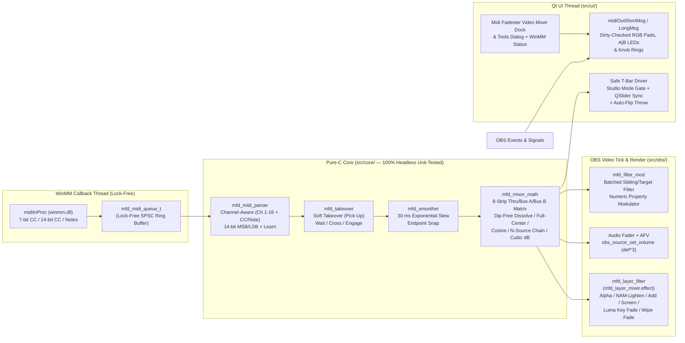

# Midi Fadester — Implementation Plan

Status: 2026-10-27 (Phase 0 scoping and plan; awaiting operator approval before code).
Companion to [REQUIREMENTS.md](REQUIREMENTS.md); requirement IDs (`R-*`) and operator decisions (`D-*`) refer to that file.

This document defines the pre-planning audit findings, old-school video mixer architecture, file layout, phased implementation steps, test matrix, risk register, and operator decisions for **Midi Fadester** (`midi-fadester.dll`) for OBS Studio 33 on Windows x64.

---

## 1. Local Machine & Toolchain Audit (Verified 2026-10-27)

| Component | Verified Path / Version | Notes |
|---|---|---|
| **Workspace** | `c:\midi-fadester` (`origin`: `https://github.com/jbrick2070/midi-fadester`) | Branch `main`, `LICENSE` is `GPL-2.0` (`df0ea1c`). |
| **OBS Studio 33 Source & SDK** | `C:\Users\jeffr\Documents\obs-playlister\.deps\obs-studio-33.0.0` | Shared read-only OBS 33.0.0 source & headers (`libobs`, `obs-frontend-api`). |
| **OBS Prebuilt Deps & Qt6** | `C:\Users\jeffr\Documents\obs-playlister\.deps\obs-deps-2026-10-23-x64`<br>`C:\Users\jeffr\Documents\obs-playlister\.deps\obs-deps-qt6-2026-10-23-x64` | Shared read-only dependencies (zero modifications to `obs-playlister`). |
| **Portable OBS 33.0.0** | `C:\Users\jeffr\OBS-Studio-33-Portable\bin\64bit\obs64.exe` | Target for live harness verification (`plugins\midi-fadester\`). |
| **Compiler & SDK** | Visual Studio 2022 Build Tools 17.14 (`MSVC 14.44`, Windows SDK `10.0.26100.0`) | `Visual Studio 17 2022` generator, `x64,version=10.0.26100.0`, C17/C++17. |
| **CMake & Formatter** | CMake `4.4.0`; `clang-format` `19.1.5` (VS 2022 LLVM); `gersemi` `0.21.0` | All `.c`/`.h`/`.cpp`/`.hpp` formatted before commit. |
| **Windows MIDI API** | `winmm.dll` / `winmm.lib` (Windows SDK `10.0.26100.0`, `<mmsystem.h>`) | Zero external MIDI dependencies (`R-PLAT-4`). |

---

## 2. Pre-Planning Technical Audit Findings (Verified Against OBS 33.0.0 Source)

### 2.1 Check 1: Does the OBS Frontend T-Bar API Fail Cleanly When Studio Mode Is Off?
**No — calling T-bar functions when Studio Mode is off crashes OBS, and `obs_frontend_release_tbar()` has a second bug even when Studio Mode is on.**

1. **Null / Use-After-Free Crash When Studio Mode Is Off:**
   - Inspected `frontend/widgets/OBSBasic.hpp:1519`, `frontend/widgets/OBSBasic_StudioMode.cpp:96-108, 259`, `frontend/OBSStudioAPI.cpp:110-123`, and `frontend/widgets/OBSBasic_Transitions.cpp:750-827`.
   - `QSlider *tBar;` on `OBSBasic` is an **uninitialized raw pointer** until Studio Mode is enabled for the first time (`CreateProgramOptions()`), and becomes a **dangling pointer** when Studio Mode is turned off (`delete programOptions;` at line 259 deletes its child `tBar` without nulling `tBar`).
   - `obs_frontend_get_tbar_position()` (`OBSStudioAPI.cpp:122`) and `OBSBasic::TBarReleased()` (`OBSBasic_Transitions.cpp:752`) both dereference `tBar->value()` unconditionally without checking `previewProgramMode`.
   - `obs_frontend_set_tbar_position()` (`OBSStudioAPI.cpp:117`) calls `OBSBasic::TBarChanged()`, which starts a manual transition even when Studio Mode is off.
   - **Our Fix (`R-FADE-1`):** Every T-bar operation checks `obs_frontend_preview_program_mode_active()` first and tracks `OBS_FRONTEND_EVENT_STUDIO_MODE_ENABLED` / `DISABLED`. When Studio Mode is off, T-bar calls are blocked and the UI shows a clear status hint (or the crossfader operates in **A/B Video Layer Bus Mode**, which works whether Studio Mode is on or off).

2. **OBS 33 `obs_frontend_set_tbar_position` + `obs_frontend_release_tbar` Cancellation Bug:**
   - In `OBSStudioAPI.cpp:115-118`, `obs_frontend_set_tbar_position(position)` calls `OBSBasic::TBarChanged(position)` directly via `QMetaObject::invokeMethod` **without** updating `tBar->setValue(position)`.
   - Because `tBar->value()` remains `0`, calling `obs_frontend_release_tbar()` at the end of a fader throw (`position = 1023`) causes `OBSBasic::TBarReleased()` (`OBSBasic_Transitions.cpp:752-777`) to read `int val = tBar->value()` (`0 <= T_BAR_CLAMP`), which **cancels** the manual transition (`"Manual transition cancelled"`) and snaps back to the old scene instead of completing!
   - **Our Fix (`R-FADE-1`):** When Studio Mode is active, our Qt-thread T-bar driver locates the Studio Mode `QSlider` (`property("class") == "slider-tbar"`) under `obs_frontend_get_main_window()`, calls `tBar->setValue(pos)` (which both updates `tBar->value()` and fires `QSlider::valueChanged` → `OBSBasic::TBarChanged(pos)`), and calls `obs_frontend_release_tbar()` when the smoothed fader hits the completion rail (`<= 2` or `>= 1021`).

3. **Transition Type Support (`ValidTBarTransition`, `OBSBasic_Transitions.cpp:782-795`):**
   - OBS 33 rejects both `"cut_transition"` **and** `"obs_stinger_transition"` for manual T-bar scrubbing, overriding either to `"fade_transition"`. Fade, Swipe, Slide, Luma Wipe, and Fade to Color work natively.

### 2.2 Check 2: Do `obs-midi-mg` or `obs-websocket` (`SetTBarPosition`) Already Solve This?
- Both call `obs_frontend_set_tbar_position` / `obs_frontend_release_tbar`, so both suffer from the `tBar->value() == 0` release-cancellation bug above.
- Neither provides **multi-source video layer mixing**, **A/B crossfader bus assignment**, **dip-free dissolve curves**, **Luma Key / Wipe fader shaders**, **30 ms slew smoothing**, **14-bit CC pairs**, or **soft takeover**.

### 2.3 Check 3: Old-School Video Mixer Math & OBS 33 Blend Modes (`libobs/obs-scene.c`)
- Inspected `libobs/obs-scene.c:68-127, 3238-3251`:
  - OBS 33 composites every `obs_sceneitem_t` in **premultiplied alpha** (`GS_BLEND_ONE, GS_BLEND_INVSRCALPHA` for `OBS_BLEND_NORMAL`, `GS_BLEND_ONE, GS_BLEND_ONE` for `OBS_BLEND_ADDITIVE`, `GS_BLEND_ONE, GS_BLEND_INVSRCCOLOR` for `OBS_BLEND_SCREEN`, and `GS_BLEND_OP_MAX` for `OBS_BLEND_LIGHTEN`).
  - **Crucial Insight 1 — Eliminating the 25% Midpoint Brightness Dip (`R-MIX-3`):**
    If Source A (bottom) and Source B (top) are both set to `50%` alpha in `OBS_BLEND_NORMAL`, Porter-Duff compositing yields $0.5 B + (1 - 0.5)(0.5 A) = 0.5 B + 0.25 A$, letting `25%` of the black canvas bleed through! By using our **Dip-Free Video Mixer Dissolve** curve ($\alpha_A = \min(1, 2(1-t)), \alpha_B = t$ when $B$ is above $A$), the composite at every point $t \in [0, 1]$ is the exact optical dissolve $(1-t)A + tB$ with **100% total opacity and zero black dip**.
  - **Crucial Insight 2 — Classic Hardware Video Mixer Modes (`R-MIX-4`):**
    - `OBS_BLEND_LIGHTEN` (`GS_BLEND_OP_MAX`) in `libobs` is the exact GPU implementation of **NAM (Non-Additive Mix)** from the Panasonic WJ-MX50 and Roland/Edirol V-4!
    - By pairing `obs_sceneitem_set_blending_mode` with our premultiplied GPU shader (`data/effects/mfd_layer_mixer.effect`), any fader can mix sources using **Alpha Dissolve**, **NAM (Lighten)**, **Additive**, **Screen**, **Multiply**, **Luma Key Fade (Bright/Dark Key)**, or **Soft-Edge Geometric Wipe Fade**.

### 2.4 Check 4: Akai APC40 mkII Communications Protocol v1.2 Exact Map

| Hardware Control | MIDI Message | Channel(s) | Video Mixer Role in Midi Fadester |
|---|---|---|---|
| **Track Faders 1–8** | `CC 7` (`0x07`) | **Ch 1–8** (`0xB0`–`0xB7`) | **Video Layer Strips 1–8** (Opacity / Luma Key / Wipe / Audio Level) |
| **Track `A|B` Buttons 1–8** | `Note 66` (`0x42`) | **Ch 1–8** (`0x90`–`0x97`) | **Crossfader Bus Assign:** cycles `Thru` (LED `0`) → `Bus A` (Yellow `1`) → `Bus B` (Orange `2`) |
| **Crossfader (A/B)** | `CC 15` (`0x0F`) | Ch 1 (`0xB0`) | **A/B Video Bus Crossfader** (`Bus A ↔ Bus B` or 1-fader 2-source mix) or **Studio Mode T-Bar** |
| **Master Fader** | `CC 14` (`0x0E`) | Ch 1 (`0xB0`) | **Master Program Opacity** or **Master Audio Level** |
| **Track Knobs 1–8** | `CC 48–55` (`0x30`–`0x37`) | Ch 1 (`0xB0`) | **Per-Strip Mix Parameter** (Luma Key softness/invert, Wipe feather, or Filter Param); LED Ring style `CC 56–63` |
| **Device Knobs 1–8** | `CC 16–23` (`0x10`–`0x17`) | Ch 1 (`0xB0` in Mode 2) | **8 Filter Modulator Slots** (Blur, Color, Zoom, Visual Sidechain); LED Ring style `CC 24–31` |
| **5×8 Clip Launch Grid** | `Notes 0–39` (`0x00`–`0x27`) | Ch 1 (`0x90` / `0x80`) | **Layer Blend Mode Select / Source Triggers / Scene Matrix**; RGB velocity feedback (`5`=Red Live, `21`=Green Preview, `37`=Cyan Active Layer, `9`=Amber) |
| **Scene Launch 1–5** | `Notes 82–86` (`0x52`–`0x56`) | Ch 1 (`0x90` / `0x80`) | **Auto-Transition, Cut, Swap A/B, Timed Fade-to-Black** |
| **Track Activator 1–8** | `Note 50` (`0x32`) | **Ch 1–8** (`0x90`–`0x97`) | **Layer Enable / Audio Mute Toggle** (`1`=On, `0`=Off, `2`=Blink on Soft-Takeover Wait) |
| **Track Solo / Flash 1–8** | `Note 49` (`0x31`) | **Ch 1–8** (`0x90`–`0x97`) | **Layer Solo or Momentary 100% Flash** |
| **SysEx Mode 2 Intro** | `F0 47 7F 29 60 00 04 42 01 00 00 F7` | SysEx | Puts APC40 mkII into **Alternate Ableton Live Mode (`0x42`)** so Device Knobs never shift MIDI channel and host controls all LEDs |

---

## 3. Target Architecture



### 3.1 File Layout

```text
c:\midi-fadester\
  CMakeLists.txt
  CMakePresets.json
  buildspec.json
  LICENSE
  README.md
  REQUIREMENTS.md
  PLAN.md
  data/
    manifest.json.in
    locale/
      en-US.ini
    effects/
      mfd_layer_mixer.effect     GPU shader: Premultiplied Alpha Dissolve, Bright/Dark Luma Key
                                 Fader, and Horizontal/Vertical/Radial/Box Wipe Fader
  src/
    plugin-main.c                Module entry, registers mfd_layer_filter, initializes engine & UI
    plugin-support.c.in / .h     Template logging helper
    core/                        Pure C17, zero OBS/WinMM/Qt headers; 100% unit-tested via ctest
      midi-types.h               Channel-aware address (type, channel 0..15, number 0..127), events
      midi-queue.h / .c          Lock-free SPSC ring buffer (1024 events) + overflow counter
      midi-parser.h / .c         Short-message decoder, 14-bit CC MSB/LSB state, MIDI Learn tracker
      smoother.h / .c            Configurable tau_ms (default 30 ms) exponential slew + snap
      takeover.h / .c            Soft takeover (pick-up) state machine + bidirectional throw flip
      mixer-math.h / .c          8-strip Thru/BusA/BusB crossfader matrix, Dip-Free Dissolve,
                                 Full-Center, Equal-Power Cosine, N-source chain, OBS cubic dB law
      apc40-profile.h / .c       APC40 mkII default mapping table, SysEx intro builder, RGB velocity
                                 & A|B LED dirty-state encoder
    midi/
      winmm-device.h / .c        WinMM enumeration, midiInOpen/midiOutOpen, explicit MMSYSERR_ALLOCATED
                                 error strings, SysEx & short message sender, hotplug rescan
    obs/
      mfd-engine.h / .c          Central coordinator: tick callback, mapping table, scene-collection
                                 save/load JSON persistence, OBS frontend event & signal hooks
      mfd-layer-filter.h / .c    "Midi Fadester — Layer Mixer" GPU filter (auto-attached as
                                 "__midi_fadester_opacity__") + sceneitem blend mode controller
      mfd-tbar.h / .cpp          Studio Mode-gated, Qt-slider-synced T-bar controller + timed FTB
      mfd-filter-mod.h / .c      Batched numeric filter setting driver with epsilon gate
    ui/
      mfd-mixer-dock.hpp / .cpp  Dockable Video Mixer Desk + Tools Menu Dialog (device banner,
                                 8 channel strips with A|B buttons & blend mode, crossfader, MIDI Learn)
  tests/
    CMakeLists.txt
    test-midi-queue.c
    test-midi-parser.c
    test-smoother.c
    test-takeover.c
    test-mixer-math.c
    test-apc40-profile.c
    test-shader-syntax.c
```

---

## 4. Phased Implementation Plan & Per-Step Tests

### Phase 0 — Scoping, Audit, Requirements & Plan (Current Step)
1. Audit OBS 33.0.0 T-bar API (`OBSBasic_Transitions.cpp`, `OBSBasic_StudioMode.cpp`), scene-item GPU blend modes (`obs-scene.c`), and cubic audio fader math (`obs-audio-controls.c`).
2. Verify Akai APC40 mkII Communications Protocol v1.2 mappings and SysEx format.
3. Author `REQUIREMENTS.md`, `PLAN.md`, and `README.md`, commit, push once, verify repository hygiene, and stop for operator review.

### Phase 1 — Build Scaffold & Pure-C Core Engine (`src/core/` + `tests/`)
- **Step 1.1: CMake & OBS 33 Packaging Scaffold**
  - Configure `CMakeLists.txt`, `CMakePresets.json` (`10.0.26100.0`), `buildspec.json`, and `data/manifest.json.in` targeting the OBS 33 non-legacy plugin layout (`R-PLAT-2`).
- **Step 1.2: Lock-Free MIDI Queue & Channel-Aware Parser (`midi-queue`, `midi-parser`)**
  - Implement lock-free SPSC ring buffer, channel-aware `(type, ch, num)` key matching, 14-bit CC MSB/LSB pairing (`CC 0..31` + `CC 32..63`), and MIDI Learn capture.
- **Step 1.3: 30 ms Slew Smoother & Soft Takeover Engine (`smoother`, `takeover`)**
  - Implement frame-rate-independent exponential slew ($\tau = 30\text{ ms}$ default) with endpoint snapping (`0.0005`), and the Soft Takeover pick-up state machine (`WAITING`, `ENGAGED`, directional hint `MOVE_UP`/`MOVE_DOWN`).
- **Step 1.4: Old-School Video Mixer Math & APC40 mkII Profile (`mixer-math`, `apc40-profile`)**
  - Implement:
    - **Dip-Free Dissolve**, **Full-Center Mix**, **Equal-Power Cosine**, **Linear**, and **Hard Cut** crossfader curves.
    - **8-Strip `Thru / Bus A / Bus B` Crossfader Matrix** and **Single-Fader $N$-Source Chain** (`2..8` sources swept across one fader).
    - **OBS Cubic Audio Curve** ($\text{mul} = d^3$, $d = \sqrt[3]{\text{mul}}$).
    - **APC40 mkII Profile** (`CC 7` Ch 1–8 strips, `Note 66` Ch 1–8 `A|B` bus cycle, `CC 15` crossfader, SysEx Mode 2 intro packet, dirty-checked RGB LED table).
- **Phase 1 Automated Tests (`ctest`):**
  - `test-midi-queue`: SPSC wrap-around, burst replay of 10,000 MIDI messages, overflow counter.
  - `test-midi-parser`: Verifies APC40 `CC 7` on Ch 1..8 never collide; 14-bit CC MSB+LSB resolution (`0..16383`); Note On `vel 0` treated as Note Off; MIDI Learn capture.
  - `test-smoother`: Verifies 7-bit step input slews smoothly with $\tau = 30\text{ ms}$ across `30/60/120 Hz` ticks and snaps to `0.0` and `1.0`.
  - `test-takeover`: Verifies zero jump when OBS value differs from physical fader, exact engagement on upward/downward crossing, and re-arming on external OBS change.
  - `test-mixer-math`: Verifies Porter-Duff composite of Dip-Free Dissolve has `0.0%` black dip at `t = 0.25, 0.50, 0.75`; verifies Full-Center gives `A = 1.0, B = 1.0` at `t = 0.5`; verifies `Bus A / Bus B / Thru` strip multiplication and cubic dB round-trip.
  - `test-apc40-profile`: Verifies exact SysEx byte sequence, `A|B` bus cycling, and dirty-checked LED output.

### Phase 2 — GPU Layer Mixer Filter (`mfd_layer_mixer.effect`), Multi-Source Bus Mixing & Audio/Filter Targets
- **Step 2.1: GPU Layer Mixer Filter (`src/obs/mfd-layer-filter.c`, `data/effects/mfd_layer_mixer.effect`)**
  - Implement `"Midi Fadester — Layer Mixer"` (`id = "midi_fadester_opacity_filter"`), auto-attached as `"__midi_fadester_opacity__"` when a video source or nested scene is bound to a layer strip or A/B crossfader.
  - Implement the 3 GPU shader techniques in `mfd_layer_mixer.effect`:
    1. `DrawAlpha` — Premultiplied RGBA scale (`color * opacity`), bypassed via `obs_source_skip_video_filter` when `opacity >= 0.999f` in Normal blend mode.
    2. `DrawLumaKey` — Hardware video mixer Luma Key fader (sweeps luma threshold + softness from `0.0 → 1.0` so bright highlights or dark shadows key over the lower source before dissolving to full).
    3. `DrawWipe` — Soft-edge geometric wipe fader (Horizontal, Vertical, Radial Circle, Box wipe driven continuously by the fader).
  - Integrate `obs_sceneitem_set_blending_mode` so any strip can switch between **Normal**, **NAM / Lighten (`OBS_BLEND_LIGHTEN`)**, **Additive (`OBS_BLEND_ADDITIVE`)**, **Screen (`OBS_BLEND_SCREEN`)**, and **Multiply (`OBS_BLEND_MULTIPLY`)**.
- **Step 2.2: Cubic Audio Level, Audio-Follows-Video (AFV) & Sibling Filter Numeric Modulator**
  - Implement `obs_source_set_volume` cubic driver, per-strip AFV option, and `mfd-filter-mod.c` (drives any numeric property on any filter—Blur, Color Correction, Transform, NVIDIA RTX filters, Visual Sidechain—with per-tick batching and epsilon gate).
- **Phase 2 Automated Tests (`ctest`):**
  - `test-shader-syntax`: Validates `data/effects/mfd_layer_mixer.effect` balanced braces, required uniforms (`image`, `opacity`, `key_softness`, `key_invert`, `wipe_mode`), techniques, UTF-8 no-BOM, and zero banned words.

### Phase 3 — WinMM I/O, Safe Studio Mode T-Bar Driver, Buttons/Hotkeys & LED Feedback
- **Step 3.1: WinMM Device Manager (`src/midi/winmm-device.c`)**
  - Implement `midiInOpen` / `midiOutOpen`, explicit `MMSYSERR_ALLOCATED` ("device held by another app") UI error reporting (`R-MIDI-1`), hotplug rescan, and dirty-checked MIDI Out transmitter.
- **Step 3.2: Safe Studio Mode T-Bar Driver & Timed Fade-to-Black (`src/obs/mfd-tbar.cpp`)**
  - Implement Studio Mode check (`obs_frontend_preview_program_mode_active()`), Qt `QSlider` (`"slider-tbar"`) sync on the UI thread so `obs_frontend_release_tbar()` completes transitions cleanly without triggering OBS 33's `val == 0` cancel bug, bidirectional auto-flip throw mode, and timed Fade-to-Black (`obs_transition_start(..., NULL)`).
- **Step 3.3: Scene Grid, Buttons, OBS Hotkey Triggering & APC40 mkII LED Feedback**
  - Implement Preview/Program scene selection, `A|B` bus button handling, arbitrary OBS hotkey triggering (`obs_enum_hotkeys` + `obs_hotkey_trigger_routed_callback`), and APC40 mkII RGB pad + `A|B` + mute + knob-ring feedback.

### Phase 4 — Video Mixer Dock / Tools UI & Portable OBS 33 Live Verification
- **Step 4.1: Midi Fadester Video Mixer Dock & Tools Dialog (`src/ui/mfd-mixer-dock.cpp`)**
  - Build the Qt6 Video Mixer UI:
    - Top bar: MIDI In / Out selectors, WinMM status / error banner, **Reconnect** button, Profile selector (`APC40 mkII`, `Generic`), Smoothing slider (`0..250 ms`, default `30 ms`).
    - **8-Channel Video Mixer Strip View:** Source picker per strip, live fader bar + Soft Takeover indicator (`Locked` / `▲` / `▼`), `Thru | A | B` crossfader bus selector, Blend/Mix Mode selector (`Dissolve`, `NAM Lighten`, `Additive`, `Screen`, `Luma Key`, `Wipe`), `AFV` toggle, and **MIDI Learn** button.
    - **Crossfader & Master Section:** Crossfader mode (`A/B Video Layer Bus`, `1-Fader 2-Source Mix`, `Studio Mode T-Bar`), Crossfade Curve selector (`Dip-Free Dissolve`, `Full-Center`, `Cosine`, `Linear`), and Custom Filter / Hotkey Mapping table.
- **Step 4.2: Portable OBS 33 Live Harness Verification (`R-TST-2`)**
  - Deploy to `C:\Users\jeffr\OBS-Studio-33-Portable\plugins\midi-fadester\`, run live verification of plugin load (no Legacy flag), 2+ source layer mixing, A/B bus crossfade, T-bar safety when Studio Mode is toggled on/off, and zero memory leaks on shutdown.

---

## 5. Risk Register (`R1 .. R6`)

| ID | Risk | Mitigation |
|---|---|---|
| `R1` | **OBS 33 Crash when calling T-bar API with Studio Mode off** (`OBSBasic::tBar` is null or deleted) | Always gate T-bar operations on `obs_frontend_preview_program_mode_active()` and listen to `OBS_FRONTEND_EVENT_STUDIO_MODE_ENABLED` / `DISABLED`. |
| `R2` | **OBS 33 `obs_frontend_release_tbar()` cancels transitions** because `obs_frontend_set_tbar_position` never updates `tBar->setValue()` | Drive the Studio Mode `tBar` `QSlider` (`property("class") == "slider-tbar"`) on the Qt UI thread so `tBar->value()` matches the fader position when `TBarReleased()` runs. |
| `R3` | **25% midpoint brightness dip when crossfading two alpha layers in a scene** | Default Normal-blend A/B crossfades to our **Dip-Free Video Mixer Dissolve** curve ($\alpha_{\text{bottom}} = \min(1, 2(1-t)), \alpha_{\text{top}} = t$) and support `OBS_BLEND_LIGHTEN` (NAM), `OBS_BLEND_ADDITIVE`, and `OBS_BLEND_SCREEN`. |
| `R4` | **WinMM deadlock if `midiOutShortMsg` or `midiInClose` is called inside `midiInProc`** | `midiInProc` only pushes 8-byte events into the lock-free SPSC ring buffer (`R-THR-1`). All MIDI Out and device open/close calls happen on the tick/UI thread. |
| `R5` | **WinMM exclusive device lock (`MMSYSERR_ALLOCATED`)** when another app holds the APC40 mkII | Never fail silently (`R-MIDI-1`); display an explicit error banner naming the device and explaining that WinMM allows only one app at a time, with a 1-click **Reconnect** button. |
| `R6` | **Heavy filter `obs_source_update` overhead during fast fader sweeps** | Layer Mixer opacity/luma/wipe updates write directly to atomic floats in `mfd_layer_filter` (zero `obs_source_update` cost!), and generic sibling filter modulation batches updates once per video tick with an epsilon gate (`0.001`). |
