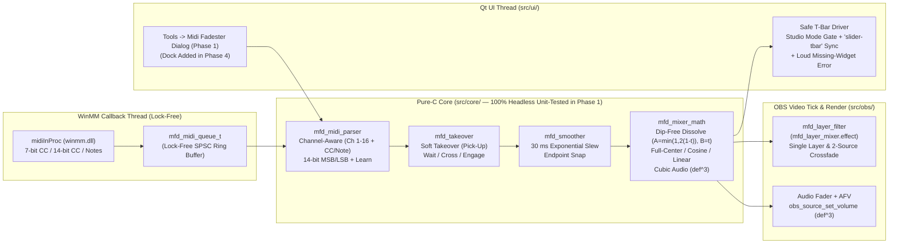

# Midi Fadester — Implementation Plan

Status: 2026-10-27. Approved by the operator on 2026-10-27 (decisions: [REQUIREMENTS.md](REQUIREMENTS.md) Section 9).
Phase 1 is scoped to deliver a complete, usable APC40 mkII fader controller in OBS 33 (MIDI In, channel-aware learn, 30 ms smoothing, soft takeover, T-bar with both OBS 33 fixes + loud widget-missing error, single-layer fade, and two-source dip-free layer crossfade); buses, blend/key/wipe modes, the dock, and controller LEDs follow in Phases 2–5.

---

## 1. Local Machine & Toolchain Audit (Verified 2026-10-27)

| Component | Verified Path / Version | Notes |
|---|---|---|
| **Workspace** | `C:\midi-fadester` (`origin`: `https://github.com/jbrick2070/midi-fadester`) | Confirmed root workspace path (`D-7`). Branch `main`, `LICENSE` is `GPL-2.0` (`df0ea1c`). |
| **OBS Studio 33 Source & SDK** | `C:\Users\jeffr\Documents\obs-playlister\.deps\obs-studio-33.0.0` | Shared read-only OBS 33.0.0 source & headers (`libobs`, `obs-frontend-api`). |
| **OBS Prebuilt Deps & Qt6** | `C:\Users\jeffr\Documents\obs-playlister\.deps\obs-deps-2026-10-23-x64`<br>`C:\Users\jeffr\Documents\obs-playlister\.deps\obs-deps-qt6-2026-10-23-x64` | Shared read-only dependencies (zero modifications to `obs-playlister`). |
| **Portable OBS 33.0.0** | `C:\Users\jeffr\OBS-Studio-33-Portable\bin\64bit\obs64.exe` | Target for live harness verification (`plugins\midi-fadester\`). |
| **Compiler & SDK** | Visual Studio 2022 Build Tools 17.14 (`MSVC 14.44`, Windows SDK `10.0.26100.0`) | `Visual Studio 17 2022` generator, `x64,version=10.0.26100.0`, C17/C++17. |
| **CMake & Formatter** | CMake `4.4.0`; `clang-format` `19.1.5` (VS 2022 LLVM); `gersemi` `0.21.0` | All `.c`/`.h`/`.cpp`/`.hpp` formatted before commit. |
| **Windows MIDI API** | `winmm.dll` / `winmm.lib` (Windows SDK `10.0.26100.0`, `<mmsystem.h>`) | Zero external MIDI dependencies (`R-PLAT-4`). |

---

## 2. Pre-Planning Technical Audit Findings (Verified Against OBS 33.0.0 Source)

### 2.1 Check 1: Does the OBS Frontend T-Bar API Fail Cleanly When Studio Mode Is Off?
**No — calling T-bar functions when Studio Mode is off crashes OBS, and `obs_frontend_release_tbar()` cancels transitions even when Studio Mode is on.**

1. **Null / Use-After-Free Crash When Studio Mode Is Off:**
   - Inspected `frontend/widgets/OBSBasic.hpp:1519`, `frontend/widgets/OBSBasic_StudioMode.cpp:96-108, 259`, `frontend/OBSStudioAPI.cpp:110-123`, and `frontend/widgets/OBSBasic_Transitions.cpp:750-827`.
   - `QSlider *tBar;` on `OBSBasic` is an **uninitialized raw pointer** until Studio Mode is enabled for the first time (`CreateProgramOptions()`), and becomes a **dangling pointer** when Studio Mode is turned off (`delete programOptions;` at line 259 deletes its child `tBar` without nulling `tBar`).
   - `obs_frontend_get_tbar_position()` (`OBSStudioAPI.cpp:122`) and `OBSBasic::TBarReleased()` (`OBSBasic_Transitions.cpp:752`) both dereference `tBar->value()` unconditionally without checking `previewProgramMode`.
   - **Our Fix (`R-FADE-1`):** Every T-bar operation checks `obs_frontend_preview_program_mode_active()` first and tracks `OBS_FRONTEND_EVENT_STUDIO_MODE_ENABLED` / `DISABLED`. When Studio Mode is off, T-bar calls are blocked and the UI shows a clear status hint.

2. **OBS 33 `obs_frontend_set_tbar_position` + `obs_frontend_release_tbar` Cancellation Bug (and Future-OBS Guard):**
   - In `OBSStudioAPI.cpp:115-118`, `obs_frontend_set_tbar_position(position)` calls `OBSBasic::TBarChanged(position)` directly via `QMetaObject::invokeMethod` **without** updating `tBar->setValue(position)`.
   - Because `tBar->value()` remains `0`, calling `obs_frontend_release_tbar()` at the end of a fader throw (`position = 1023`) causes `OBSBasic::TBarReleased()` (`OBSBasic_Transitions.cpp:752-777`) to read `int val = tBar->value()` (`0 <= T_BAR_CLAMP`), which **cancels** the manual transition (`"Manual transition cancelled"`) and snaps back to the old scene instead of completing.
   - **Our Fix (`R-FADE-1`):** When Studio Mode is active, our Qt-thread T-bar driver locates the Studio Mode `QSlider` (`property("class") == "slider-tbar"`) under `obs_frontend_get_main_window()`, calls `tBar->setValue(pos)` (which updates `tBar->value()` and fires `QSlider::valueChanged` → `OBSBasic::TBarChanged(pos)`), and calls `obs_frontend_release_tbar()` when the smoothed fader hits the completion rail (`<= 2` or `>= 1021`).
   - **Loud Error When Internal Widget Changes:** Because locating `"slider-tbar"` reaches into OBS's internal Qt window hierarchy, if `obs_frontend_preview_program_mode_active()` is true and the `"slider-tbar"` `QSlider` is not found, the plugin logs a `LOG_ERROR` and displays a loud error banner in the UI (`"Studio Mode T-bar widget ('slider-tbar') not found — this OBS version changed its internal Studio Mode UI"`), never failing silently.

3. **Transition Type Support (`ValidTBarTransition`, `OBSBasic_Transitions.cpp:782-795`):**
   - OBS 33 rejects both `"cut_transition"` **and** `"obs_stinger_transition"` for manual T-bar scrubbing, overriding either to `"fade_transition"`. Fade, Swipe, Slide, Luma Wipe, and Fade to Color work natively.

### 2.2 Check 2: Two-Source Crossfade Math (`libobs/obs-scene.c`)
- Inspected `libobs/obs-scene.c:68-127`:
  - OBS 33 composites `OBS_BLEND_NORMAL` scene items in premultiplied alpha (`GS_BLEND_ONE, GS_BLEND_INVSRCALPHA`).
  - If Source A (bottom) and Source B (top) are both set to `50%` alpha at the midpoint of a fade, Porter-Duff compositing yields $0.5 B + (1 - 0.5)(0.5 A) = 0.5 B + 0.25 A$, letting `25%` of the black canvas bleed through.
  - **Our Fix (`R-MIX-1`, `D-2`):** Default two-source crossfades to our **Dip-Free Video Mixer Dissolve** curve ($\alpha_A = \min(1, 2(1-t)), \alpha_B = t$ when $B$ is above $A$), producing an exact $(1-t)A + tB$ optical crossfade with **100% total coverage and 0% black dip**.

### 2.3 Check 3: Akai APC40 mkII Communications Protocol v1.2 Exact Map

| Hardware Control | MIDI Message | Channel(s) | Phase | Role in Midi Fadester |
|---|---|---|---|---|
| **Crossfader (A/B)** | `CC 15` (`0x0F`) | Ch 1 (`0xB0`) | **Phase 1** | Defaults to **Studio Mode T-Bar** (`D-1`); configurable to **Two-Source Dip-Free Crossfade** (`Source A ↔ Source B`) or Phase 2 `A/B` Bus |
| **Track Faders 1–8** | `CC 7` (`0x07`) | **Ch 1–8** (`0xB0`–`0xB7`) | **Phase 1** | **8 Fader Slots** (Single-Layer Opacity Fade, Two-Source Dip-Free Crossfade, or Cubic Audio Level) |
| **Master Fader** | `CC 14` (`0x0E`) | Ch 1 (`0xB0`) | **Phase 1** | **Master Audio Level** or **Master Layer Opacity** |
| **Track `A|B` Buttons 1–8** | `Note 66` (`0x42`) | **Ch 1–8** (`0x90`–`0x97`) | **Phase 2** | **Crossfader Bus Assign:** cycles `Thru` → `Bus A` → `Bus B` |
| **Track / Device Knobs** | `CC 48–55` / `CC 16–23` | Ch 1 (`0xB0`) | **Phase 2–3** | **Filter Numeric Settings** (Phase 2) & **Luma Key / Wipe Parameters** (Phase 3) |
| **Clip Grid & Scene Pads** | `Notes 0–39`, `82–86` | Ch 1 (`0x90` / `0x80`) | **Phase 2** | **Scene Select, Transition, Mute, Timed Fade-to-Black, OBS Hotkeys** |
| **SysEx Mode 2 + RGB LEDs** | `F0 47 7F 29 60 ...` | SysEx / Ch 1–8 | **Phase 5** | **Mode 2 (`0x42`) Init + RGB Pad, `A|B`, Mute, and Knob Ring LEDs** |

---

## 3. Target Architecture & File Layout



### 3.1 Phase 1 File Layout (`C:\midi-fadester`)

```text
C:\midi-fadester\
  CMakeLists.txt
  CMakePresets.json
  buildspec.json
  LICENSE
  README.md
  REQUIREMENTS.md
  PLAN.md
  data/
    manifest.json.in
    locale/
      en-US.ini
    effects/
      mfd_layer_mixer.effect     Phase 1: DrawAlpha premultiplied opacity shader
                                 (Phase 3 adds DrawLumaKey and DrawWipe)
  src/
    plugin-main.c                Module entry, registers mfd_opacity_filter, starts engine & Tools menu
    plugin-support.c.in / .h     Template logging helper
    core/                        Pure C17, zero OBS/WinMM/Qt headers; 100% unit-tested via ctest
      midi-types.h               Channel-aware address (type, channel 0..15, number 0..127), events
      midi-queue.h / .c          Lock-free SPSC ring buffer (1024 events) + overflow counter
      midi-parser.h / .c         Short-message decoder, 14-bit CC MSB/LSB state, MIDI Learn tracker
      smoother.h / .c            Configurable tau_ms (default 30 ms) exponential slew + snap
      takeover.h / .c            Soft takeover (pick-up) state machine + bidirectional throw flip
      mixer-math.h / .c          Dip-Free Dissolve, Full-Center, Cosine, Linear, Cubic dB law
      apc40-profile.h / .c       APC40 mkII default fader map (CC 15 T-Bar, CC 7 Ch 1-8, CC 14)
    midi/
      winmm-device.h / .c        WinMM enumeration, midiInOpen, explicit MMSYSERR_ALLOCATED error
                                 reporting, hotplug rescan (Phase 5 adds midiOut)
    obs/
      mfd-engine.h / .c          Tick callback, fader slot evaluation, global device config +
                                 per-Scene-Collection save/load JSON persistence
      mfd-layer-filter.h / .c    "Midi Fadester — Layer Opacity" GPU filter (auto-attached as
                                 "__midi_fadester_opacity__")
      mfd-tbar.h / .cpp          Studio Mode-gated, Qt "slider-tbar"-synced T-bar driver with loud
                                 missing-widget error + bidirectional auto-flip throw
    ui/
      mfd-settings-dialog.hpp / .cpp  Tools -> Midi Fadester configuration dialog (MIDI In picker,
                                      WinMM/T-bar error banner, Reconnect, APC40 profile button,
                                      fader mapping table with MIDI Learn & Soft Takeover status)
  tests/
    CMakeLists.txt
    test-midi-queue.c
    test-midi-parser.c
    test-smoother.c
    test-takeover.c
    test-mixer-math.c
    test-apc40-profile.c
    test-shader-syntax.c
```

---

## 4. Phased Implementation Plan & Per-Step Tests

### Phase 1 — Core MVP: Solving the Fader Problem End-to-End (Usable on APC40 mkII)

- **Step 1.1: CMake & OBS 33 Non-Legacy Packaging Scaffold**
  - Create `CMakeLists.txt`, `CMakePresets.json` (`10.0.26100.0`), `buildspec.json`, `data/manifest.json.in`, `data/locale/en-US.ini`, and `src/plugin-support.c.in` targeting the OBS 33 non-legacy plugin layout (`R-PLAT-2`).
- **Step 1.2: Pure-C Core Engine (`src/core/`) & Headless `ctest` Suite (`tests/`)**
  - Implement:
    - `midi-queue.c`: Lock-free SPSC ring buffer (`1024` events).
    - `midi-parser.c`: Channel-aware `(type, ch 0..15, num 0..127)` matcher, 14-bit CC MSB/LSB combiner (`CC 0..31` + `CC 32..63`), and one-shot MIDI Learn tracker.
    - `smoother.c`: Frame-rate-independent exponential slew ($\tau = 30\text{ ms}$ default) with `0.0005` endpoint snap.
    - `takeover.c`: Soft Takeover pick-up state machine (`WAITING`, `ENGAGED`, `MOVE_UP`/`MOVE_DOWN` hints) + bidirectional T-bar throw polarity flip.
    - `mixer-math.c`: **Dip-Free Video Mixer Dissolve** ($\alpha_A = \min(1, 2(1-t)), \alpha_B = t$), Full-Center, Cosine, Linear, and OBS Cubic Audio ($\text{mul} = d^3$, $d = \sqrt[3]{\text{mul}}$).
    - `apc40-profile.c`: Default APC40 mkII fader bindings (`CC 15` Ch 1 → T-Bar per `D-1`; `CC 7` Ch 1–8 → Fader Slots 1–8; `CC 14` Ch 1 → Master Fader).
  - **Step 1.2 Automated Tests (`ctest`):**
    - `test-midi-queue`: SPSC wrap-around, 10,000-event burst, overflow drop count.
    - `test-midi-parser`: APC40 `CC 7` on Ch 1–8 independence; 14-bit MSB/LSB pairing; MIDI Learn capture.
    - `test-smoother`: 30 ms slew response across `30/60/120 Hz` ticks; exact `0.0` and `1.0` snap.
    - `test-takeover`: Pick-up waiting when OBS value diverges, upward/downward crossing lock, external jump re-arm, bidirectional throw flip.
    - `test-mixer-math`: Verifies Porter-Duff composite of Dip-Free Dissolve has `0.0%` black dip at `t = 0.25, 0.50, 0.75`; verifies cubic dB round-trip (`def^3` and `cbrtf`).
    - `test-apc40-profile`: Verifies APC40 mkII default slot creation and channel addressing.
- **Step 1.3: WinMM MIDI In, GPU Layer Opacity Filter & Two-Source Dip-Free Crossfade**
  - Implement `src/midi/winmm-device.c`: Enumerates MIDI In ports, opens via `midiInOpen`, surfaces explicit `MMSYSERR_ALLOCATED` ("device in use by another application") error strings (`R-MIDI-1`), and handles unplug/reconnect (`R-MIDI-2`).
  - Implement `src/obs/mfd-layer-filter.c` & `data/effects/mfd_layer_mixer.effect`: Registers `"Midi Fadester — Layer Opacity"` (`id = "midi_fadester_opacity_filter"`), auto-attaches `"__midi_fadester_opacity__"` to bound sources without touching user filters, multiplies premultiplied RGBA by `opacity`, and calls `obs_source_skip_video_filter` when `opacity >= 0.999f`.
  - Implement single-layer fade, **Two-Source Dip-Free Crossfade (`Source A ↔ Source B`)**, and **Cubic Audio Level + AFV** in `src/obs/mfd-engine.c`.
  - **Step 1.3 Automated Tests (`ctest`):**
    - `test-shader-syntax`: Validates `data/effects/mfd_layer_mixer.effect` syntax, balanced braces, uniforms, UTF-8 no-BOM, and zero banned words.
- **Step 1.4: Studio Mode T-Bar Driver (Both OBS 33 Fixes + Loud Widget Error) & Tools Dialog**
  - Implement `src/obs/mfd-tbar.cpp`:
    - Guards all T-bar operations on `obs_frontend_preview_program_mode_active()`.
    - Locates the `"slider-tbar"` `QSlider` under `obs_frontend_get_main_window()` on the Qt thread, updates `setValue(pos)`, and calls `obs_frontend_release_tbar()` at the completion rails (`<= 2` or `>= 1021`) with bidirectional auto-flip.
    - Logs `LOG_ERROR` and sets a loud UI error banner if Studio Mode is active but `"slider-tbar"` is missing in a future OBS version (`R-FADE-1`).
  - Implement `src/ui/mfd-settings-dialog.cpp` (**Tools → Midi Fadester**):
    - MIDI In selector, **Load APC40 mkII Defaults** button, **Reconnect** button, live status / error banner (WinMM busy, Studio Mode off, or T-bar widget missing), global smoothing slider (`30 ms` default), and fader mapping rows with **MIDI Learn**, target type (`Studio Mode T-Bar`, `Two-Source Crossfade (A ↔ B)`, `Single Layer Fade`, `Audio Volume`), Source A / Source B pickers, Crossfade Curve picker (`Dip-Free Dissolve` default), `AFV` checkbox, and live Soft Takeover status (`Locked` / `Move ▲` / `Move ▼`).
- **Step 1.5: Portable OBS 33 Live Harness Verification (`R-TST-2`)**
  - Deploy `midi-fadester.dll` and `data/` to `C:\Users\jeffr\OBS-Studio-33-Portable\plugins\midi-fadester\`.
  - Verify in portable OBS 33.0.0: clean load without `Legacy` badge, `mfd_layer_mixer.effect` D3D11 compilation, Studio Mode off T-bar safety, Studio Mode on `"slider-tbar"` lookup and crossfade completion, two-source dip-free crossfade, and clean exit with `obs_get_num_leaks() == 0`.

---

### Phase 2 — Multi-Strip Buses (`Thru | Bus A | Bus B`), Filter Modulation & Buttons/Hotkeys
- Add 8-strip `Thru | Bus A | Bus B` crossfader matrix (`Note 66` `A|B` assign on Ch 1–8) and N-source chain crossfader.
- Add `src/obs/mfd-filter-mod.c` to drive any numeric property (`OBS_PROPERTY_FLOAT` / `OBS_PROPERTY_INT`) on any filter with per-tick batching and epsilon gate.
- Add button/pad bindings for Preview/Program scene select, Trigger Transition, Mute, Timed Fade-to-Black over $N$ ms, and any registered OBS hotkey (`obs_enum_hotkeys` + `obs_hotkey_trigger_routed_callback`).

### Phase 3 — Hardware Video Mixer Blend Modes, Luma Key Fader & Wipe Faders
- Add per-layer OBS scene-item blend mode control (`OBS_BLEND_LIGHTEN` / NAM, `OBS_BLEND_ADDITIVE`, `OBS_BLEND_SCREEN`, `OBS_BLEND_MULTIPLY`, `OBS_BLEND_DARKEN`) with automatic Full-Center curve selection (`D-2`).
- Add `DrawLumaKey` (Bright/Dark Luma Key fader) and `DrawWipe` (Horizontal, Vertical, Radial Circle, Box soft-edge wipe faders) to `data/effects/mfd_layer_mixer.effect`.

### Phase 4 — Dockable Video Mixer Panel (`Midi Fadester` Dock)
- Add a dockable 8-strip Video Mixer Panel (`obs_frontend_add_dock_by_id`) with live fader meters, soft-takeover arrows, `Thru|A|B` bus buttons, and blend/key selectors inside the OBS main window (`D-3`).

### Phase 5 — Controller Lights & Bidirectional MIDI Out Feedback
- Add WinMM `midiOutOpen`, APC40 mkII SysEx Mode 2 (`0x42`) introduction (`D-4`), and dirty-checked MIDI Out feedback for the 5×8 RGB clip grid (Red = Program, Green = Preview, Cyan = Active Layer, Amber = Assigned), `A|B` bus LEDs, Mute/Activator LEDs (with soft-takeover blink), and Knob LED rings.

---

## 5. Risk Register (`R1 .. R6`)

| ID | Risk | Mitigation |
|---|---|---|
| `R1` | **OBS 33 Crash when calling T-bar API with Studio Mode off** (`OBSBasic::tBar` is null or deleted) | Always gate T-bar operations on `obs_frontend_preview_program_mode_active()` and listen to `OBS_FRONTEND_EVENT_STUDIO_MODE_ENABLED` / `DISABLED`. |
| `R2` | **OBS 33 `obs_frontend_release_tbar()` cancels transitions** because `obs_frontend_set_tbar_position` never updates `tBar->setValue()` — and reaching into `"slider-tbar"` could break in a future OBS version | Drive the Studio Mode `tBar` `QSlider` (`property("class") == "slider-tbar"`) on the Qt UI thread when Studio Mode is active, and **emit a loud `LOG_ERROR` + UI error banner if `"slider-tbar"` is not found while Studio Mode is active**. |
| `R3` | **25% midpoint brightness dip when crossfading two alpha layers in a scene** | Default Normal-blend two-source crossfades to our **Dip-Free Video Mixer Dissolve** curve ($\alpha_{\text{bottom}} = \min(1, 2(1-t)), \alpha_{\text{top}} = t$). |
| `R4` | **WinMM deadlock if `midiInClose` or `midiOut*` is called inside `midiInProc`** | `midiInProc` only pushes 8-byte events into the lock-free SPSC ring buffer (`R-THR-1`). All device open/close calls happen on the UI thread. |
| `R5` | **WinMM exclusive device lock (`MMSYSERR_ALLOCATED`)** when another app holds the APC40 mkII | Never fail silently (`R-MIDI-1`); display an explicit error banner naming the device and explaining that WinMM allows only one app at a time, with a 1-click **Reconnect** button. |
| `R6` | **Filter `obs_source_update` overhead during fast fader sweeps** | Layer opacity updates write directly to atomic floats in `mfd_layer_filter` (zero `obs_source_update` cost during a fade!). |

---

## 6. Autonomous Overnight Decisions (`D-8+`, 2026-10-27)

| ID | Decision | One-Line Reasoning |
|---|---|---|
| `D-8` | Apply the `6 %` T-bar origin start band symmetrically (`x > 0.06` normal polarity, `x < 0.94` reversed polarity) with throw progress $t$ rescaled to `0` at `0.06` / `0.94` on `Idle -> Throwing`, while keeping `Throwing -> Idle` abort at `x <= 0.03` / `x >= 0.97`. | Gives both rails an identical `3 %` hysteresis deadband (`CC 4..7` and `CC 120..123`) so rail jitter never starts spurious transitions regardless of current bidirectional polarity. |
| `D-9` | Normalize all `get_state` and UI `reason` strings to the exact trailing-period sentences in `MIDI-FADESTER-UI.md` (`"Studio Mode is off."`, `"Not used. Click to set up."`, `"<Layer> is no longer in scene <Scene>."`, `"Scene <Scene> was deleted."`, `"<Source> has no audio."`). | Ensures the engine, Tools dialog, and external obs-websocket surfaces share a single canonical sentence source of truth without string rewriting. |
| `D-10` | Ground scene stack-order detection in `libobs/obs-scene.c` (`scene->first_item` = index `0` rendered first/bottom; higher index = rendered later/on top), with an optional pinned `scene` per slot and automatic scene resolution when `scene` is omitted. | Preserves full v1 `API-CONTRACT.md` backward compatibility while guaranteeing Left (`0 %`) and Right (`100 %`) always show the user's chosen Left and Right layers regardless of scene stacking order. |
| `D-11` | Check `!obs_source_removed(src)` in `libobs` scene/source queries and subscribe to both `"source_remove"` and `"source_destroy"` on `obs_get_signal_handler()`. | `libobs` fires `"source_remove"` after setting `s->removed = true` but before unlinking the name from `public_sources`, so checking `obs_source_removed` updates preconditions immediately on deletion with zero polling. |
| `D-12` | Report the Output bar percentage directly from the calibrated position `last_raw_norm` ($\text{round}(x \times 100)$) in all states, and reset takeover (`WAITING`, `parked = false`, identity `[0, 1]` rescale, `polarity_reversed = false`) plus `tbar_state = MFD_TBAR_IDLE` whenever a slot's `target_type` changes. | Prevents carried-over rescale anchors or parked/throw flags from distorting the live readout or the next mode's fader mapping. |
| `D-13` | Remove both `QTimer`s from `src/ui/` (`33 ms` UI refresh poll and `2000 ms` MIDI health poll) and replace them with outermost-unlock `ui_notify_fn` coalescing (`MfdUiDispatcher` `Qt::QueuedConnection`) plus a Win32 `WM_DEVICECHANGE` `QAbstractNativeEventFilter`, enforced by a source-scan guard in `test-shader-syntax`. | Satisfies the standing "no timers anywhere" rule end-to-end while keeping live fader bars, smoother ramps, and USB hot-plug recovery strictly event-driven. |
| `D-14` | Harden `mfd_midi_queue` / `mfd_winmm_device` with `<util/threading.h>` `os_atomic_*` operations, protect all non-RT engine/WebSocket/UI state with a recursive `pthread_mutex_t state_mutex` that drains events and UI notifications strictly after the outermost unlock, and unregister WebSocket vendor requests before engine teardown. | Eliminates cross-thread data races, render-thread `obs_frontend_*` / disk-save stalls, and unload callback races across WinMM, OBS render, `obs-websocket`, and Qt UI threads. |
| `D-15` | Make the 3-step `Set up` sheet modeless and transactional via `mfd_setup_session` (`candidate_addr`, `candidate_invert`, `candidate_raw_norm`, `base_slot_rev`), pausing live OBS writes on the edited strip until **Done**, preserving hardware CCs on `[Not used]`, and sharing `evaluate_slot_preconditions_const` as the single validator for both Step 2/3 gating and commit. | Lets operators add or fix OBS sources mid-setup without closing the dialog, prevents accidental live broadcast writes during Step 3 `"Try it"`, and guarantees validator/engine equivalence structurally. |
| `D-16` | Gate the First-Run Offer on `!first_run_offer_dismissed && frontend_finished_loading && apc40_controller_detected`, defaulting `first_run_offer_dismissed = true` whenever an existing `0.1.x` `global.json` lacks `"first_run_offer_dismissed"` or a scene collection loads non-default slots, and binding `Master` on `[Yes]` only when an audio source matches `"Desktop Audio"` case-insensitively. | Protects existing `0.1.x` configurations from unsolicited reset prompts and avoids guessing an arbitrary audio source on non-English or custom OBS setups. |
| `D-17` | Add a structured `enum mfd_winmm_error_kind` on `mfd_winmm_device` and distinguish deleted audio sources (`"<Source> was deleted."`) from non-audio sources (`"<Source> has no audio."`), plus gate takeover pickup prompts on `has_last_fader == true`. | Closes every controller and strip state in a deterministic precedence table without brittle error-substring parsing or phantom pickup warnings on untouched faders at startup. |
| `D-18` | Link `Qt6::Svg` ONLY (`QSvgRenderer` inside a custom `QWidget::paintEvent`) and run `test-ui-dialog` on Windows `qwindows` (`QT_PLUGIN_PATH` + `Qt::WA_DontShowOnScreen` + `show()` + `grab()`), never linking `Qt6::SvgWidgets` or requiring `qoffscreen.dll`. | Verified directly against `C:\Users\jeffr\OBS-Studio-33-Portable\bin\64bit` and `obs-deps-qt6`: `Qt6Svg.dll` and `qwindows.dll` ship in OBS 33, whereas `Qt6SvgWidgets.dll` and `qoffscreen.dll` do not. |
| `D-19` | Heap-allocate `struct mfd_ui_catalog` (`mfd_ui_catalog_create` / `mfd_ui_catalog_destroy`) and validate UI screenshots in `${CMAKE_CURRENT_BINARY_DIR}/ui_screenshots` during normal `ctest` while exporting `docs/screenshots/*.png` via `--export-screenshots` for `TESTING.md`. | Prevents `> 600 KB` catalog structs from overflowing Windows' `1 MB` thread stack and keeps `ctest` runs non-tree-dirtying and font-hinting resilient across machines and CI. |
| `D-20` | Define `QT_NO_KEYWORDS` on Qt6-compiling targets (`midi-fadester` and `test-ui-dialog`) and derive `QT_PLUGIN_PATH` in `tests/CMakeLists.txt` from `Qt6::Core`'s `IMPORTED_LOCATION` (`<qt_root>/plugins`). | Avoids Qt's `#define slots` macro colliding with pure-C `struct mfd_ui_snapshot::slots` and ensures `test-ui-dialog` resolves `qwindows.dll` automatically on both local `obs-deps-qt6` caches and GitHub Actions `windows-2022`. |
| `D-21` | Generalize `src/core/apc40-profile.{h,c}` (`0.3.0`) into a declarative `struct mfd_controller_profile_def` registry carrying an explicit `enum mfd_profile_support_tier` (`CUSTOM`, `VERIFIED`, `BETA_UNTESTED`), WinMM port match substrings, physical topology flags (`has_crossfader`, `track_fader_count`, `has_master_fader`), upper desk SVG style (`CLIP_PADS`, `KNOB_ROWS_3`, `TRANSPORT_AND_KNOBS_1`), and factory CC bindings for `apc40mk2` (Verified) plus `apcminimk2`, `midimix`, `nanokontrol2`, and `launchcontrolxl` (Beta untested specs). | Lets operators plug in common 8- and 9-fader USB MIDI mixers immediately with honest amber `BETA (untested spec)` badges, physical-strip filtering on `Strips`, target-preserving layout switching (`mfd_engine_select_profile`), and 1-struct extensibility for future controllers without silent assumptions. |
