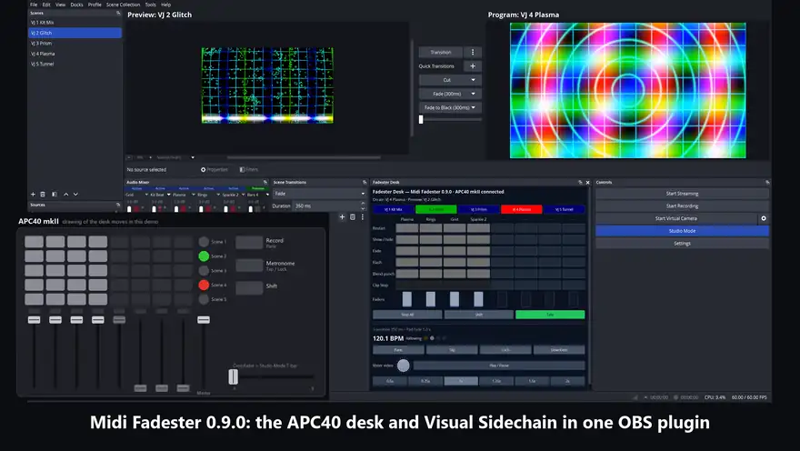
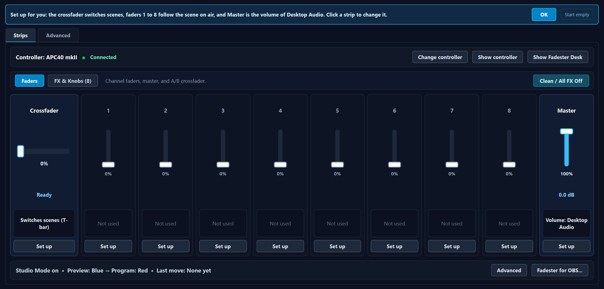
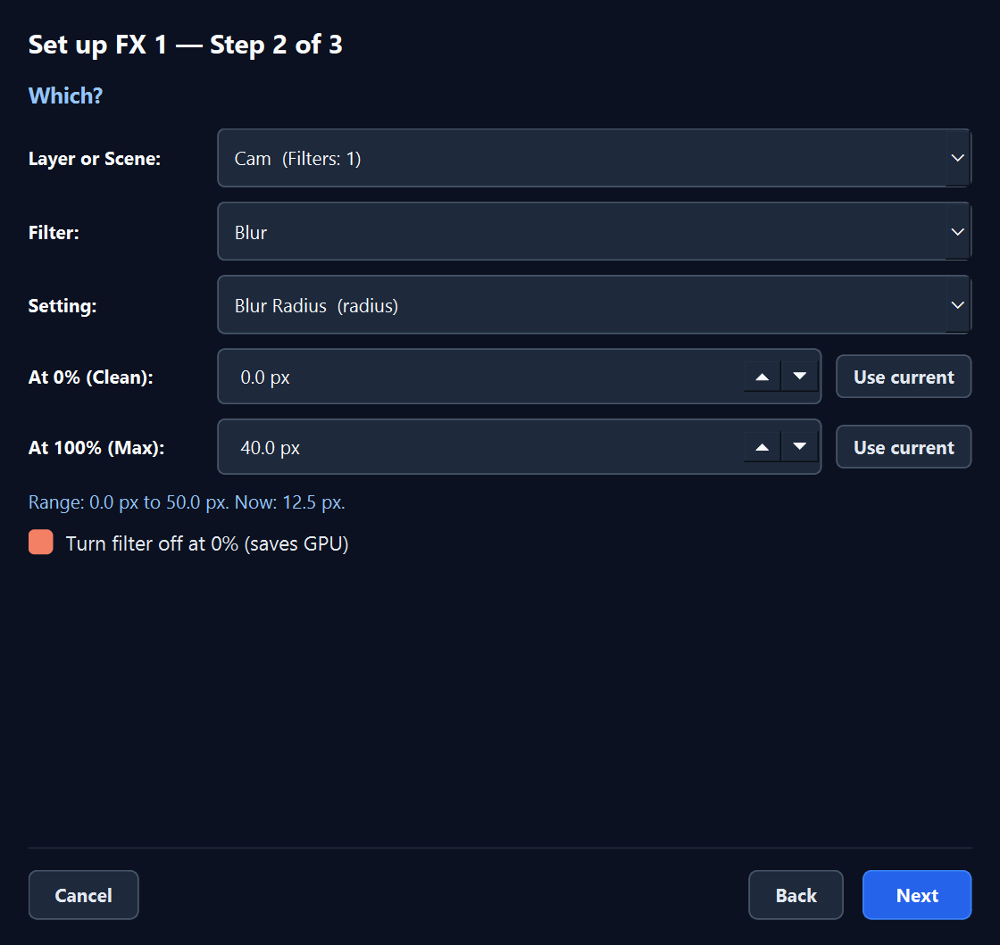
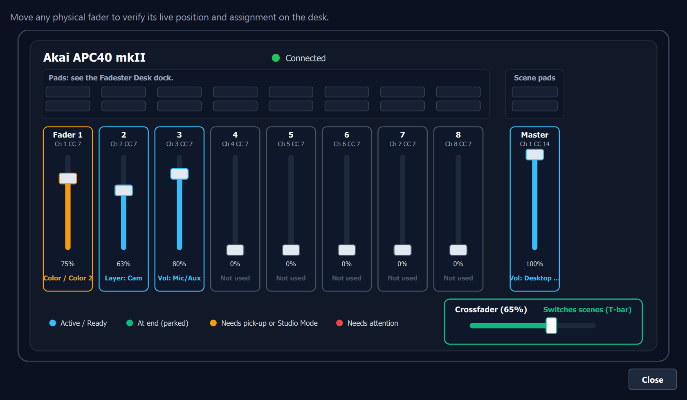
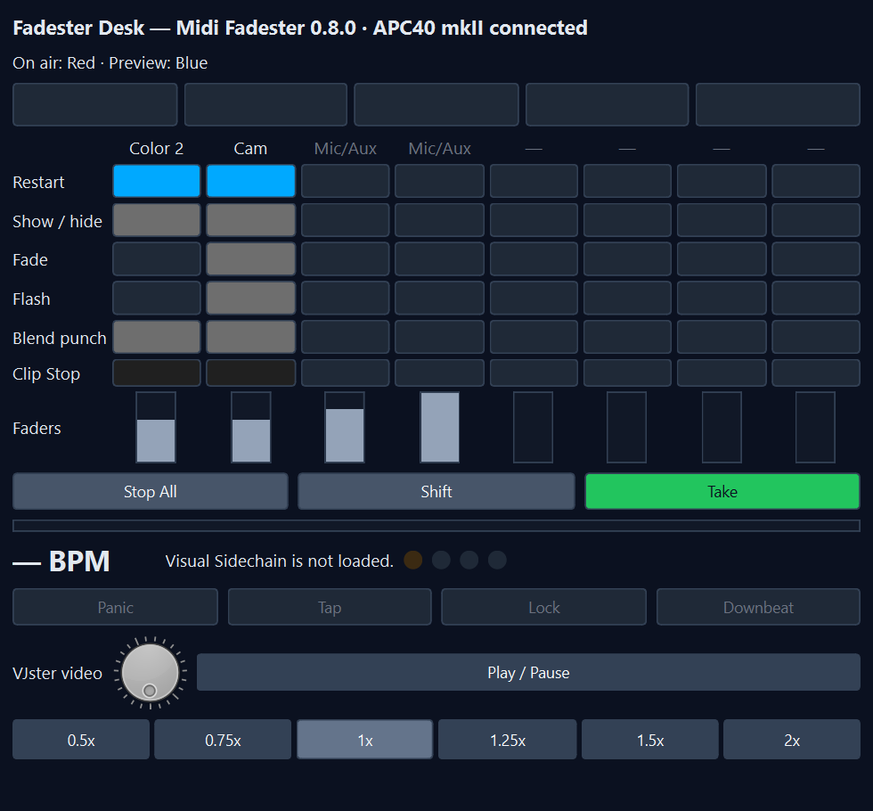

# Midi Fadester

> **Setting up the Fadester Suite?** Start with **[START-HERE.md](https://github.com/jbrick2070/streamdeck-fadester/blob/main/docs/START-HERE.md)** for what to install for your controller, which video player to pick, first-run OBS settings, and the compatibility matrix.

[](https://github.com/jbrick2070/midi-fadester/releases/latest)
[](https://github.com/jbrick2070/midi-fadester/actions/workflows/push.yaml)
[](LICENSE)

Midi Fadester turns the faders and knobs on a MIDI controller into live controls for OBS Studio. Fade from one scene to the next with a real crossfader. Mix two layers. Fade a camera in and out. Ride a volume. Sweep any filter setting. It is made for the Akai APC40 mkII and works with other controllers through MIDI Learn.

[](docs/demo/Midi-Fadester-0.9.0-demo.mp4)

**[Watch the one-minute demo](docs/demo/Midi-Fadester-0.9.0-demo.mp4)** (MP4, 9 MB): the crossfader throws the Studio Mode T-bar, channel faders fade the layers of the scene on air, Visual Sidechain's Beat Zoom moves with the music, Panic and Restore visuals, tap and lock the tempo, and the Fadester Desk dock follows all of it. The "Your controller" APC40 in the corner is a drawing of the desk moves; OBS was driven by a script for the recording.


> **Disclaimer:** Midi Fadester is an independent third-party plugin for OBS Studio. It is not made, endorsed, or supported by the OBS Project or by Akai Professional / inMusic Brands.

## Contents

- [What it does](#what-it-does)
- [You need](#you-need)
- [Install](#install)
- [The first five minutes](#the-first-five-minutes)
- [Fader assignments](#fader-assignments)
- [Switch scenes or Mix two layers?](#switch-scenes-or-mix-two-layers)
- [FX & Knobs and Clean / All FX Off](#fx--knobs-and-clean--all-fx-off)
- [Controllers](#controllers)
- [How it feels](#how-it-feels)
- [Visual Sidechain is built in](#visual-sidechain-is-built-in)
- [Works with](#works-with)
- [Control it from scripts and other programs](#control-it-from-scripts-and-other-programs)
- [Where settings live](#where-settings-live)
- [If something is wrong](#if-something-is-wrong)
- [Languages](#languages)
- [Not yet](#not-yet)
- [Releases](#releases)
- [Building from source](#building-from-source)
- [Documents](#documents)
- [License, disclosures and credits](#license-disclosures-and-credits)

## What it does

Every fader or knob gets one job:

- **Switch scenes.** Throw the crossfader and OBS fades Preview into Program, like OBS's own T-bar in Studio Mode.
- **Mix two layers.** In one scene, crossfade between two layers. Left is one, right is the other, and with the default feel the picture never darkens in the middle.
- **Show or hide a layer.** Fade one layer in and out, 0 to 100 %.
- **Volume.** Ride one audio source: 0 dB at the top, silence at the bottom, about −18 dB in the middle (volume = position cubed).
- **Filter or effect setting.** Sweep any numeric setting of any filter between two values you choose: a blur radius, a color correction, a key threshold, a shader's slider, Visual Sidechain's reactivity amount.

There are 18 slots: a crossfader, eight channel faders, a master, and eight FX knobs. Each remembers its own job. The faders feel like hardware: moves are smoothed, a fader that is out of place picks up without a jump, and the ends of the travel never flicker.

## You need

- **OBS Studio 33.0.0 or newer** on 64-bit Windows or macOS 13.0 or newer. The 0.9.0 release has Windows x64 files and a universal macOS build (Apple Silicon and Intel); see [Install](#install). The plugin uses the OBS 33 plugin layout and does not load in older versions.
- **A USB MIDI controller** with faders or knobs. The Akai APC40 mkII is set up out of the box and has been tested with a real desk on Windows (last recorded 2026-11-08). Four more desks have ready-made layouts, and any other controller works through Learn (see [Controllers](#controllers)).
- **Studio Mode** turned on, for scene switching only. The other jobs work with it off.
- **The obs-websocket server** turned on (it ships with OBS), only if you also use Fadester for OBS or scripts.

No internet connection, account or other software is needed.

## Install

> **Which version is this page about?** Version 0.9.0, the [latest release](https://github.com/jbrick2070/midi-fadester/releases/latest). See [Releases](#releases).

Download one file from the [latest release](https://github.com/jbrick2070/midi-fadester/releases/latest):

| File | Use it when | What it does |
|---|---|---|
| `midi-fadester-<version>-windows-x64-Installer.exe` | OBS is installed the normal way | Installs into `C:\ProgramData\obs-studio\plugins\midi-fadester\` |
| `midi-fadester-<version>-windows-x64.zip` | Same, but you prefer to unpack it yourself | Extract into `C:\ProgramData\obs-studio\plugins\` |
| `midi-fadester-<version>-windows-x64-Portable.zip` | You run a portable OBS | Extract into the portable OBS folder, the one that holds `bin`, `core` and `data`; the zip adds a `plugins` folder there |
| `midi-fadester-<version>-macos-universal.pkg` | Mac | Installs the plugin into OBS's plugins folder under `Library/Application Support/obs-studio/plugins` |
| `midi-fadester-<version>-macos-universal.tar.xz` | Mac, unpack it yourself | The same `midi-fadester.plugin` bundle as the `.pkg` |

On Windows you end up with `plugins\midi-fadester\midi-fadester.dll` and `plugins\midi-fadester\data\`. Then start OBS.

> **Mac users, please read.** The macOS build is new. On 2026-11-17 it was installed in OBS 33.0.1 on an Apple Silicon Mac (M6, macOS 27.3) and checked: it loads, its vendor requests answer, and OBS quits with 0 memory leaks. The full hands-on test with a controller is still to come, so please report what you find. The `.pkg` is not signed or notarized by Apple, so macOS will refuse to open it the first time. To allow it, right-click (or Control-click) the `.pkg` and choose **Open**, then **Open** again; or try to open it once, then go to **System Settings → Privacy & Security** and click **Open Anyway**.

- The builds are not code-signed, so Windows SmartScreen may warn before the installer runs. Choose **More info**, then **Run anyway**. Every release page lists the SHA-256 checksum of each file.
- To check that it loaded: the **Tools** menu has a **Midi Fadester** entry, and **Tools → Plugin Manager** lists it without a *Legacy* badge (that badge marks plugins installed in the old folder layout). The dialog's title bar shows the version and the commit it was built from.
- To update, install the new version over the old one. To remove it, delete the `midi-fadester` folder.

## The first five minutes

1. **Plug in the controller**, ideally before you start OBS. If you plug it in later, the plugin picks it up when Windows reports it; if it does not, the controller bar shows a **Reconnect** button.
2. **Open Tools → Midi Fadester.** With an APC40 mkII connected for the first time, a blue bar at the top offers the usual layout: *Crossfader switches scenes, Master is Desktop Audio volume.* Click **Yes**. Master takes the volume job only if your OBS has a source called Desktop Audio. The eight channel faders stay free for you to assign.

   

3. **Turn on Studio Mode.** If it is off, the crossfader strip says *Studio Mode is off.* and offers a **Turn on Studio Mode** button. Click it.
4. **Throw the crossfader** all the way to the other end. Program fades to what was in Preview. When the throw finishes, OBS moves the old Program scene into Preview (its default *Swap Preview/Program Scenes After Transitioning* setting), ready for the next throw, and the strip reads *At end.* Pick another scene in Preview and throw the crossfader back the other way.
5. **Give a fader a job.** Click **Set up** under a strip. Three steps: pick the job, pick the scene and layer or source, then move the fader, check that the bar in the sheet follows it, and click **Done**. OBS does not change until you click **Done**.

   

6. **Another controller?** Click **Change controller** and pick its port; a known desk gets its layout by itself, any other desk gets the Generic layout. When a desk has no ready layout but another desk's layout is in use, a blue bar at the top says so. If a fader does not respond, open **Which hardware control?** in step 3 of Set up, press **Learn** and move the fader. The **Advanced** tab also has a **Learn** button on every row; changes on that tab take effect at once and are saved.

The jobs are saved with the scene collection and the controller settings per Windows user; both come back the next time OBS starts.

## Fader assignments

| Job | What the fader does | What it needs |
|---|---|---|
| **Switch scenes (T-bar)** | Fades Preview into Program from 0 to 100 %. Reach the far end to finish; return to the start to cancel. | Studio Mode on. Any transition except Cut and Stinger, which OBS swaps for Fade while a T-bar moves. |
| **Mix two layers** | Crossfades the Left layer and the Right layer inside one scene. Left end shows Left, right end shows Right. | Both layers in the same scene. Which one is on top is detected automatically. |
| **Show or hide a layer** | Fades one layer from invisible to fully visible. | The layer in a scene. |
| **Volume** | Sets one audio source's volume on a cubic curve (volume = position cubed); the strip shows the dB value. OBS's own mixer slider uses a log curve, so the same position reads a different dB there. | A source that has audio. |
| **Whole mix** | Fades all OBS mixer inputs together, from silence to 0 dB, on the same cubic curve, through Fadester Companion. The strip shows *Requested* until Fadester Companion confirms or declines. | Fadester Companion running, with its option for all OBS mixer inputs turned on (see [Set up the shared mix for MIDI](#set-up-the-shared-mix-for-midi)). |
| **Filter or effect setting** | Sweeps one numeric setting of one filter between a value *At 0 %* and a value *At 100 %*. | The filter already added to the source or scene in OBS. |

A strip can also be **Not used**. Its MIDI control stays assigned, so you can give it a job later.

Good to know:

- Layer fades and mixes work through a filter the plugin adds to the source. OBS lists it in the source's Filters as `__midi_fadester_opacity__` (its type is *Midi Fadester — Layer Opacity*); leave it there. Your own filters are not touched, and at 100 % the filter skips its GPU pass.
- A layer faded to 0 % keeps running. A media source keeps playing, so it can fade back in at once. Tick **Also fade audio** on the Advanced tab if its sound should follow.
- The filter sits on the source, not on the scene item. If the same source appears in two scenes, it fades in both; Set up warns you when that is the case. For a layer that should fade in one scene only, copy the source and use **Paste (Duplicate)**, not **Paste (Reference)**, in the other scene.
- One setting of one filter can be driven by one slot at a time. Set up refuses a second binding to the same setting.

## Switch scenes or Mix two layers?

Both crossfade video, in two different styles.

**Switch scenes (T-bar)** is the broadcast switcher. It works with the scenes you already have and needs Studio Mode. A throw goes like this:

- Nothing happens in the first 6 % of the travel, so a fader resting near its end cannot start a transition by itself.
- Past that, the fader drives OBS's T-bar in a straight line to 100 %. OBS's own on-screen T-bar treats anything past 90 % as the end when you let go; Midi Fadester keeps the fade going all the way to the physical end.
- In the last 3 % of the travel the throw finishes: OBS swaps the scenes, the old Program scene moves into Preview (with OBS's default swap setting), and OBS resets its T-bar. The strip reads *At end.*
- Come back into the first 3 % instead, and the throw cancels: Program does not change.
- **T-bar works in both directions** is on by default. After a finished throw, the next throw starts from where the fader sits and runs the other way, so you never have to bring the fader back first. Turn it off on the Advanced tab if you prefer one-way throws.
- **Finish now** on the strip completes a throw from the mouse.

Watch the Program box (on the right in OBS's default layout). It never jumps; it only fades. At the end of a throw the Preview box switches to the old Program scene: that is OBS's default *Swap Preview/Program Scenes After Transitioning* setting lining up the next throw.

**Mix two layers** is the DJ mixer. Put both sources, or two nested scenes, in one scene, and give a fader the job with Left and Right. The left end shows Left, the right end shows Right, and the middle shows both. There is no Preview and Program, and Studio Mode can stay off. The **Feel** column on the Advanced tab picks the curve; the Set up sheet offers all of them:

| Curve | What you see |
|---|---|
| **Dip-free** (default) | The picture never darkens in the middle. The lower layer stays at 100 % while the upper one fades, which gives a true optical dissolve instead of the 25 % dip two half-transparent layers produce. |
| **Full at center** | Both layers reach 100 % at the center mark. |
| **Equal power** | A sine/cosine crossfade for sources of matched brightness. |
| **Linear** | A straight 0 to 100 % blend on both layers. |
| **Cut** | An instant switch at the halfway mark. |

## FX & Knobs and Clean / All FX Off

The bank bar on the Strips screen switches between **Faders** and **FX & Knobs (8)**. The eight FX slots are for filter sweeps and shader controls. On the APC40 mkII they are the eight Device Control knobs (CC 16 to 23); other desks map their knob rows (see [Controllers](#controllers)). The FX slots stay available even on a controller without knobs, because a Stream Deck + dial or a script can drive them too.


**Set up** on an FX strip, or **Filter or effect setting** on any fader, walks you through source or scene → filter → setting. Step 2 lets you set the value *At 0 %* and *At 100 %*, with **Use current** buttons to capture what OBS shows right now, so a knob can sweep a blur from 0 to 20 px or a brightness from 0 to −1. **Turn filter off at 0 % (saves GPU)** disables the filter entirely while the knob rests at zero, and turns it back on as soon as the knob moves. When two slots drive two settings of the same filter, they share that switch without fighting over it.



**Clean / All FX Off** resets every enabled filter-setting binding in both banks back to its *At 0 %* value and applies its bypass. Volumes, layer fades, two-layer mixes and the T-bar are left exactly where they are, media keeps playing, and Visual Sidechain's separate global **Panic / Restore visuals** bypass is untouched. It is also available as the `reset_fx` request, instant or as a timed ramp, so a Stream Deck key can do the same.

## Controllers

| Controller | Layout | Status | Faders and knobs it maps |
|---|---|---|---|
| **Akai APC40 mkII** | `apc40mk2` | **Tested on hardware** (Windows, last recorded 2026-11-08) | Crossfader (Ch 1 CC 15), Faders 1–8 (Ch 1–8 CC 7), Master (Ch 1 CC 14); FX 1–8 on the Device knobs (Ch 1 CC 16–23) |
| **Akai APC mini mk2** | `apcminimk2` | Beta, from the manufacturer's MIDI spec | Faders 1–8 (Ch 1 CC 48–55), Master (Ch 1 CC 56); no knobs, so FX 1–8 through Learn or a Stream Deck |
| **Akai MIDImix** | `midimix` | Beta, from the manufacturer's MIDI spec | Faders 1–8 (Ch 1 CC 19, 23, 27, 31, 49, 53, 57, 61), Master (Ch 1 CC 62); FX 1–8 on the third knob row (Ch 1 CC 18, 22, 26, 30, 48, 52, 56, 60) |
| **Korg nanoKONTROL2** | `nanokontrol2` | Beta, from the manufacturer's MIDI spec | Sliders 1–8 (Ch 1 CC 0–7, default CC mode); FX 1–8 on the knobs (Ch 1 CC 16–23) |
| **Novation Launch Control XL** | `launchcontrolxl` | Beta, from the manufacturer's MIDI spec | Faders 1–8 (Ch 1 CC 77–84, as sent by User template 1; a Factory template sends on channel 9, so use Learn); FX 1–8 on the third knob row (Ch 1 CC 49–56) |
| **Anything else** | `generic` | Learn | Up to 18 controls, each learned by moving it |

- **Beta** means the layout was written from the published MIDI implementation and has not yet been checked on a physical desk. It shows an amber *BETA* badge. If a fader does not match, **Learn** it once; the rest of the layout stays.
- **Change controller** on the Strips screen picks the MIDI port and the layout. The plugin picks the APC40 mkII's port by itself when it sees one.
- **Show controller** opens a live picture of the desk with each fader's position, job and state, so you can see which physical fader does what (faders, master and crossfader; the FX knobs are not drawn).
- A desk without a horizontal crossfader can give **Switch scenes** to any vertical fader. Layouts for desks without a crossfader or master turn those two slots off.
- **Reverse direction** on the Advanced tab flips a control that runs the wrong way.
- Adding a desk is one entry in `src/core/apc40-profile.c`.



## How it feels

- **Smoothing.** Every move gets a short glide (30 ms by default, *Smoothing (ms)* on the Advanced tab; 0 turns it off), so the 128 steps of a MIDI fader do not show as steps on screen.
- **Pick-up.** If a value moved without the fader (someone dragged it in OBS, a Stream Deck dial turned it, a scene collection loaded), the fader does not make it jump. The strip shows an amber bar, a marker at the target and *Move the fader up to 40 % to pick up.* Once the fader crosses that point it takes over without a step.
- **Rails.** The top and bottom 3 % of the travel are the rails. A control resting there is parked (*At end.*), so hand jitter against the end stop never flickers a layer or re-triggers a transition. Moving 8 % back unparks it, and the rest of the travel is rescaled so there is no jump.
- **Calibration.** Each control starts with the full MIDI range and widens it whenever it sends a value beyond anything seen before, saved per layout and control. A fader that stops at 125 instead of 127 still reaches 100 %, because the top 3 % of the travel counts as the end.
- **Resolution.** Ordinary 7-bit controls, high-resolution 14-bit CC pairs and pitch bend are all accepted. A binding remembers the MIDI channel as well as the number: the APC40 mkII's eight faders all send CC 7 and differ only by channel, and that works.

## Visual Sidechain is built in

From 0.9.0, Midi Fadester includes **Visual Sidechain**, which used to be a separate plugin: video effects that move with your music, an Audio Modulator that moves your other filters' settings to the beat, Panic and Restore visuals hotkeys with a 3 flashes per second limit, and the **Tape Deck**, which plays a video file at 25% to 800% speed. Add them from a source's **Filters** as **`Visual Sidechain: Shader Filter`**, **`Visual Sidechain: Audio Modulator`** and **`Visual Sidechain: Tape Deck`**. Every fader and FX knob can drive their settings. Its guide is **[docs/VISUAL-SIDECHAIN.md](docs/VISUAL-SIDECHAIN.md)**.

If you had the separate Visual Sidechain plugin, close OBS and run the Midi Fadester installer: it removes the old plugin, and your filters, decks, hotkeys and Stream Deck keys keep working (same names, same obs-websocket vendor `visual-sidechain`). If an old copy is still found, Visual Sidechain stays off and the Fadester Desk dock names the file to remove.

## Works with

- **[Fadester for OBS](https://github.com/jbrick2070/streamdeck-fadester)**, a plugin for the Stream Deck and Stream Deck +. Its dials and keys move the same slots: a dial nudges a fader or an FX knob, a key starts a timed fade or presses Clean / All FX Off, and the dial screens show the live values. It talks to Midi Fadester through the obs-websocket server, not MIDI, so it never takes the MIDI port; turn the server on in OBS (**Tools → WebSocket Server Settings**); the Stream Deck plugin fills in the password OBS saved on the same computer. The Midi Fadester dialog shows a *Use a Stream Deck?* card until you click **Hide**, and keeps a **Fadester for OBS...** button on the Strips screen. Midi Fadester works without a Stream Deck, and the FX bank and Clean / All FX Off need Midi Fadester 0.6.0 or later.

## Control it from scripts and other programs

Midi Fadester registers an obs-websocket 5 vendor API. Call it with `CallVendorRequest`, `vendorName` `"midi-fadester"`. Values are floats from 0.0 to 1.0. Slot ids are stable strings: `crossfader`, `fader_1` … `fader_8`, `master`, `fx_1` … `fx_8`.

| Request | Does |
|---|---|
| `get_state` | Returns everything: version, Studio Mode, the active layout, the MIDI device and all 18 slots with their job, value, readout and availability. |
| `set_fader_value` | Moves a slot to a value. On a T-bar, `release: true` finishes the throw; `release: false` with `value: 0` cancels it. |
| `nudge_fader` | Adds a delta, for endless encoders and dials. |
| `auto_fade` | Fades a slot to a value over 50 to 20 000 ms. |
| `set_slot` | Gives a slot a job, with the same fields as the dialog. Unknown names come back as an error sentence, never as a silent no-op. |
| `load_profile` | Loads a controller layout: `apc40mk2`, `apcminimk2`, `midimix`, `nanokontrol2`, `launchcontrolxl` or `generic`. Replaces all 18 slots. |
| `get_catalog` | Lists scenes, layers (including `has_internal_opacity` and `opacity_slot` ownership), audio sources, filters and their numeric settings with ranges and current values, so a client can build pickers and explain internal layer opacity. |
| `reset_fx` | Clean / All FX Off, instant or over a timed ramp. |
| `mix_reply` | Accepts a shared mix provider's reply only while its matching request UUID is pending. The response includes `accepted`. |
| `fill_from_scene` | Fills empty channel faders 1–8 from a scene's video sources (`scene`, Program when left out), bottom first, as strips that follow the scene on air; `all: true` also takes the *Show or hide a layer* strips. Returns `scene`, `filled` and `status` (`ok`, `no_empty_strips`, `no_video_layers`), or `scene_not_found`. |

### Set up the shared mix for MIDI

1. Open **Fadester Companion** on the OBS computer. It supplies the shared mix service and works with a MIDI controller alone. In OBS, enable **Tools → WebSocket Server Settings** with authentication, then use the same local port in Fadester Companion. It can read OBS’s saved password, or you can enter the password shown by OBS.
2. In Fadester Companion’s **Setup** tab, check **Enable All OBS mixer inputs**. For MIDI use, check **Run for Stream Deck, OpenDeck or MIDI only (no TourBox shortcuts)**. Click **Save & start controls** and leave Fadester Companion running. This service moves the public mixer inputs together, preserving their relative levels.
3. In **OBS → Tools → Midi Fadester**, choose **Master → Set up → Whole mix**, then learn the fader if needed. The same assignment is available per slot under **Advanced**. **Volume** continues to operate one chosen OBS source directly.

The bottom stop requests silence, midpoint requests about −18.1 dB, and the top requests unity. **Requested** means the strip is waiting for Fadester Companion. **Confirmed** shows its reply. After ten seconds without a reply the strip shows *No answer from Fadester Companion*. Until the first request it shows *Needs Fadester Companion*. After starting Fadester Companion, move the fader again to send a fresh request.

Two events: `fader_changed` whenever a value changes, at most 30 times a second per slot (fields: `slot`, `value`, `display_value` and `origin`: `midi`, `ui`, `api`, `auto_fade` or `obs`), and `state_changed` whenever a job, device, layout or Studio Mode changes.

```json
{
  "op": 6,
  "d": {
    "requestType": "CallVendorRequest",
    "requestId": "fade-cam-in",
    "requestData": {
      "vendorName": "midi-fadester",
      "requestType": "auto_fade",
      "requestData": { "slot": "fader_2", "to": 1.0, "ms": 1500 }
    }
  }
}
```

Validation errors come back inside `responseData` as `{ "error": "...", "comment": "..." }`, with a sentence that names the fix, for example *Slot 'fader_9' does not exist. Valid slots: crossfader, fader_1 .. fader_8, master, fx_1 .. fx_8.* If obs-websocket is not loaded, Midi Fadester logs one line and keeps working from MIDI.

Other plugins inside the same OBS do not need the websocket. Midi Fadester registers the procs `midi_fadester_get_slot_value` and `midi_fadester_set_fader_value` and the signal `midi_fadester_fader_changed` on OBS's global handlers.

The full contract, with every field and the rules both sides follow, is [API-CONTRACT.md](https://github.com/jbrick2070/streamdeck-fadester/blob/main/API-CONTRACT.md) in the Stream Deck repository.

## Where settings live

- **Per Windows user:** the MIDI port, layout, smoothing, T-bar direction, each control's learned range and your first-run and Stream Deck card choices are saved in `%APPDATA%\obs-studio\plugin_config\midi-fadester\global.json` (for a portable OBS: `config\obs-studio\plugin_config\midi-fadester\global.json` inside the OBS folder). That file also keeps a copy of the 18 jobs, which stay active when a scene collection has no saved set of its own.
- **Per scene collection:** the 18 jobs are saved inside the collection, because they name scenes and sources.
- **Import...** and **Export...** on the Advanced tab read and write that whole file: port, layout, smoothing, T-bar direction, learned ranges, card choices and jobs.

## If something is wrong

The dialog says what is wrong in a sentence, next to the strip it concerns, and usually offers the button that fixes it.

| You see | It means | Do |
|---|---|---|
| *Another program has the APC40 mkII open. Close it, then press Reconnect.* | Windows lets one program use a MIDI port at a time. | Close the DAW, MIDI-OX, a browser tab using Web MIDI, or whatever else holds the desk, then **Reconnect**. |
| *APC40 mkII not found. Plug it in, then press Reconnect.* / *No MIDI controller found. Plug one in, then press Reconnect.* | The port is gone or the desk is off. | Plug it in or power it on. The plugin notices when Windows reports the device again; **Reconnect** forces a rescan, and **Change controller** picks a different port. |
| *Could not open APC40 mkII. Unplug and replug it, then press Reconnect.* | Windows refused the port for another reason. | Do that. |
| *Studio Mode is off.* | Switch scenes needs Studio Mode. | **Turn on Studio Mode** on the strip, or the **Studio Mode** button in OBS's Controls dock. |
| *No MIDI control assigned. Click Set up. In step 3, press Learn.* | The strip has a job but no MIDI control. | Do that and move the fader, or press **Learn** on the Advanced tab. |
| *There is no ready layout for …* in a blue bar at the top | Midi Fadester has no layout for this desk, and the layout in use is for another desk, so the strips may not follow this desk's faders. | Learn each fader as the bar says. **OK** hides the bar until the window is opened again. |
| *Scene Red was deleted.* / *Cam is no longer in scene Blue.* / *Color and Color 2 are not in the same scene.* | The scene or layer the job named is gone or moved. | **Set up** on the strip and pick again. Renames follow by themselves; only removals break a job. |
| *Mic/Aux has no audio.* | A Volume job points at a source without sound. | Pick a source with audio. |
| *Filter 'Blur' was removed from Cam. Re-add it in OBS Filters or click Set up.* / *Setting 'radius' is no longer available on 'Blur'.* | The filter or its setting is gone. | Re-add the filter in OBS, or **Set up** and pick another. |
| *Move the fader up to 40 % to pick up.* | Not an error: the value moved without the fader. | Move the fader past the marker. |
| *At end.* | Not an error: the control is parked on a rail. | Move it 8 % back to pick up again. |
| The crossfader moves but nothing happens | A throw starts only past the first 6 % of the travel. | Throw further. If the strip is amber, Studio Mode is off. |
| The transition is a Fade although Cut or Stinger is selected | OBS uses Fade for any T-bar move with those two. | Pick another transition for throws, or use OBS's Transition button for cuts. |
| A layer fades in a scene you did not expect | The opacity filter sits on the source, which is in both scenes. | Put a copy of the source in the other scene. |
| *Midi Fadester cannot find the T-bar in this OBS version. Switch scenes does not work. Everything else still works. Look for a newer version of Midi Fadester.* in red on the crossfader strip | OBS changed its Studio Mode window and the T-bar cannot be driven. The log says *CRITICAL: Studio Mode is active, but Qt QSlider 'slider-tbar' was not found in OBS main window!* | Everything else still works. Please open an issue with your OBS version. |

The OBS log (**Help → Log Files → Show Log Files**) has every Midi Fadester line prefixed with `[midi-fadester]`.

## Languages

Midi Fadester follows the language OBS runs in (Settings > General > Language; OBS needs a restart to change it).
Besides English it speaks Simplified Chinese, Spanish, Brazilian Portuguese, Russian, Japanese, German, French,
Korean, Traditional Chinese, Turkish and Dutch. A few strings start from OBS's own translation; the rest was drafted
by an AI model (Claude), and every file was reviewed by a second one (Gemini), whose corrections were taken. No
native speaker has checked them yet. If something reads wrong in your language, please open an issue or a pull
request: the files are in `data/locale/`, one per language, and `en-US.ini` is the English source. Log lines and the
obs-websocket vendor API stay English, so the Stream Deck plugin and your scripts keep working the same in every
language.

## APC40 mkII pads

With an APC40 mkII connected, the desk is a VJ deck. **Columns 1 to 8 are the sources of the scene on air**, bottom
layer first: column 1 is the lowest video source in Program, column 2 the next, and so on (audio-only sources, music files included, are
skipped). The first time OBS starts with the desk and all eight channel faders empty, they fill themselves from Program
as *Show or hide a layer* strips and **follow the scene on air**: switch scenes and they move to the new scene's
sources. A fader you set yourself never moves, and neither does a column you pin. **Advanced → Fill empty faders from
the scene on air** fills empty faders the same way at any time. A newly filled fader starts with the layer as it is
(100 % at first) and picks up when you move it through that level, so a fader at the bottom never blacks a layer out.

| Control | What it does |
| --- | --- |
| Bottom row, column *k* | **Blend punch:** the source between its own blend in the scene (Normal, or say Screen on an overlay) and its punch mode (Screen at first, or the next mode when Screen is its own). |
| Shift + bottom row pad | **Next punch mode** for that column: Lighten, Screen, Additive, Multiply, Subtract. A column already blending switches straight to it. |
| Row 2 | **Flash** the source to 100 % while you hold the pad; the fader keeps its place underneath. With Shift: **blackout**, 0 % while held. |
| Row 3 | **Fade** the source out over the pad fade time; press again to fade it back. With Shift: **snap** to 0 % and back, at once. |
| Row 4 | **Show or hide** the source (its eye in OBS). With Shift: **wake** it: shown, 100 %, its own blend. |
| Row 5 (top) | Pad 1 (yellow): **cut** the scene in Preview to Program at once; pressed while a scene fade is still running, it jumps that fade to its end. Pads 2 to 8: **scene fades**, long to short: Preview fades to Program over 8 bars, 4 bars, 2 bars, 1 bar, 2 beats, 1 beat or ½ beat (16 s down to 0.25 s at 120 BPM). The tempo is Visual Sidechain's, 120 BPM when it has none. Pad 2 is a slow roll for a big change. Shift changes nothing on this row. Your own transition length is put back straight after; Cut and Stinger keep their own timing. Studio Mode only. |
| Clip Stop *k* | **Column clean:** that source back to its own blend, a held flash or blackout let go. With Shift: **pin** the column to its source (it stays when the scene changes); again, it follows the scene again. Pinning works on a column with no source yet. |
| Stop All Clips | **Clean:** every effect off (Clean / All FX Off) and every source back to its own blend. With Shift: **fade every source out**. |
| Scene Launch 1–5 | The first five scenes in OBS's Scenes list, top first. Press once: the scene goes to **Preview**. Press the scene in Preview again: it **fades** to Program with the transition. The scene already on air does nothing, so there is always something to fade to. With Shift (or outside Studio Mode): **straight to Program**, skipping Preview. Both use your OBS transition and its length. |
| Session | **Blackout:** Program fades to black over the transition length (at least 0.3 s), on top of everything, whatever is on air; press again to fade it back. Nothing is added to your scenes. Blinks while black. |
| Cue Level knob | **Transition length**, 50 ms per click. With Shift: the **pad fade time**. |
| Tempo knob | **Video speed** 0.05x faster or slower per click; with Shift held, 0.25x. |
| Nudge − / Nudge + | **Video speed** 0.25x slower / faster. |
| Tap Tempo | **Video speed back to 1x.** With Shift: Visual Sidechain **back to the downbeat**. |
| Play | **Play or pause the video.** |
| Record | Visual Sidechain **Panic**; press again to **Restore**. Blinks while panicked. |
| Metronome | Visual Sidechain **tap tempo**. With Shift: **lock or unlock** its BPM. |

**Lights.** Scenes: Program red, Preview pulsing from dim to bright green, other scenes dim blue, no scene dark. Sources:
dim white at their own blend, the blend colour when punched (Lighten azure, Screen yellow, Additive orange, Multiply violet, Subtract magenta),
bright white while flashing, amber when faded out, blacked out or at 0 %, row 4 blinking dim / bright red when the source is hidden
(pressing its pads would change nothing you can see), rows 1 to 4 dark when the column has no source. Row 5 is always
lit: the cut yellow on the left, then seven greens from dark (the longest fade) to light (the shortest, on the right). Clip Stop lights while its column has a blend punched, and while Shift is held it shows the pinned columns
instead; Session blinks while Program is blacked out; Record
blinks while Visual Sidechain is panicked. Pulses and blinks use the desk's slowest rate, and start from the dim colour, so a pad stays lit even if the desk does
not animate it. A source's own blend is the one it had in the scene when its column took it: Clean never turns a shape on
black into a black wall by forcing Normal. When a column moves to another source (a scene change, a layer added),
the source it leaves goes back to its own blend, and a blend you change in OBS with the mouse becomes that source's own.

The video speed controls drive VJster (the Chrome extension or the OBS video page) through
[Fadester Companion](https://github.com/jbrick2070/streamdeck-fadester) 0.1.15 or later with its controls and VJster on:
an OBS media source restarts its clip when its speed changes, so live speed is VJster's. Midi Fadester adds the clicks up
and sends them at most 20 times a second as the obs-websocket vendor event `vjster_action`
(`{"action": "vjster.speed.step", "steps": n}`, n × 0.05x, or `{"action": "vjster.speed.reset"}` /
`{"action": "vjster.playPause"}`); without the Companion nothing happens. The Companion keeps the speed between 0.25x and 4x.
Record, Metronome and Shift + Tap Tempo call Visual Sidechain through obs-websocket (`panic` / `restore`, `tap_tempo`,
`lock_bpm`, `resync_downbeat`); without it they do nothing and the log says so.

Only controls that are momentary in the desk's default mode are used. Solo, Activator, Record Arm and Crossfade A|B
latch inside the desk, and Track Select and Master move the Device knobs onto other MIDI channels, so they are left
alone; so are the Bank buttons. The log names a button with no job the first time it is pressed. MIDI
Learn skips the endless Tempo and Cue Level knobs, which send clicks rather than a position. Darken is not a punch mode,
because fading a Darken layer down turns its rectangle black. A strip learned onto a pad keeps that pad. The lights need
the desk's MIDI Out; the pads work without them. The Advanced tab turns the pads off and sets the fade time; the
obs-websocket `get_state` reply lists them under `vj_pads`, with the five scenes and which strips follow the scene.

**Fadester Desk dock.** Turn it on in OBS under **Docks → Fadester Desk** (it starts hidden; OBS remembers where you put it). It shows what the desk shows: the five scene buttons (Program red, Preview pulsing green), the 8 × 5 pad grid in the desk's own colours with each column's source name above it, Clip Stop, Stop All, **Fade** (Preview to Program with your transition) and **Blackout** (it works with or without the desk, so a blackout can always be ended; a banner says when Program is black), the eight faders and the crossfader, and Visual Sidechain's BPM, tempo lock, beat (four dots for the bar) and a red banner while it is panicked. Click a button and it does what the desk button does, while the APC40 mkII is connected: hold a Flash pad for as long as you hold the mouse; **Shift** on the dock is for the next pad only; **Ctrl-click** (Cmd on a Mac) a scene to put it straight on air. A greyed button says why in its tooltip (no source on the column, a fader learned that button, a crossfader throw under way). Without the desk the dock still shows the scenes, faders and Visual Sidechain, and its Panic, Tap, Lock and Downbeat buttons still work (they need obs-websocket, like the desk's). A dock press never cancels a pad or Shift you are holding on the desk, and a Shift held on the desk shifts a dock click too (the row names show it).

Also on the dock: a red Panic banner at the very top while Visual Sidechain is panicked; **On air** and **Preview** scene
names; the transition length and pad fade time (what the Cue Level knob just changed); a **Reconnect** button when the
APC40 drops; row names that switch to Cut, Wake, Snap, Blackout and Punch mode while Shift is armed; beat 1 in amber;
**Escape** lets go of anything held from the dock. The **VJster video** row drives the video speed through
[Fadester Companion](https://github.com/jbrick2070/streamdeck-fadester): an endless speed dial (0.05x per notch, like the
Tempo knob; click it first to use the scroll wheel or arrow keys), preset speeds 0.5x, 0.75x, **1x**, 1.25x, 1.5x and 2x
(the presets other than 1x need Companion 0.1.17 or later), and Play / Pause. It works without the APC40. Midi Fadester
does not hear back from the video, so the dock shows only the last speed it asked for, marked unconfirmed.



## Not yet

- No Linux build yet (Windows uses WinMM; macOS uses CoreMIDI in `src/midi/coremidi-device.c`).
- The macOS build has had a first check in OBS 33.0.1 on an Apple Silicon Mac (it loads, its vendor requests answer, OBS quits with 0 memory leaks), but not yet the full hands-on test with a controller. It is not signed or notarized.
- OBS 33.0.0 or newer only.
- Lights: the APC40 mkII's clip pads, Scene Launch, Clip Stop, Session and Record are lit; the knob rings are not driven yet.
- Buttons that latch inside the desk (Solo, Activator, Record Arm, Crossfade A|B) and Track Select need the desk switched to another mode first, so they are not mapped yet.
- The Fadester Desk dock works the pads only while the APC40 mkII is connected; its faders are read-only.
- No luma key or wipe faders, and no A/B bus matrix across eight strips.

These are planned phases 2 to 5 in [PLAN.md](PLAN.md).

## Releases

Releases are built by GitHub Actions from a version tag as a draft, then published on the [Releases](https://github.com/jbrick2070/midi-fadester/releases) page with checksums.

**0.9.0** (November 2026) is the current release. **Visual Sidechain is now part of Midi Fadester**: one plugin, one install, one version. The installer removes the old separate Visual Sidechain plugin (on Windows its own uninstaller runs; the Mac package deletes the old `visual-sidechain.plugin`). Filter names, hotkeys, saved scenes and the `visual-sidechain` obs-websocket vendor are unchanged, so Fadester for OBS and the Companion keep working. If the old plugin is still found, Visual Sidechain stays off and the Fadester Desk dock shows which file to remove. See [Visual Sidechain is built in](#visual-sidechain-is-built-in).

**0.8.0** (November 2026). It adds the **Fadester Desk** dock (Docks → Fadester Desk): the APC40 mkII on screen, with the scene buttons, the pad grid in the desk's own colours, Clip Stop, the faders and Visual Sidechain's tempo, beat, lock and panic, and buttons that act like the desk's (see [APC40 mkII pads](#apc40-mkii-pads)). Designed with reviews by Codex and Antigravity. Visual Sidechain moves to 0.8.0 with it (no changes there).

**0.7.8** (November 2026). From two second-opinion code reviews of the APC40 desk: with Studio Mode's Duplicate Scene option, blend and show / hide now reach the copy of the scene on air, not only the scene in Preview; two Scene Launch presses faster than OBS answers no longer put the wrong scene on air (a take goes ahead only for the scene it meant); a punched blend survives quitting OBS (saved with the scene collection and put back at the next start); a blend changed with the mouse is read at the next press, so Clip Stop and Clean keep it; Clean writes only columns you punched; renaming a punched source keeps its own blend; changing a fader's source while its blackout is held lets go of the old source; a fill from a named scene is not put straight back to the scene on air; Record lights from Visual Sidechain's panic state (also when a hotkey set it) and always gets through a burst of presses. Visual Sidechain 0.7.8 fixes a possible freeze when a scene collection is saved with an Audio Modulator running.

**0.7.7** (November 2026). From a second-opinion review of the APC40 layout: each column remembers its source's own blend in the scene, so Clean, Clip Stop and wake return to it (an overlay on black stays in Screen instead of becoming a black wall) and the bottom pad switches between that blend and the punch mode; Preview pulses and hidden sources blink from a dim colour, so they stay lit if the desk does not animate; following faders refill when layers are added, removed or reordered in the scene on air; pinning needs a source on the column. Visual Sidechain moves to 0.7.7 with it.

**0.7.6** (November 2026). It fixes the APC40 mkII faders filling from the scene on air: a Media Source playing a music file (mp3, ogg, wav and the like) no longer takes a fader, since OBS reports every media source as video; `get_state` slots now carry `follows_scene`. Visual Sidechain moves to 0.7.6 with it.

**0.7.5** (November 2026). The APC40 mkII becomes a whole VJ deck: the channel faders fill themselves from the scene on air and follow it (pin a column to keep its source; **Fill empty faders from the scene on air** on the Advanced tab; obs-websocket `fill_from_scene`); Scene Launch 1–5 pick the first five scenes into Preview and take them, with Session as Take and Shift sending a scene straight to Program, lit Program red and Preview green; pad row 4 shows or hides a source (Shift: wake it) and row 5 restarts its video (Shift: pin); Shift + row 2 holds a blackout and Shift + row 3 snaps; Clip Stop cleans one column; Cue Level sets the transition length (Shift: pad fade time); Record, Metronome and Shift + Tap Tempo drive Visual Sidechain's Panic / Restore, tap tempo, BPM lock and downbeat. Idle sources light dim white and hidden ones blink red. Visual Sidechain moves to 0.7.5 with it.

**0.7.4** (November 2026). It adds video speed on the APC40 mkII's transport controls (Tempo knob, Nudge − / +, Tap Tempo, Play) through Fadester Companion 0.1.15 and VJster, as the vendor event `vjster_action`, and MIDI Learn now skips the APC40's endless Tempo and Cue Level knobs. Visual Sidechain moves to 0.7.4 with it.

**0.7.3** (November 2026). It fixes a T-bar hazard on the APC40 mkII: Cue Level (CC 47) and the track knobs (CC 48..55) sit on the 14-bit partner numbers of the crossfader and the Device knobs, so turning one within 3 ms of the other could merge them and let Cue Level drive the T-bar; with an APC40 mkII open, CCs are never paired. It adds the APC40 mkII pads: blend punch and punch modes, flash, fades and Clean on the clip pads, lit through the desk's MIDI Out (Windows and macOS), with an Advanced tab switch and fade time, and an additive `vj_pads` block in `get_state`. Visual Sidechain moves to 0.7.3 with it so the two keep sharing one version.

**0.7.2** (November 2026). It has the same features as 0.7.1, which was never published (nor was 0.7.0); the number moved so Midi Fadester and Visual Sidechain keep sharing one version (Visual Sidechain 0.7.2 adds its macOS build; 0.7.1 fixed its hotkeys). Since 0.6.0: macOS CoreMIDI backend and universal CI build; removed dead `visual_sidechain_set_fader_slot` proc call; clarified macOS support and how Clean / All FX Off differs from Visual Sidechain's Panic / Restore visuals; Whole mix (`mix_master`) slots pin the first whole-mix `provider.id` heard for the session and show *Two mix providers are answering* instead of sending commands if another provider replies; aborts an open T-bar throw back to Program once per unexpected MIDI controller disconnect without automatic resume on reconnect (`DEC-4`); added the shared suite T-bar safety test vectors (`tests/vectors/tbar-safety.json`) exercised in `test-tbar-logic` and `test-vendor-api`; `get_catalog` overview layer entries now include additive `has_internal_opacity` and `opacity_slot` fields (`P1-8`); suite naming pass unifying *Fadester for OBS*, *Fadester Companion*, and *Whole mix* across English UI strings (`P1-7`).

**0.6.0** (November 2026). Compared with 0.1.0 it adds the Strips screen and the three-step Set up sheet, the first-run offer, the live controller picture, the FX & Knobs bank with Clean / All FX Off, the filter-setting job, the four Beta desk layouts, `get_catalog` and `reset_fx`, the Stream Deck companion and translations. Visual Sidechain uses the same number; Fadester for OBS is versioned separately.

**0.1.0** (October 2026) was the Phase 1 build: the crossfader as T-bar (with the guard against OBS 33's crash when Studio Mode is off, and the workaround for its cancel-on-release bug), two-layer mix, layer fade, volume, smoothing, pick-up, calibrated rails, the APC40 mkII layout, MIDI Learn, and the first six API requests. Its dialog is the table that is now the Advanced tab.

## Building from source

You need Visual Studio 2022 Build Tools (MSVC 14.44 and the Windows 10.0.26100 SDK) and CMake 3.28 or newer. The first configure downloads the OBS 33.0.0 sources, the prebuilt OBS dependencies and Qt6 named in `buildspec.json`.

```powershell
cmake --preset windows-x64
cmake --build --preset windows-x64 --config RelWithDebInfo
ctest --preset windows-x64 -C RelWithDebInfo --output-on-failure
```

The built plugin lands in `build_x64\rundir\RelWithDebInfo\midi-fadester\`; copy that folder into your OBS `plugins` folder.

- **Tests.** Thirty-three `ctest` targets run in a few seconds without OBS or hardware: the MIDI parser and queue, the smoother, pick-up, the crossfade curves, the T-bar state machine, the filter math, every UI sentence, the vendor API with a fake websocket, a real Qt6 dialog and the Fadester Desk dock that render the thirteen screenshots in `docs/screenshots/`, and repository hygiene (UTF-8 without BOM, no timers, every locale key present).
- **Live self-test.** `scripts\run-live-selftest.ps1` boots a dedicated portable OBS 33 with a loopMIDI port, throws the T-bar eight ways, checks GPU pixels through `GetSourceScreenshot`, and exits with zero leaks. [TESTING.md](TESTING.md) explains the setup.
- **Formatting.** CI checks C and C++ with clang-format 17 and CMake with gersemi, using the repository's `.clang-format` and `.gersemirc`.
- **Design.** The MIDI input thread is lock-free and never calls OBS; the engine has no timers and runs on MIDI and OBS events. [PLAN.md](PLAN.md) has the thread contract.

## Documents

- [REQUIREMENTS.md](REQUIREMENTS.md): what the plugin must do, as numbered requirements, and the operator decisions behind them.
- [PLAN.md](PLAN.md): the OBS 33 and APC40 mkII audit, the architecture, the phased plan and the risk register.
- [PLAN-UI.md](PLAN-UI.md): the Strips screen, the Set up sheet and the controller picture.
- [PLAN-FX.md](PLAN-FX.md): the FX bank, filter settings, Clean / All FX Off and the cross-plugin rollout.
- [docs/VISUAL-SIDECHAIN.md](docs/VISUAL-SIDECHAIN.md): Visual Sidechain's guide (shaders, Audio Modulator, Panic, Tape Deck, its vendor API).
- [TESTING.md](TESTING.md): the test suites and the screenshot gallery of every dialog state.
- [API-CONTRACT.md](https://github.com/jbrick2070/streamdeck-fadester/blob/main/API-CONTRACT.md): the vendor API, kept in the Stream Deck repository because both sides build to it.

## License, disclosures and credits

Midi Fadester is free software under the GNU General Public License, version 2 or later. The GPL v2 text is in [LICENSE](LICENSE); Midi Fadester's own C and C++ source files carry an `SPDX-License-Identifier: GPL-2.0-or-later` header, and `src/obs/obs-websocket-api.h` is obs-websocket's header with its own GPL notice.

Midi Fadester is an independent third-party plugin for OBS Studio. It is not made, endorsed, or supported by the OBS Project or by Akai Professional / inMusic Brands.

This project is developed with the assistance of AI coding tools under human direction, review, and hardware verification on OBS Studio 33.

Built on the OBS Studio plugin template and obs-websocket's vendor API header, with the Akai APC40 mkII Communications Protocol as the reference for its layout. OBS Studio, Akai, APC40, APC mini, MIDImix, Korg, nanoKONTROL, Novation, Launch Control, Elgato and Stream Deck are trademarks of their respective owners.
