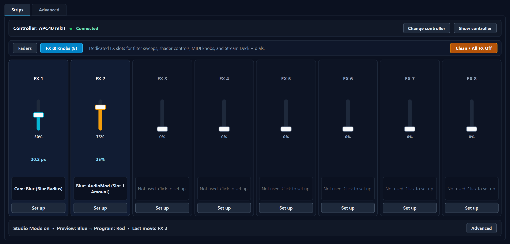
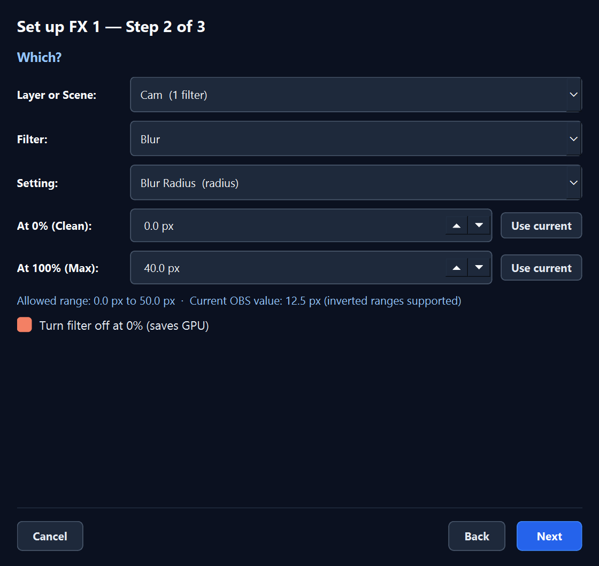

# Midi Fadester

[](https://github.com/jbrick2070/midi-fadester/releases/latest)
[](https://github.com/jbrick2070/midi-fadester/actions/workflows/push.yaml)
[](LICENSE)

Midi Fadester turns the faders and knobs on a MIDI controller into live controls for OBS Studio. Fade from one scene to the next with a real crossfader. Mix two layers. Fade a camera in and out. Ride a volume. Sweep any filter setting. It is made for the Akai APC40 mkII and works with other controllers through MIDI Learn.


> **Disclaimer:** Midi Fadester is an independent third-party plugin for OBS Studio. It is not made, endorsed, or supported by the OBS Project or by Akai Professional / inMusic Brands.

## Contents

- [What it does](#what-it-does)
- [You need](#you-need)
- [Install](#install)
- [The first five minutes](#the-first-five-minutes)
- [The five jobs a fader can do](#the-five-jobs-a-fader-can-do)
- [Switch scenes or Mix two layers?](#switch-scenes-or-mix-two-layers)
- [FX & Knobs and Clean / All FX Off](#fx--knobs-and-clean--all-fx-off)
- [Controllers](#controllers)
- [How it feels](#how-it-feels)
- [Works with](#works-with)
- [Control it from scripts and other programs](#control-it-from-scripts-and-other-programs)
- [Where settings live](#where-settings-live)
- [If something is wrong](#if-something-is-wrong)
- [Not yet](#not-yet)
- [Releases](#releases)
- [Building from source](#building-from-source)
- [Documents](#documents)
- [License, disclosures and credits](#license-disclosures-and-credits)

## What it does

Every fader or knob gets one job:

- **Switch scenes.** Throw the crossfader and OBS fades Program to Preview, like OBS's own T-bar in Studio Mode.
- **Mix two layers.** In one scene, crossfade between two layers. Left is one, right is the other, and with the default feel the picture never darkens in the middle.
- **Show or hide a layer.** Fade one layer in and out, 0 to 100 %.
- **Volume.** Ride one audio source on a cubic dB curve: 0 dB at the top, silence at the bottom.
- **Filter or effect setting.** Sweep any numeric setting of any filter between two values you choose: a blur radius, a color correction, a key threshold, a shader's slider, Visual Sidechain's reactivity amount.

There are 18 slots: a crossfader, eight channel faders, a master, and eight FX knobs. Each remembers its own job. The faders feel like hardware: moves are smoothed, a fader that is out of place picks up without a jump, and the ends of the travel never flicker.

## You need

- **OBS Studio 33.0.0 or newer** on 64-bit Windows. The plugin uses the OBS 33 plugin layout and does not load in older versions.
- **A USB MIDI controller** with faders or knobs. The Akai APC40 mkII is set up out of the box and has been tested on hardware. Four more desks have ready-made layouts, and any other controller works through Learn (see [Controllers](#controllers)).
- **Studio Mode** turned on, for scene switching only. The other jobs work with it off.
- **The obs-websocket server** turned on (it ships with OBS), only if you also use the Stream Deck companion or scripts.

No internet connection, account or other software is needed.

## Install

> **Which version is this page about?** The code on `main`, version 0.6.0. The only download so far, 0.1.0, is the Phase 1 build: one settings table and ten slots, with no Strips screen, Set up sheet, FX & Knobs bank, Clean / All FX Off or Stream Deck link. Until the next release, following *The first five minutes* needs a [build from source](#building-from-source); with 0.1.0 you set up faders in its one table, which is now the Advanced tab. See [Releases](#releases).

Download one file from the [latest release](https://github.com/jbrick2070/midi-fadester/releases/latest):

| File | Use it when | What it does |
|---|---|---|
| `midi-fadester-<version>-windows-x64-Installer.exe` | OBS is installed the normal way | Installs into `C:\ProgramData\obs-studio\plugins\midi-fadester\` |
| `midi-fadester-<version>-windows-x64.zip` | Same, but you prefer to unpack it yourself | Extract into `C:\ProgramData\obs-studio\plugins\` |
| `midi-fadester-<version>-windows-x64-Portable.zip` | You run a portable OBS | Extract into the portable OBS folder, the one that holds `bin`, `core` and `data`; the zip adds a `plugins` folder there |

Either way you end up with `plugins\midi-fadester\midi-fadester.dll` and `plugins\midi-fadester\data\`. Then start OBS.

- The builds are not code-signed, so Windows SmartScreen may warn before the installer runs. Choose **More info**, then **Run anyway**. Every release page lists the SHA-256 checksum of each file.
- To check that it loaded: the **Tools** menu has a **Midi Fadester** entry, and **Tools → Plugin Manager** lists it without a *Legacy* badge (that badge marks plugins installed in the old folder layout). The dialog's title bar shows the version and the commit it was built from.
- To update, install the new version over the old one. To remove it, delete the `midi-fadester` folder.

## The first five minutes

1. **Plug in the controller**, ideally before you start OBS. If you plug it in later, the plugin picks it up when Windows reports it; if it does not, the controller bar shows a **Reconnect** button.
2. **Open Tools → Midi Fadester.** With an APC40 mkII connected for the first time, a blue bar at the top offers the usual layout: *Crossfader switches scenes, Master is Desktop Audio volume.* Click **Yes**. Master takes the volume job only if your OBS has a source called Desktop Audio. The eight channel faders stay free for you to assign.

   

3. **Turn on Studio Mode.** If it is off, the crossfader strip says *Studio Mode is off.* and offers a **Turn on Studio Mode** button. Click it.
4. **Throw the crossfader** all the way to the other end. Program fades to what was in Preview. When the throw finishes, OBS moves the old Program scene into Preview (its default *Swap Preview/Program Scenes After Transitioning* setting), ready for the next throw, and the strip reads *At end.* Pick another scene in Preview and throw the crossfader back the other way.
5. **Give a fader a job.** Click **Set up** under a strip. Three steps: pick the job, pick the scene and layer or source, then move the fader and watch it work before you click **Done**.

   

6. **Another controller?** Click **Change controller** and pick its port; a known desk gets its layout by itself, any other desk gets the Generic layout. If a fader does not respond, open **Which hardware control?** in step 3 of Set up, press **Learn** and move the fader. The **Advanced** tab also has a **Learn** button on every row.

The jobs are saved with the scene collection and the controller settings per Windows user; both come back the next time OBS starts.

## The five jobs a fader can do

| Job | What the fader does | What it needs |
|---|---|---|
| **Switch scenes (T-bar)** | Fades Program to Preview from 0 to 100 %. Reach the far end to finish; return to the start to cancel. | Studio Mode on. Any transition except Cut and Stinger, which OBS swaps for Fade while a T-bar moves. |
| **Mix two layers** | Crossfades the Left layer and the Right layer inside one scene. Left end shows Left, right end shows Right. | Both layers in the same scene. Which one is on top is detected automatically. |
| **Show or hide a layer** | Fades one layer from invisible to fully visible. | The layer in a scene. |
| **Volume** | Sets one audio source's volume on a cubic curve (volume = position cubed); the strip shows the dB value. OBS's own mixer slider uses a log curve, so the same position reads a different dB there. | A source that has audio. |
| **Filter or effect setting** | Sweeps one numeric setting of one filter between a value *At 0 %* and a value *At 100 %*. | The filter already added to the source or scene in OBS. |

A strip can also be **Not used**. Its hardware control stays bound, so you can give it a job later.

Good to know:

- Layer fades and mixes work through a filter the plugin adds to the source. OBS lists it in the source's Filters as `__midi_fadester_opacity__` (its type is *Midi Fadester — Layer Opacity*); leave it there. Your own filters are not touched, and at 100 % the filter skips its GPU pass.
- A layer faded to 0 % keeps running. A media source keeps playing, so it can fade back in at once. Tick **Also fade audio** on the Advanced tab if its sound should follow.
- The filter sits on the source, not on the scene item. If the same source appears in two scenes, it fades in both; Set up warns you when that is the case. For a layer that should fade in one scene only, copy the source and use **Paste (Duplicate)**, not **Paste (Reference)**, in the other scene.
- One setting of one filter can be driven by one slot at a time. Set up refuses a second binding to the same setting.

## Switch scenes or Mix two layers?

Both crossfade video, in two different styles.

**Switch scenes (T-bar)** is the broadcast switcher. It works with the scenes you already have and needs Studio Mode. A throw goes like this:

- Nothing happens in the first 6 % of the travel, so a fader resting near its end cannot start a transition by itself.
- Past that, the fader drives OBS's T-bar in a straight line to 100 %. OBS's own on-screen T-bar treats anything past 90 % as the end when you let go; Midi Fadester keeps the fade going all the way to the physical end.
- In the last 3 % of the travel the throw finishes: OBS swaps the scenes, the old Program scene moves into Preview (with OBS's default swap setting), and OBS resets its T-bar. The strip reads *At end.*
- Come back into the first 3 % instead, and the throw cancels: Program does not change.
- **T-bar works in both directions** is on by default. After a finished throw, the next throw starts from where the fader sits and runs the other way, so you never have to bring the fader back first. Turn it off on the Advanced tab if you prefer one-way throws.
- **Finish now** on the strip completes a throw from the mouse.

Watch the Program box (on the right in OBS's default layout). It never jumps; it only fades. At the end of a throw the Preview box switches to the old Program scene: that is OBS's default *Swap Preview/Program Scenes After Transitioning* setting lining up the next throw.

**Mix two layers** is the DJ mixer. Put both sources, or two nested scenes, in one scene, and give a fader the job with Left and Right. The left end shows Left, the right end shows Right, and the middle shows both. There is no Preview and Program, and Studio Mode can stay off. The **Feel** column on the Advanced tab picks the curve; the Set up sheet offers all but Full-center, and opening Set up on a Full-center strip changes it to Dip-free:

| Curve | What you see |
|---|---|
| **Dip-free** (default) | The picture never darkens in the middle. The lower layer stays at 100 % while the upper one fades, which gives a true optical dissolve instead of the 25 % dip two half-transparent layers produce. |
| **Full-center** | Both layers reach 100 % at the center mark. Advanced tab and API only. |
| **Equal power** | A sine/cosine crossfade for sources of matched brightness. |
| **Linear** | A straight 0 to 100 % blend on both layers. |
| **Cut** | An instant switch at the halfway mark. |

## FX & Knobs and Clean / All FX Off

The bank bar on the Strips screen switches between **Faders** and **FX & Knobs (8)**. The eight FX slots are for filter sweeps and shader controls. On the APC40 mkII they are the eight Device Control knobs (CC 16 to 23); other desks map their knob rows (see [Controllers](#controllers)). The FX slots stay available even on a controller without knobs, because a Stream Deck + dial or a script can drive them too.



**Set up** on an FX strip, or **Filter or effect setting** on any fader, walks you through source or scene → filter → setting. Step 2 lets you set the value *At 0 %* and *At 100 %*, with **Use current** buttons to capture what OBS shows right now, so a knob can sweep a blur from 0 to 20 px or a brightness from 0 to −1. **Turn filter off at 0 % (saves GPU)** disables the filter entirely while the knob rests at zero, and turns it back on as soon as the knob moves. When two slots drive two settings of the same filter, they share that switch without fighting over it.



**Clean / All FX Off** is the panic button. One click takes every filter setting in both banks back to its *At 0 %* value and applies the bypass. Volumes, layer fades, two-layer mixes and the T-bar are left exactly where they are, and media keeps playing. It is also available as the `reset_fx` request, instant or as a timed ramp, so a Stream Deck key can do the same.

## Controllers

| Controller | Layout | Status | Faders and knobs it maps |
|---|---|---|---|
| **Akai APC40 mkII** | `apc40mk2` | **Tested on hardware** | Crossfader (Ch 1 CC 15), Faders 1–8 (Ch 1–8 CC 7), Master (Ch 1 CC 14); FX 1–8 on the Device knobs (Ch 1 CC 16–23) |
| **Akai APC mini mk2** | `apcminimk2` | Beta, from the manufacturer's MIDI spec | Faders 1–8 (Ch 1 CC 48–55), Master (Ch 1 CC 56); no knobs, so FX 1–8 through Learn or a Stream Deck |
| **Akai MIDImix** | `midimix` | Beta, from the manufacturer's MIDI spec | Faders 1–8 (Ch 1 CC 19, 23, 27, 31, 49, 53, 57, 61), Master (Ch 1 CC 62); FX 1–8 on the third knob row (Ch 1 CC 18, 22, 26, 30, 48, 52, 56, 60) |
| **Korg nanoKONTROL2** | `nanokontrol2` | Beta, from the manufacturer's MIDI spec | Sliders 1–8 (Ch 1 CC 0–7, default CC mode); FX 1–8 on the knobs (Ch 1 CC 16–23) |
| **Novation Launch Control XL** | `launchcontrolxl` | Beta, from the manufacturer's MIDI spec | Faders 1–8 (Ch 1 CC 77–84, as sent by User template 1; a Factory template sends on channel 9, so use Learn); FX 1–8 on the third knob row (Ch 1 CC 49–56) |
| **Anything else** | `generic` | Learn | Up to 18 controls, each learned by moving it |

- **Beta** means the layout was written from the published MIDI implementation and has not yet been checked on a physical desk. It shows an amber *BETA* badge. If a fader does not match, **Learn** it once; the rest of the layout stays.
- **Change controller** on the Strips screen picks the MIDI port and the layout. The plugin picks the APC40 mkII's port by itself when it sees one.
- **Show controller** opens a live picture of the desk with each fader's position, job and state, so you can see which physical fader does what (faders, master and crossfader; the FX knobs are not drawn).
- A desk without a horizontal crossfader can give **Switch scenes** to any vertical fader. Layouts for desks without a crossfader or master turn those two slots off.
- **Reverse direction** on the Advanced tab flips a control that runs the wrong way.
- Adding a desk is one entry in `src/core/apc40-profile.c`.


## How it feels

- **Smoothing.** Every move gets a short glide (30 ms by default, *Smoothing (ms)* on the Advanced tab; 0 turns it off), so the 128 steps of a MIDI fader do not show as steps on screen.
- **Pick-up.** If a value moved without the fader (someone dragged it in OBS, a Stream Deck dial turned it, a scene collection loaded), the fader does not make it jump. The strip shows an amber bar, a marker at the target and *Move the fader up to 40 % to pick up.* Once the fader crosses that point it takes over without a step.
- **Rails.** The top and bottom 3 % of the travel are the rails. A control resting there is parked (*At end.*), so hand jitter against the end stop never flickers a layer or re-triggers a transition. Moving 8 % back unparks it, and the rest of the travel is rescaled so there is no jump.
- **Calibration.** Each control starts with the full MIDI range and widens it whenever it sends a value beyond anything seen before, saved per layout and control. A fader that stops at 125 instead of 127 still reaches 100 %, because the top 3 % of the travel counts as the end.
- **Resolution.** Ordinary 7-bit controls, high-resolution 14-bit CC pairs and pitch bend are all accepted. A binding remembers the MIDI channel as well as the number: the APC40 mkII's eight faders all send CC 7 and differ only by channel, and that works.

## Works with

- **[Fadester for OBS](https://github.com/jbrick2070/streamdeck-fadester)**, a plugin for the Stream Deck and Stream Deck +. Its dials and keys move the same slots: a dial nudges a fader or an FX knob, a key starts a timed fade or presses Clean / All FX Off, and the dial screens show the live values. It talks to Midi Fadester through the obs-websocket server, not MIDI, so it never takes the MIDI port; turn the server on in OBS (**Tools → WebSocket Server Settings**) and give the Stream Deck plugin the password. The Midi Fadester dialog shows a *Use a Stream Deck?* card until you click **Hide**, and keeps a **Stream Deck companion...** button on the Strips screen. Midi Fadester works without a Stream Deck, and the FX bank and Clean / All FX Off need a Midi Fadester build newer than 0.1.0.
- **[Visual Sidechain](https://github.com/jbrick2070/visual-sidechain)**, an audio-reactive filter suite. An FX knob can trim its reactivity amount like any other filter setting, and Visual Sidechain can read the fader values inside OBS to drive its shaders.

## Control it from scripts and other programs

Midi Fadester registers an obs-websocket 5 vendor API. Call it with `CallVendorRequest`, `vendorName` `"midi-fadester"`. Values are floats from 0.0 to 1.0. Slot ids are stable strings: `crossfader`, `fader_1` … `fader_8`, `master`, `fx_1` … `fx_8`.

| Request | Does |
|---|---|
| `get_state` | Returns everything: version, Studio Mode, the active layout, the MIDI device and all 18 slots with their job, value, readout and availability. |
| `set_fader_value` | Moves a slot to a value. On a T-bar, `release: true` finishes the throw; `release: false` with `value: 0` cancels it. |
| `nudge_fader` | Adds a delta, for endless encoders and dials. |
| `auto_fade` | Fades a slot to a value over 50 to 20 000 ms. |
| `set_slot` | Gives a slot a job, with the same fields as the dialog. Unknown names come back as an error sentence, never as a silent no-op. |
| `load_profile` | Loads a controller layout: `apc40mk2`, `apcminimk2`, `midimix`, `nanokontrol2`, `launchcontrolxl` or `generic`. Replaces all 18 slots. |
| `get_catalog` | Lists scenes, layers, audio sources, filters and their numeric settings with ranges and current values, so a client can build pickers. |
| `reset_fx` | Clean / All FX Off, instant or over a timed ramp. |

Two events: `fader_changed` whenever a value changes, at most 30 times a second per slot (fields: `slot`, `value`, `display_value` and `origin`: `midi`, `ui`, `api`, `auto_fade` or `obs`), and `state_changed` whenever a job, device, layout or Studio Mode changes.

```json
{
  "op": 6,
  "d": {
    "requestType": "CallVendorRequest",
    "requestId": "fade-cam-in",
    "requestData": {
      "vendorName": "midi-fadester",
      "requestType": "auto_fade",
      "requestData": { "slot": "fader_2", "to": 1.0, "ms": 1500 }
    }
  }
}
```

Validation errors come back inside `responseData` as `{ "error": "...", "comment": "..." }`, with a sentence that names the fix, for example *Slot 'fader_9' does not exist. Valid slots: crossfader, fader_1 .. fader_8, master, fx_1 .. fx_8.* If obs-websocket is not loaded, Midi Fadester logs one line and keeps working from MIDI.

Other plugins inside the same OBS do not need the websocket. Midi Fadester registers the procs `midi_fadester_get_slot_value` and `midi_fadester_set_fader_value` and the signal `midi_fadester_fader_changed` on OBS's global handlers.

The full contract, with every field and the rules both sides follow, is [API-CONTRACT.md](https://github.com/jbrick2070/streamdeck-fadester/blob/main/API-CONTRACT.md) in the Stream Deck repository.

## Where settings live

- **Per Windows user:** the MIDI port, layout, smoothing, T-bar direction, each control's learned range and your first-run and Stream Deck card choices are saved in `%APPDATA%\obs-studio\plugin_config\midi-fadester\global.json` (for a portable OBS: `config\obs-studio\plugin_config\midi-fadester\global.json` inside the OBS folder). That file also keeps a copy of the 18 jobs, which stay active when a scene collection has no saved set of its own.
- **Per scene collection:** the 18 jobs are saved inside the collection, because they name scenes and sources.
- **Import...** and **Export...** on the Advanced tab read and write that whole file: port, layout, smoothing, T-bar direction, learned ranges, card choices and jobs.

## If something is wrong

The dialog says what is wrong in a sentence, next to the strip it concerns, and usually offers the button that fixes it.

| You see | It means | Do |
|---|---|---|
| *Another program has the APC40 mkII open. Close it, then press Reconnect.* | Windows lets one program use a MIDI port at a time. | Close the DAW, MIDI-OX, a browser tab using Web MIDI, or whatever else holds the desk, then **Reconnect**. |
| *APC40 mkII not found. Plug it in, then Reconnect.* / *No MIDI controller found. Plug one in, then press Reconnect.* | The port is gone or the desk is off. | Plug it in or power it on. The plugin notices when Windows reports the device again; **Reconnect** forces a rescan, and **Change controller** picks a different port. |
| *Could not open APC40 mkII. Unplug and replug it, then press Reconnect.* | Windows refused the port for another reason. | Do that. |
| *Studio Mode is off.* | Switch scenes needs Studio Mode. | **Turn on Studio Mode** on the strip, or the **Studio Mode** button in OBS's Controls dock. |
| *No MIDI control bound.* | The strip has a job but no fader. | **Set up**, or **Learn** on the Advanced tab, then move the fader. |
| *Scene Red was deleted.* / *Cam is no longer in scene Blue.* / *Color and Color 2 are not in the same scene.* | The scene or layer the job named is gone or moved. | **Set up** on the strip and pick again. Renames follow by themselves; only removals break a job. |
| *Mic/Aux has no audio.* | A Volume job points at a source without sound. | Pick a source with audio. |
| *Filter 'Blur' was removed from Cam. Re-add it in OBS Filters or click Set up.* / *Setting 'radius' is no longer available on 'Blur'.* | The filter or its setting is gone. | Re-add the filter in OBS, or **Set up** and pick another. |
| *Move the fader up to 40 % to pick up.* | Not an error: the value moved without the fader. | Move the fader past the marker. |
| *At end.* | Not an error: the control is parked on a rail. | Move it 8 % back to pick up again. |
| The crossfader moves but nothing happens | A throw starts only past the first 6 % of the travel. | Throw further. If the strip is amber, Studio Mode is off. |
| The transition is a Fade although Cut or Stinger is selected | OBS uses Fade for any T-bar move with those two. | Pick another transition for throws, or use OBS's Transition button for cuts. |
| A layer fades in a scene you did not expect | The opacity filter sits on the source, which is in both scenes. | Put a copy of the source in the other scene. |
| *CRITICAL: Studio Mode 'slider-tbar' widget not found in this OBS version. T-bar sync disabled.* in red on the crossfader strip | OBS changed its Studio Mode window and the T-bar cannot be driven. The log says *CRITICAL: Studio Mode is active, but Qt QSlider 'slider-tbar' was not found in OBS main window!* | Everything else still works. Please open an issue with your OBS version. |

The OBS log (**Help → Log Files → Show Log Files**) has every Midi Fadester line prefixed with `[midi-fadester]`.

## Not yet

- Windows only. The MIDI layer uses the Windows multimedia API, and no macOS or Linux build exists.
- OBS 33.0.0 or newer only.
- No lights: the desk's LEDs and knob rings are not driven yet.
- Faders and knobs only: pads, buttons and hotkeys are not mapped yet.
- No dock: the controls live in the Tools dialog.
- No blend modes, luma key or wipe faders, and no A/B bus matrix across eight strips.

These are planned phases 2 to 5 in [PLAN.md](PLAN.md).

## Releases

Releases are built by GitHub Actions from a version tag as a draft, then published on the [Releases](https://github.com/jbrick2070/midi-fadester/releases) page with checksums.

**0.1.0** (October 2026) is the only release so far. It is the Phase 1 build: the crossfader as T-bar (with the guard against OBS 33's crash when Studio Mode is off, and the workaround for its cancel-on-release bug), two-layer mix, layer fade, volume, smoothing, pick-up, calibrated rails, the APC40 mkII layout, MIDI Learn, and the first six API requests. Its dialog is the table that is now the Advanced tab.

The code on `main` is **0.6.0** (Visual Sidechain uses the same number; Fadester for OBS is versioned separately). Compared with 0.1.0 it adds the Strips screen and the three-step Set up sheet, the first-run offer, the live controller picture, the FX & Knobs bank with Clean / All FX Off, the filter-setting job, the four Beta desk layouts, `get_catalog` and `reset_fx`, and the Stream Deck companion. Those arrive with the next release; until then they need a [build from source](#building-from-source).

## Building from source

You need Visual Studio 2022 Build Tools (MSVC 14.44 and the Windows 10.0.26100 SDK) and CMake 3.28 or newer. The first configure downloads the OBS 33.0.0 sources, the prebuilt OBS dependencies and Qt6 named in `buildspec.json`.

```powershell
cmake --preset windows-x64
cmake --build --preset windows-x64 --config RelWithDebInfo
ctest --preset windows-x64 -C RelWithDebInfo --output-on-failure
```

The built plugin lands in `build_x64\rundir\RelWithDebInfo\midi-fadester\`; copy that folder into your OBS `plugins` folder.

- **Tests.** Fifteen `ctest` targets run in a few seconds without OBS or hardware: the MIDI parser and queue, the smoother, pick-up, the crossfade curves, the T-bar state machine, the filter math, every UI sentence, the vendor API with a fake websocket, a real Qt6 dialog that renders the twelve screenshots in `docs/screenshots/`, and repository hygiene (UTF-8 without BOM, no timers, every locale key present).
- **Live self-test.** `scripts\run-live-selftest.ps1` boots a dedicated portable OBS 33 with a loopMIDI port, throws the T-bar eight ways, checks GPU pixels through `GetSourceScreenshot`, and exits with zero leaks. [TESTING.md](TESTING.md) explains the setup.
- **Formatting.** CI checks C and C++ with clang-format 17 and CMake with gersemi, using the repository's `.clang-format` and `.gersemirc`.
- **Design.** The MIDI input thread is lock-free and never calls OBS; the engine has no timers and runs on MIDI and OBS events. [PLAN.md](PLAN.md) has the thread contract.

## Documents

- [REQUIREMENTS.md](REQUIREMENTS.md): what the plugin must do, as numbered requirements, and the operator decisions behind them.
- [PLAN.md](PLAN.md): the OBS 33 and APC40 mkII audit, the architecture, the phased plan and the risk register.
- [PLAN-UI.md](PLAN-UI.md): the Strips screen, the Set up sheet and the controller picture.
- [PLAN-FX.md](PLAN-FX.md): the FX bank, filter settings, Clean / All FX Off and the cross-plugin rollout.
- [TESTING.md](TESTING.md): the test suites and the screenshot gallery of every dialog state.
- [API-CONTRACT.md](https://github.com/jbrick2070/streamdeck-fadester/blob/main/API-CONTRACT.md): the vendor API, kept in the Stream Deck repository because both sides build to it.

## License, disclosures and credits

Midi Fadester is free software under the GNU General Public License, version 2 or later. The GPL v2 text is in [LICENSE](LICENSE); Midi Fadester's own C and C++ source files carry an `SPDX-License-Identifier: GPL-2.0-or-later` header, and `src/obs/obs-websocket-api.h` is obs-websocket's header with its own GPL notice.

Midi Fadester is an independent third-party plugin for OBS Studio. It is not made, endorsed, or supported by the OBS Project or by Akai Professional / inMusic Brands.

This project is developed with the assistance of AI coding tools under human direction, review, and hardware verification on OBS Studio 33.

Built on the OBS Studio plugin template and obs-websocket's vendor API header, with the Akai APC40 mkII Communications Protocol as the reference for its layout. OBS Studio, Akai, APC40, APC mini, MIDImix, Korg, nanoKONTROL, Novation, Launch Control, Elgato and Stream Deck are trademarks of their respective owners.
