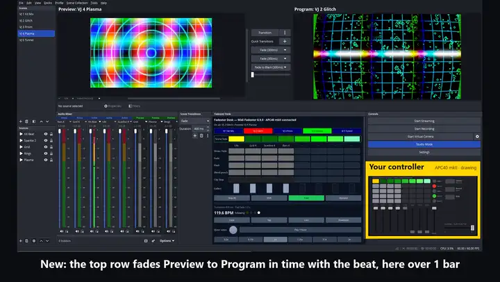
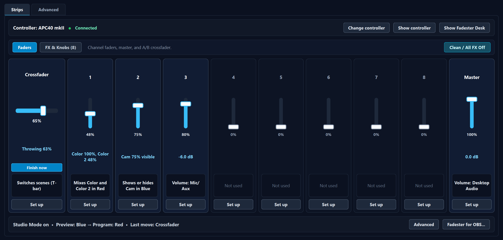
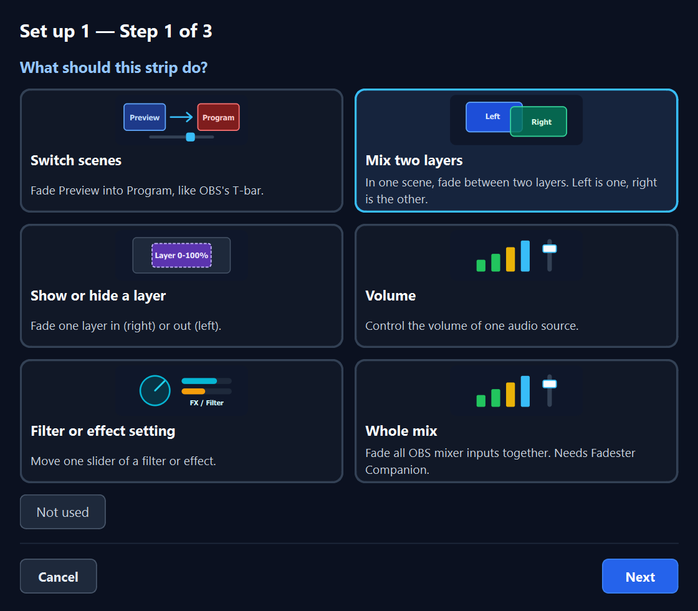
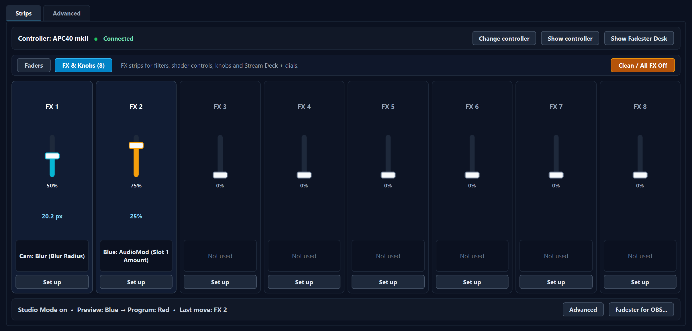

# Midi Fadester

> **Setting up the Fadester Suite?** Start with **[START-HERE.md](https://github.com/jbrick2070/streamdeck-fadester/blob/main/docs/START-HERE.md)** for what to install for your controller, which video player to pick, first-run OBS settings, and the compatibility matrix.

Midi Fadester turns the faders and knobs on a MIDI controller into live controls for OBS Studio: fade between scenes with a real crossfader, mix two layers, fade a camera, ride a volume, sweep any filter setting. It is made for the Akai APC40 mkII and works with other controllers through MIDI Learn.

**[Watch the one-minute demo](docs/demo/Midi-Fadester-0.9.1-demo.mp4)** (MP4, 7 MB, recorded on a 0.9.1 development build): the crossfader throws the Studio Mode T-bar, the top row fades Preview to Program in time with the beat (1 bar, then 2 bars) and its yellow pad cuts, Session fades Program to black and back, channel faders fade the layers of the scene on air, Visual Sidechain's Beat Zoom moves with the music, and Panic turns every effect off; the Fadester Desk dock follows all of it. The "Your controller" APC40 in the corner is a drawing of the desk moves; OBS was driven by a script for the recording.

> **Disclaimer:** Midi Fadester is an independent third-party plugin for OBS Studio. It is not made, endorsed, or supported by the OBS Project or by Akai Professional / inMusic Brands.

## Quick start

1. **Install it.** From the [latest release](https://github.com/jbrick2070/midi-fadester/releases/latest), run `midi-fadester-<version>-windows-x64-Installer.exe` (Windows) or `midi-fadester-<version>-macos-universal.pkg` (Mac), then start OBS Studio 33 or newer. Other files and warnings: [Install](#install).
2. **Plug in the controller.** An APC40 mkII sets itself up and the **Fadester Desk** dock opens. Another desk: open **Tools → Midi Fadester** (OBS's menu bar, top) and click **Change controller** on the Strips screen.
3. **Throw the crossfader.** Click **Studio Mode** in OBS's Controls dock (bottom right), then push the crossfader to the other end: Program fades to what was in Preview.

That's it. To give a fader another job, click **Set up** under its strip in **Tools → Midi Fadester**.

Quick start in other languages: [Deutsch](docs/quickstart/de.md#midi-fadester) · [Español](docs/quickstart/es.md#midi-fadester) · [Français](docs/quickstart/fr.md#midi-fadester) · [Italiano](docs/quickstart/it.md#midi-fadester) · [日本語](docs/quickstart/ja.md#midi-fadester) · [한국어](docs/quickstart/ko.md#midi-fadester) · [Nederlands](docs/quickstart/nl.md#midi-fadester) · [Português (Brasil)](docs/quickstart/pt-BR.md#midi-fadester) · [Русский](docs/quickstart/ru.md#midi-fadester) · [Türkçe](docs/quickstart/tr.md#midi-fadester) · [简体中文](docs/quickstart/zh-CN.md#midi-fadester) · [繁體中文](docs/quickstart/zh-TW.md#midi-fadester)

## Contents

- [What it does](#what-it-does) · [You need](#you-need) · [Install](#install) · [The first five minutes](#the-first-five-minutes) · [Fader assignments](#fader-assignments)
- [Switch scenes or Mix two layers?](#switch-scenes-or-mix-two-layers) · [FX & Knobs and Clean / All FX Off](#fx--knobs-and-clean--all-fx-off) · [Controllers](#controllers) · [How it feels](#how-it-feels) · [APC40 mkII pads](#apc40-mkii-pads)
- [Visual Sidechain is built in](#visual-sidechain-is-built-in) · [Works with](#works-with) · [Control it from scripts and other programs](#control-it-from-scripts-and-other-programs) · [Where settings live](#where-settings-live)
- [If something is wrong](#if-something-is-wrong) · [Languages](#languages) · [Not yet](#not-yet) · [Releases](#releases) · [Building from source](#building-from-source) · [Documents](#documents) · [License](#license-disclosures-and-credits)

## What it does

Every fader or knob gets one job:

| Job | What you get |
|---|---|
| **Switch scenes** | Throw the crossfader and OBS fades Preview into Program, like OBS's own T-bar in Studio Mode. |
| **Mix two layers** | Crossfade between two layers in one scene. With the default feel the picture never darkens in the middle. |
| **Show or hide a layer** | Fade one layer in and out, 0 to 100 %. |
| **Volume** | Ride one audio source: 0 dB at the top, silence at the bottom, about −18 dB in the middle. |
| **Filter or effect setting** | Sweep any numeric setting of any filter between two values you choose: a blur radius, a color correction, a shader's slider. |

There are 18 slots: a crossfader, eight channel faders, a master and eight FX knobs. Moves are smoothed, a fader that is out of place picks up without a jump, and the ends of the travel never flicker.

## You need

- **OBS Studio 33.0.0 or newer** on 64-bit Windows or macOS 13.0 or newer. It does not load in older versions.
- **A USB MIDI controller** with faders or knobs. The Akai APC40 mkII is set up out of the box and has been tested with a real desk on Windows (last recorded 2026-11-08). Four more desks have ready-made layouts; any other works through Learn (see [Controllers](#controllers)).
- **Studio Mode**, for scene switching only.
- **The obs-websocket server** (it ships with OBS), only if you also use Fadester for OBS or scripts.

No internet connection, account or other software is needed.

## Install

> **Which version is this page about?** Version 1.5.1, the [latest release](https://github.com/jbrick2070/midi-fadester/releases/latest). See [Releases](#releases).

Download one file from the [latest release](https://github.com/jbrick2070/midi-fadester/releases/latest):

| File | Use it when | What it does |
|---|---|---|
| `midi-fadester-<version>-windows-x64-Installer.exe` | OBS is installed the normal way | Installs into `C:\ProgramData\obs-studio\plugins\midi-fadester\` |
| `midi-fadester-<version>-windows-x64.zip` | Same, but you prefer to unpack it yourself | Extract into `C:\ProgramData\obs-studio\plugins\` |
| `midi-fadester-<version>-windows-x64-Portable.zip` | You run a portable OBS | Extract into the portable OBS folder, the one that holds `bin`, `core` and `data`; the zip adds a `plugins` folder there |
| `midi-fadester-<version>-macos-universal.pkg` | Mac (Apple Silicon and Intel) | Installs the plugin into OBS's plugins folder under `Library/Application Support/obs-studio/plugins` |
| `midi-fadester-<version>-macos-universal.tar.xz` | Mac, unpack it yourself | The same `midi-fadester.plugin` bundle as the `.pkg` |

- **Windows warning.** The builds are not code-signed, so SmartScreen may warn. Choose **More info**, then **Run anyway**. Every release page lists the SHA-256 checksum of each file.
- **Mac warning.** The `.pkg` is not signed or notarized by Apple. Right-click (or Control-click) it and choose **Open**, then **Open** again; or try to open it once, then click **Open Anyway** in **System Settings → Privacy & Security**.
- **The Mac build is new.** On 2026-11-17 it was checked in OBS 33.0.1 on an Apple Silicon Mac: it loads, its vendor requests answer, and OBS quits with 0 memory leaks. The full hands-on test with a controller is still to come, so please report what you find.
- **Check that it loaded.** On Windows you end up with `plugins\midi-fadester\midi-fadester.dll` and `plugins\midi-fadester\data\`. The **Tools** menu has a **Midi Fadester** entry, and **Tools → Plugin Manager** lists it without a *Legacy* badge (that badge marks the old folder layout). Every Midi Fadester window shows the version in its title bar; the commit is on the last line of the **Advanced** tab.
- **Update or remove.** Install the new version over the old one. To remove it, delete the `midi-fadester` folder.

## The first five minutes

1. **Plug in the controller**, ideally before you start OBS. Plugged in later, it is picked up when the system reports it; if not, the controller bar shows a **Reconnect** button.
2. **An APC40 mkII sets itself up** the first time: the crossfader switches scenes, faders 1 to 8 fill themselves from the scene on air and follow it, and Master becomes the volume of Desktop Audio (if your OBS has that source). The **Fadester Desk** dock opens by itself that one time, and **Tools → Midi Fadester** shows a blue bar saying what was set up: click **OK**. The small **Start empty** clears all 18 strips instead, after asking, and the faders then no longer fill themselves.

   

3. **Turn on Studio Mode.** If it is off, the crossfader strip says *Studio Mode is off.* and offers a **Turn on Studio Mode** button.
4. **Throw the crossfader** all the way. Program fades to what was in Preview, OBS moves the old Program scene into Preview (its default *Swap Preview/Program Scenes After Transitioning* setting), and the strip reads *At end.* Pick another scene in Preview and throw back the other way.
5. **Give a fader a job.** Click **Set up** under a strip: pick the job; pick the scene and layer or source; move the fader, check that the bar follows it, and click **Done**. OBS does not change until you click **Done**.

   

6. **Another controller?** Click **Change controller** and pick its port; a known desk gets its layout by itself, any other the Generic layout. If a fader does not respond, open **Which hardware control?** in step 3 of Set up, press **Learn** and move the fader.

The **Advanced** tab is a map of all 18 strips, each with **Learn**, **×**, **On**, **Reverse** and **Edit...**; its switches apply at once and are saved. Jobs are saved with the scene collection and controller settings per user; both come back the next time OBS starts.

## Fader assignments

| Job | What the fader does | What it needs |
|---|---|---|
| **Switch scenes (T-bar)** | Fades Preview into Program. Reach the far end to finish; return to the start to cancel. | Studio Mode on. Any transition except Cut and Stinger, which OBS swaps for Fade while a T-bar moves. |
| **Mix two layers** | Crossfades a Left and a Right layer inside one scene. | Both layers in the same scene. |
| **Show or hide a layer** | Fades one layer from invisible to fully visible. | The layer in a scene. |
| **Volume** | Sets one audio source's volume on a cubic curve; the strip shows the dB value (OBS's own slider uses a log curve, so it reads differently). | A source that has audio. |
| **Whole mix** | Fades all OBS mixer inputs together through Fadester Companion. | Fadester Companion running (see [Set up the shared mix for MIDI](#set-up-the-shared-mix-for-midi)). |
| **Filter or effect setting** | Sweeps one numeric setting of one filter between a value *At 0 %* and a value *At 100 %*. | The filter already added in OBS. |
| **Not used** | Nothing; its MIDI control stays assigned for later. | |

Layer fades add a filter named `__midi_fadester_opacity__` to the source: leave it there. Because it sits on the source, a source used in two scenes fades in both. Every job in detail: [How the faders work](docs/FADERS.md).

## Switch scenes or Mix two layers?

**Switch scenes** is the broadcast switcher: it uses your scenes and Studio Mode, ignores the first 6 % of the travel, finishes in the last 3 % and cancels if you come back. **Mix two layers** is the DJ mixer: two layers in one scene, no Preview and Program, with a choice of five curves (default **Dip-free**, which never darkens in the middle). The full throw rules and the curve table are in [How the faders work](docs/FADERS.md#switch-scenes-or-mix-two-layers).

## FX & Knobs and Clean / All FX Off

The bank bar on the Strips screen switches between **Faders** and **FX & Knobs (8)**. The eight FX slots are for filter sweeps and shader controls; on the APC40 mkII they are the eight Device Control knobs, and a Stream Deck + dial or a script can drive them too.

- **Set up** on an FX strip walks you through source or scene → filter → setting, with **Use current** buttons for the *At 0 %* and *At 100 %* values.
- **Turn filter off at 0 % (saves GPU)** disables the filter while the knob rests at zero.
- **Clean / All FX Off** sends every filter-setting binding back to its *At 0 %* value. Volumes, layer fades, mixes and the T-bar stay where they are, and Visual Sidechain's separate **Panic / Restore visuals** is untouched. More: [How the faders work](docs/FADERS.md#fx--knobs-and-clean--all-fx-off).

## Controllers

| Controller | Layout | Status |
|---|---|---|
| **Akai APC40 mkII** | `apc40mk2` | **Tested on hardware** (Windows, last recorded 2026-11-08) |
| **Akai APC mini mk2** | `apcminimk2` | Beta |
| **Akai MIDImix** | `midimix` | Beta |
| **Korg nanoKONTROL2** | `nanokontrol2` | Beta |
| **Novation Launch Control XL** | `launchcontrolxl` | Beta (User template 1; a Factory template needs Learn) |
| **Anything else** | `generic` | Learn: up to 18 controls, each learned by moving it |

**Beta** means written from the manufacturer's MIDI spec and not yet checked on a real desk; if a fader does not match, **Learn** it once. **Change controller** on the Strips screen picks the port and layout, and **Show controller** opens a live picture of the desk. Every MIDI number per desk: [Controllers and their MIDI maps](docs/CONTROLLERS.md).

## How it feels

Every move gets a short glide (**Smoothing**, 30 ms by default). If a value moved without the fader, the strip shows an amber bar and *Move the fader up to 40% to start.* until the fader catches up. The top and bottom 3 % are rails, so hand jitter at the ends never flickers. Details: [How the faders work](docs/FADERS.md#how-it-feels).

## APC40 mkII pads

With an APC40 mkII connected, the desk is a VJ deck: columns 1 to 8 are the sources of the scene on air, the pads blend, flash, fade and show or hide them, the top row cuts or fades Preview on air in beats, Scene Launch picks scenes and Session blacks Program out. The **Fadester Desk** dock (**Docks → Fadester Desk**) shows the same desk on screen. Every pad, light and dock button: **[APC40 mkII pads](docs/APC40.md)**.

## Visual Sidechain is built in

Since 0.9.0, Midi Fadester includes **Visual Sidechain**: video effects that move with your music, an Audio Modulator that moves your other filters to the beat, Panic and Restore visuals hotkeys with a 3 flashes per second limit, and the **Tape Deck** (a video file at 25% to 800% speed). Add them from a source's **Filters** as **`Visual Sidechain: Shader Filter`**, **`Visual Sidechain: Audio Modulator`** and **`Visual Sidechain: Tape Deck`**; every fader and FX knob can drive their settings. Guide: **[docs/VISUAL-SIDECHAIN.md](docs/VISUAL-SIDECHAIN.md)**.

Had the separate Visual Sidechain plugin? Close OBS and run the Midi Fadester installer: it removes the old plugin, and your filters, decks, hotkeys and Stream Deck keys keep working. If an old copy is still found, Visual Sidechain stays off and the Fadester Desk dock names the file to remove.

## Works with

**[Fadester for OBS](https://github.com/jbrick2070/streamdeck-fadester)**, a plugin for the Stream Deck and Stream Deck +, moves the same slots: a dial nudges a fader or FX knob, a key starts a timed fade or presses Clean / All FX Off. It talks through the obs-websocket server, not MIDI: turn the server on in OBS (**Tools → WebSocket Server Settings**); the Stream Deck plugin fills in the password OBS saved on the same computer. The dialog shows a *Use a Stream Deck?* card until you click **Hide**, and keeps a **Fadester for OBS...** button on the Strips screen. Midi Fadester works without a Stream Deck; the FX bank and Clean / All FX Off need Midi Fadester 0.6.0 or later.

## Control it from scripts and other programs

Midi Fadester registers an obs-websocket 5 vendor API, `vendorName` `"midi-fadester"`, with requests such as `get_state`, `set_fader_value`, `auto_fade` and `reset_fx`, and events when a value or a job changes. Every request, event and field: **[Scripting](docs/SCRIPTING.md)**.

### Set up the shared mix for MIDI

1. **Start Fadester Companion** on the OBS computer. In OBS, enable **Tools → WebSocket Server Settings** with authentication, and use the same port in Fadester Companion (it can read OBS's saved password).
2. **Turn on the mix.** In Fadester Companion's **Setup** tab, check **Enable All OBS mixer inputs** and, for MIDI use, **Run for Stream Deck, OpenDeck or MIDI only (no TourBox shortcuts)**. Click **Save & start controls** and leave it running. It moves the mixer inputs together, keeping their relative levels.
3. **Give the fader the job.** In **Tools → Midi Fadester**, choose **Master → Set up → Whole mix** and learn the fader if needed.

The bottom requests silence, the middle about −18.1 dB, the top unity. The strip reads *Needs Fadester Companion* until the first request, **Requested** while it waits, **Confirmed** when Fadester Companion replies, and *No answer from Fadester Companion* after ten seconds; then start Fadester Companion and move the fader again.

## Where settings live

- **Per user:** the MIDI port, layout, which MIDI control drives each strip (what **Learn** set) with its learned range, smoothing, T-bar direction and your card choices are saved in `%APPDATA%\obs-studio\plugin_config\midi-fadester\global.json` (portable OBS: `config\obs-studio\plugin_config\midi-fadester\global.json` inside the OBS folder). It also keeps a copy of the 18 jobs, used when a scene collection has none of its own.
- **Per scene collection:** the 18 jobs, because they name scenes and sources. Loading a collection changes the jobs, not which MIDI control drives a strip.
- **Import...** and **Export...** on the Advanced tab read and write that whole file.

## If something is wrong

The dialog says what is wrong next to the strip and usually offers the button that fixes it. The most common:

| You see | Do |
|---|---|
| *Another program has the APC40 mkII open. Close it, then press Reconnect.* | Close the DAW, MIDI-OX or browser tab that holds the desk, then **Reconnect**. |
| *APC40 mkII not found. Plug it in, then press Reconnect.* | Plug it in or power it on; **Change controller** picks another port. |
| *Studio Mode is off.* | **Turn on Studio Mode** on the strip. |
| The crossfader moves but nothing happens | Throw further: a throw starts past the first 6 %. |
| A layer fades in a scene you did not expect | The source is in both scenes; put a copy in the other scene. |

Every message: **[If something is wrong](docs/TROUBLESHOOTING.md)**. The OBS log (**Help → Log Files → Show Log Files**) marks every line with `[midi-fadester]`.

## Languages

Midi Fadester follows the language OBS runs in (**Settings → General → Language**, then restart OBS): English, Simplified Chinese, Spanish, Brazilian Portuguese, Russian, Japanese, German, French, Korean, Traditional Chinese, Turkish, Dutch and Italian. The translations were drafted by an AI model (Claude) and, except Italian, reviewed by a second one (Gemini); no native speaker has checked them yet. Corrections are welcome as an issue or pull request on the files in `data/locale/` (`en-US.ini` is the English source). Log lines and the vendor API stay English.

## Not yet

- No Linux build.
- The Mac build has not had the full hands-on test with a controller, and it is not signed or notarized.
- The APC40 mkII's knob rings are not lit, and its latching buttons (Solo, Activator, Record Arm, Crossfade A|B) and Track Select are not mapped.
- The Fadester Desk dock works the pads only while the APC40 mkII is connected; its faders are read-only.
- No luma key or wipe faders, and no A/B bus matrix across eight strips.

These are planned phases 2 to 5 in [PLAN.md](PLAN.md).

## Releases

**1.5.1** (November 2026) is the current release, a fix release. None of it has been through the hand tests on real hardware or in a live OBS yet.

- **Fixes** from a full code review: resetting or clearing the strips, choosing another layout or **Import...** no longer leaves a faded-out layer invisible; a fader that follows the scene on air no longer leaves its old source faded out; Visual Sidechain hears stereo music at the right level when OBS's audio is set to 5.1 or 7.1; Flash Guard also limits an Audio Modulator aimed at a custom shader's brightness; two Tape Deck fixes, and stricter checks for scripts.
- **Documentation:** a shorter README that opens with a three-step quick start, also in 12 more languages.

**1.5.0** (November 2026): every Fadester product moved to 1.5 together, so Midi Fadester (and Visual Sidechain inside it) went from 0.9.0 to 1.5.0.

- **APC40 mkII:** Session is now **Blackout**; the top pad row cuts or fades Preview on air in beats; pinning moved to Shift + Clip Stop.
- **A simpler screen:** the version in every title bar, a clearer Fadester Desk dock that works without an APC40, an Advanced tab that maps the 18 strips, and confirmations before resets.
- **Fixes** from a code review of the whole repository, including a Paste Filters freeze and a crash on long non-English source names.
- **Italian** is new, for 13 languages.
- **Updating:** which MIDI control drives a strip is now kept only per user (see [Where settings live](#where-settings-live)).

Full notes and every earlier release: **[docs/RELEASES.md](docs/RELEASES.md)**. Downloads with checksums are on the [Releases](https://github.com/jbrick2070/midi-fadester/releases) page.

## Building from source

Visual Studio 2022 Build Tools and CMake 3.28 or newer; then `cmake --preset windows-x64`, build, and run `ctest` (80 tests, no OBS or hardware needed). Steps, tests and the live self-test: [docs/BUILDING.md](docs/BUILDING.md).

## Documents

- For users: [APC40 mkII pads](docs/APC40.md), [Controllers and their MIDI maps](docs/CONTROLLERS.md), [How the faders work](docs/FADERS.md), [If something is wrong](docs/TROUBLESHOOTING.md), [Visual Sidechain](docs/VISUAL-SIDECHAIN.md), [Releases](docs/RELEASES.md).
- For developers: [Scripting](docs/SCRIPTING.md), [Building](docs/BUILDING.md), [Visual Sidechain for developers](docs/VISUAL-SIDECHAIN-DEVELOPERS.md), [API-CONTRACT.md](https://github.com/jbrick2070/streamdeck-fadester/blob/main/API-CONTRACT.md) (kept in the Stream Deck repository).
- Design: [REQUIREMENTS.md](REQUIREMENTS.md), [PLAN.md](PLAN.md), [PLAN-UI.md](PLAN-UI.md), [PLAN-FX.md](PLAN-FX.md), [TESTING.md](TESTING.md).

## License, disclosures and credits

Midi Fadester is free software under the GNU General Public License, version 2 or later. The GPL v2 text is in [LICENSE](LICENSE); Midi Fadester's own C and C++ source files carry an `SPDX-License-Identifier: GPL-2.0-or-later` header, and `src/obs/obs-websocket-api.h` is obs-websocket's header with its own GPL notice.

Midi Fadester is an independent third-party plugin for OBS Studio. It is not made, endorsed, or supported by the OBS Project or by Akai Professional / inMusic Brands.

This project is developed with the assistance of AI coding tools under human direction, review, and hardware verification on OBS Studio 33.

Built on the OBS Studio plugin template and obs-websocket's vendor API header, with the Akai APC40 mkII Communications Protocol as the reference for its layout. OBS Studio, Akai, APC40, APC mini, MIDImix, Korg, nanoKONTROL, Novation, Launch Control, Elgato and Stream Deck are trademarks of their respective owners.
