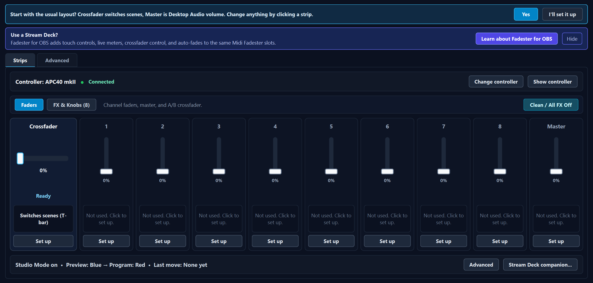
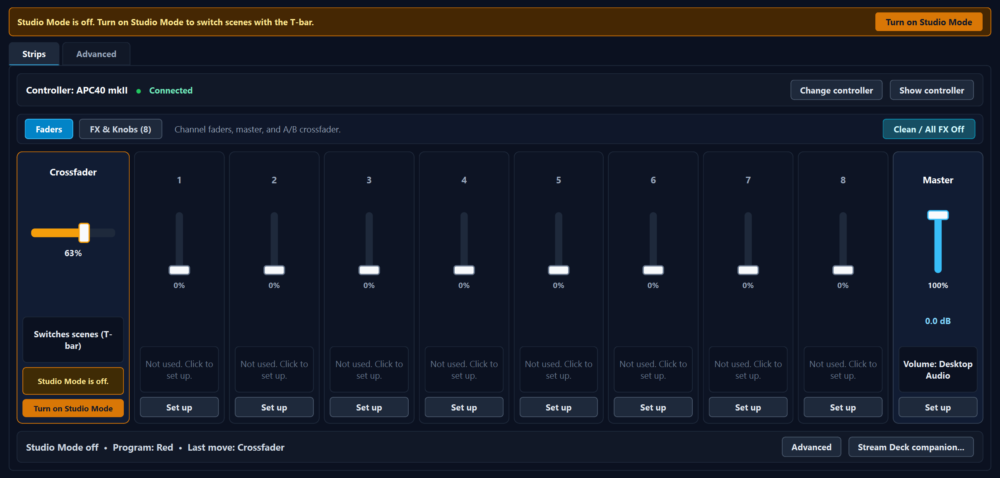
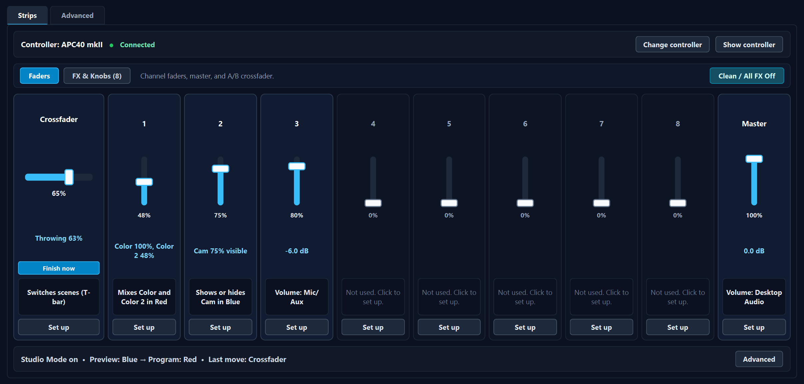
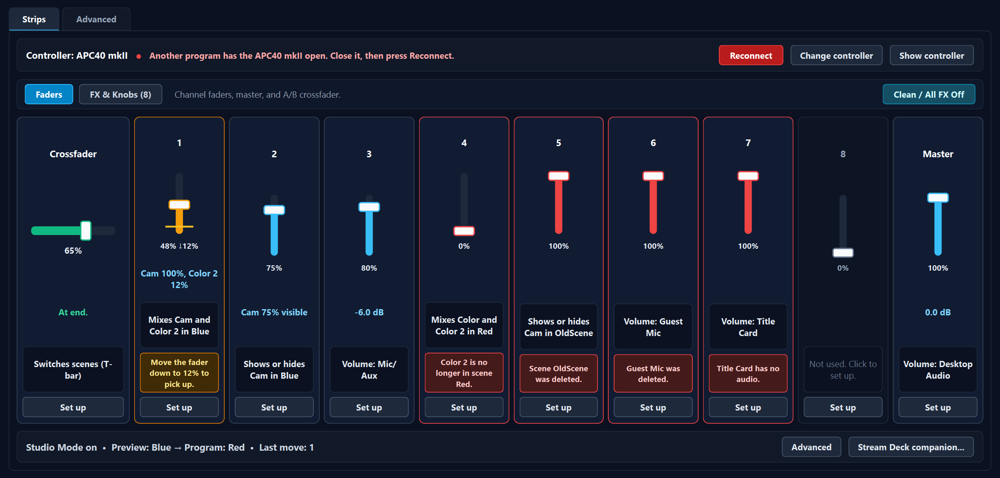
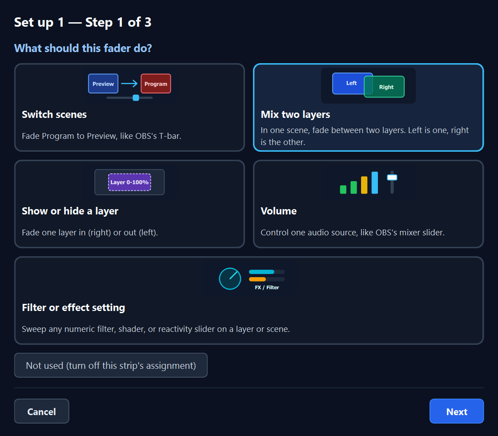
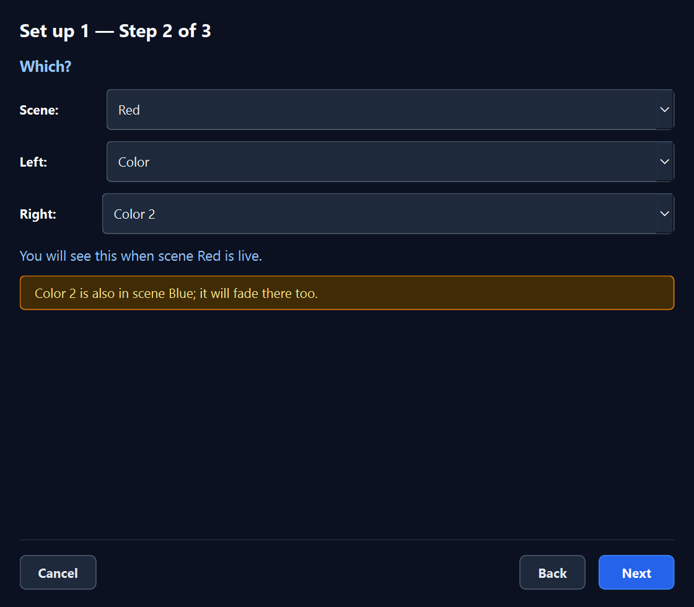
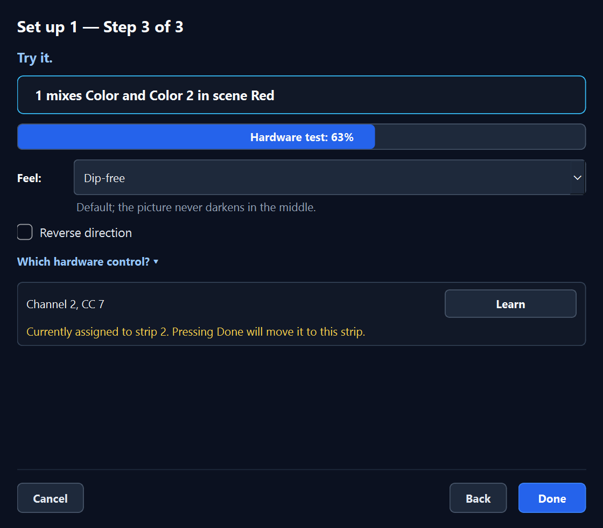
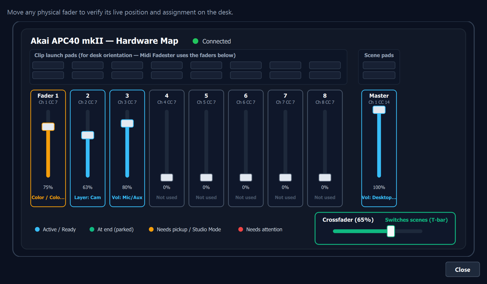
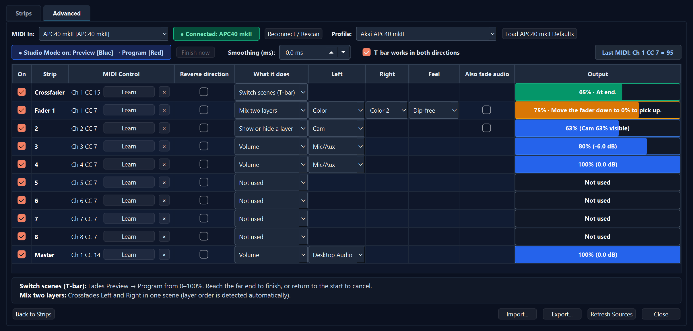
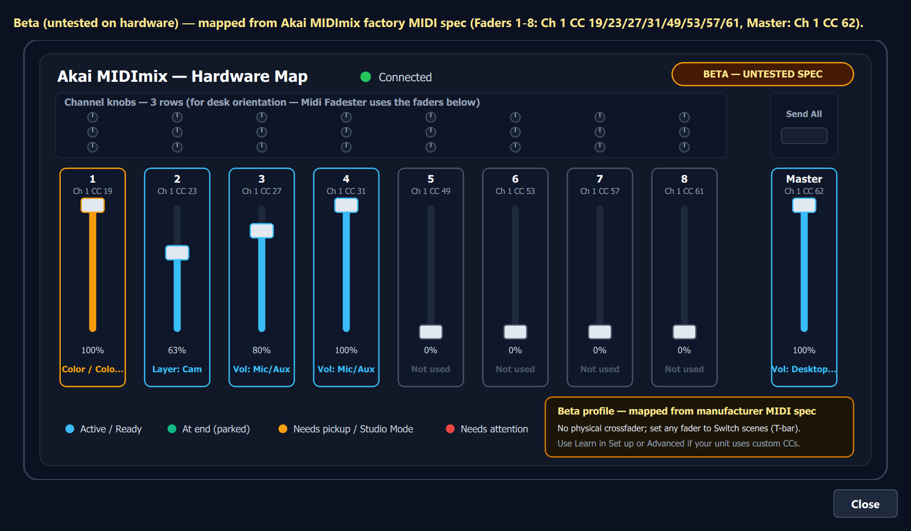

# Midi Fadester — Verification & UI State Gallery (`0.3.0`)

Midi Fadester verifies every engine invariant, T-bar state transition, Soft Takeover rail/pickup rule, concurrency contract, plain-English UI sentence, and rendered Qt6 dialog state across two complementary suites:

1. **Automated `ctest` Suite (14 headless targets, ~1.6 s total)** — runs on every local build and every GitHub Actions `windows-2022` CI push without requiring OBS Studio or physical MIDI hardware.
2. **Live Portable OBS 33 + `loopMIDI` Hardware-Loopback Suite (`MFD_SELF_TEST=1`)** — boots real `obs64.exe` in Studio Mode, renders HLSL `mfd_layer_mixer.effect` composites on the GPU, checks `GetSourceScreenshot` pixel samples, verifies live scene-item reorder stack-order inversion, drives 8 physical-timing `loopMIDI` cases through WinMM `midiInOpen`, and asserts `Number of memory leaks: 0` on clean exit.

---

## 1. Automated `ctest` Suite (`14/14` Targets)

Run locally from a configured preset:

```powershell
cmake --preset windows-x64
cmake --build --preset windows-x64 --config RelWithDebInfo
ctest --preset windows-x64 -C RelWithDebInfo --output-on-failure
```

| # | Target | Scope & Verified Invariants |
|---|---|---|
| 1 | `test-midi-queue` | Lock-free SPSC ring buffer (`os_atomic_load_long` / `os_atomic_store_long` acquire/release ordering), wrap-around, overflow drop accounting, and 2-thread producer/consumer sequential order + payload integrity stress. |
| 2 | `test-midi-parser` | Running-status MIDI byte parser, 7-bit CC (`0..127`), 14-bit Pitch Bend (`0..16383`), Note On/Off, SysEx skip, and real-time status interleaving. |
| 3 | `test-smoother` | First-order exponential smoother (`tau_ms`), instant snap at `tau_ms = 0`, frame-rate independence, and rail convergence. |
| 4 | `test-takeover` | Soft Takeover state machine (`UNINITIALIZED`, `PICKUP_WAITING`, `CAPTURED`), calibrated `[raw_min, raw_max]` auto-widening, directional pickup hints (`ABOVE` / `BELOW`), polarity reversal, and mode-switch reset to `Idle`. |
| 5 | `test-mixer-math` | Crossfade laws (`Dip-free`, `Full-center`, `Equal power`, `Linear`, `Cut`), `[-60 dB, 0 dB]` audio deflection taper, and top/bottom layer alpha inversion when OBS scene stack order flips. |
| 6 | `test-apc40-profile` | Declarative 6-controller profile registry (`apc40mk2` Verified; `apcminimk2`, `midimix`, `nanokontrol2`, `launchcontrolxl` Beta untested manufacturer specs; `generic` Custom), factory MIDI CC maps, physical strip presence flags (`10` / `9` / `8` strips), and WinMM USB port name auto-detection. |
| 7 | `test-tbar-logic` | Pure-C T-bar state machine (`R-TBAR-SM`): `6%` start deadband (`x > 0.06` starts throw with `t` rescaled `[0.06, 1.0] -> [0.0, 1.0]`), linear tracking to `100%`, `3%` target rail completion (`x >= 0.97` normal / `x <= 0.03` reversed), `3%` origin rail abort (`Throwing -> Idle` with `pos = 0`, single `release`, zero polarity flip), and bidirectional park/unpark. |
| 8 | `test-ui-sentences` | Pure-C table-driven test of every plain-English UI sentence in `src/core/ui-sentences.c`: controller status bar (`Connected`, unplugged, WinMM busy/error, generic/none), strip assignment/state/action precedence (`Not used`, `Studio Mode is off`, missing scene/layer/audio recovery sentences, `Throwing N%` + `Finish now`, `At end.`, Soft Takeover pickup arrows/sentences, live `%` / `dB` readouts), 3-step `Set up` sheet copy & multi-scene warning, Zone 3 live status line, and `Advanced` tab Output cell text. |
| 9 | `test-vendor-api` | Full engine & `obs-websocket` vendor API (`get_state` including `profile` / `profile_display_name` / `profile_tier`, `set_slot_value`, `configure_slot`, `load_profile` across all 6 controller slugs, `bind_midi`), target-preserving layout switching (`mfd_engine_select_profile`), recursive `state_mutex` + outermost-unlock deferred disk/UI drain, `0.2.0` First-Run Offer (`Yes` vs `I'll set it up`), 3-step `mfd_setup_session` transaction/cancel rollback, `[Not used]` MIDI binding preservation, and 4-thread concurrent stress (`tick` + `snapshot` + `setup_session` + `shutdown`). |
| 10 | `test-ui-dialog` | Real Qt6 `qwindows` (`Qt::WA_DontShowOnScreen`) end-to-end dialog test instantiating `mfd_ui_create_settings_dialog`: drives First-Run banner, Studio Mode amber banner & one-click recovery, live MIDI CC throws/fades, Soft Takeover pickup arrows, red precondition recovery flows, 3-step `Set up` modal sheet (`Step 1` -> `Step 2` -> `Step 3 Try it` + `Cancel` rollback), `[Show controller]` live SVG desk view (`QSvgRenderer::isValid()` across all 6 controller profiles), Beta profile badges & physical strip card filtering (`10` / `9` / `8` strips), `Advanced` tab round-trip synchronization, and non-blank `QDialog::grab()` PNG verification of all 10 states below. |
| 11 | `test-midi-send` | CLI argument validation and WinMM loopback message framing for `midi-send.exe`. |
| 12 | `test-shader-syntax` | HLSL `data/effects/mfd_layer_mixer.effect` uniform/pass validation, repository-wide UTF-8 no-BOM guard across 33 source/config files, and zero-timer / zero-sleep static source audit (`QTimer`, `startTimer`, `SetTimer`, `QThread::msleep`, `os_sleep_ms`). |
| 13 | `check-locale-keys` | Verifies every `obs_module_text(...)` key in `src/` exists in `data/locale/en-US.ini` with non-empty text and no `"OBS"` prefix violation. |
| 14 | `check-locale-keys-fails-on-missing-key` | Negative mutation check proving `check-locale-keys` fails immediately when a locale key is missing. |

---

## 2. Dialog State Screenshot Gallery (`0.3.0` UI)

All 10 screenshots below are rendered deterministically by `test-ui-dialog` on the real Windows `qwindows` Qt6 platform plugin (`1380x660` main dialog, `Qt::WA_DontShowOnScreen`). To regenerate them into `docs/screenshots/`:

```powershell
ctest --preset windows-x64 -C RelWithDebInfo -R test-ui-dialog --output-on-failure
Copy-Item -Force .\build_x64\tests\ui_screenshots\*.png .\docs\screenshots\
```

### State 1 — First-Run Offer Banner (`APC40 mkII` Detected on Fresh Config)

When an Akai APC40 mkII is connected and no prior `slots.json` exists, Midi Fadester pre-populates the usual layout (Crossfader switches scenes via T-bar; Master controls Desktop Audio volume; Faders 1–8 stay `[Not used]` with their physical CCs bound and live) and offers `[Yes]` or `[I'll set it up]`.



### State 2 — Studio Mode Off (Amber Banner + In-Place `[Turn on Studio Mode]` Action)

When Crossfader is assigned to `Switch scenes (T-bar)` while OBS Studio Mode is off, both the top amber banner and the Crossfader strip surface `"Studio Mode is off."` with a one-click `[Turn on Studio Mode]` button.



### State 3 — Live T-Bar Throw in Progress (`Throwing 63%` + `[Finish now]`) & Active Strips

Moving physical Crossfader past the `6%` bottom-rail deadband transitions into `Throwing 63%` with an inline `[Finish now]` escape button, while Fader 1 mixes `Color` and `Color 2` in `Red`, Strip 2 fades `Cam` opacity in `Blue` (`75% visible`), Strip 3 fades `Mic/Aux` (`-6.0 dB`), and Master sits at `0.0 dB`. Zone 3 tracks `"Studio Mode on • Preview: Blue -> Program: Red • Last move: Crossfader"`.



### State 4 — Soft Takeover Pickup Arrow, Red Precondition Sentences & Controller Busy

Each strip reports the highest-priority actionable sentence without abbreviations:
- **Crossfader:** Completed throw parked at target rail (`"At end."`, emerald bar).
- **Fader 1:** Soft Takeover waiting for physical fader (`48%`) to move down to OBS's target (`12%`) — amber bar, hollow target marker, downward arrow glyph, and `"Move down to 12% to pick up"`.
- **Strip 4:** Missing layer in scene (`"Color 2 is not in Red"` + `[Fix]`).
- **Strip 5:** Deleted scene (`"Scene OldScene was removed"` + `[Fix]`).
- **Strip 6:** Video-only source assigned to Volume (`"Color has no audio"` + `[Fix]`).
- **Zone 1 (Controller Bar):** Red dot + `"APC40 mkII is busy in another app. Close Ableton or MIDI-OX, then click Reconnect."` + `[Reconnect]`.



### State 5 — 3-Step `Set up` Sheet: Step 1 of 3 (`What should Fader 1 do?`)

Clicking `[Set up]` (or `[Fix]`) opens a non-destructive transactional sheet over `Strips`. Step 1 presents the four plain-English role cards (`Switch scenes`, `Mix two layers`, `Show or hide a layer`, `Volume`) plus `Not used` on any strip, so controllers without a physical horizontal crossfader can assign any vertical fader to `Switch scenes`. Clicking `Cancel` or `Esc` at any step rolls back without touching live bindings.



### State 6 — 3-Step `Set up` Sheet: Step 2 of 3 (`Which?` + Shared-Source Warning)

Step 2 filters pickers to valid OBS scenes/sources for the chosen role, explains `"You will see this when scene Red is live."`, and warns in amber whenever a chosen layer also appears in another scene (`"Color 2 is also in scene Blue; it will fade there too."`) because Midi Fadester attaches its GPU opacity filter at the source level.



### State 7 — 3-Step `Set up` Sheet: Step 3 of 3 (`Try it` Live Hardware Rehearsal)

Step 3 lets the operator move the physical fader and watch the live response bar (`75%`) and plain-English confirmation (`"1 mixes Color and Color 2 in scene Red"`) before clicking `[Done]`, with a one-click `[Wrong fader? Move a different one]` MIDI Learn rebind button.



### State 8 — `[Show controller]` Live APC40 mkII SVG Desk Map (Hardware-Verified)

Clicking `[Show controller]` opens a vector (`Qt6::Svg`) hardware map of the Akai APC40 mkII desk showing labeled orientation zones above the faders (`"Clip launch pads (for desk orientation — Midi Fadester uses the faders below)"` and `"Scene pads"`), all 8 track faders (`Ch 1–8 CC 7`), Master fader (`Ch 1 CC 14`), horizontal Crossfader (`Ch 1 CC 15`), live `%` positions, short assignment labels, and color-coded state accents (`Active / Ready`, `At end (parked)`, `Needs pickup / Studio Mode`, `Needs attention`) updating event-driven on every MIDI/OBS change.



### State 9 — `Advanced` Tab (Multi-Controller Profile Picker, 10-Row Power-User Table & High-Contrast Help Callout)

Switching to `Advanced` provides the multi-controller `Profile:` picker (Verified & Beta controller layouts), `Load <Profile> Defaults`, the full 10-row power-user matrix (`On`, `Strip`, `MIDI Control` + `Learn` / clear, `Reverse direction`, `What it does`, `Left`, `Right`, `Feel`, `Also fade audio`, stretched `Output` readout bar), `Smoothing (ms)`, `T-bar works in both directions`, `Import...` / `Export...`, `Back to Strips`, and a full-width `13px` two-line callout comparing **Switch scenes (T-bar)** vs. **Mix two layers**. Edits in `Advanced` and `Strips` share the exact same `mfd_engine` snapshot and round-trip instantaneously.



### State 10 — `[Show controller]` Beta Controller Hardware Map (`Akai MIDImix` — Untested Manufacturer Spec)

Selecting one of the four **Beta** profiles (`Akai APC mini mk2`, `Akai MIDImix`, `Korg nanoKONTROL2`, `Novation Launch Control XL`) filters `Strips` to the controller's physical fader count (`9` or `8`), displays an explicit amber `BETA — UNTESTED SPEC` badge, renders the matching upper desk silhouette (`3×8` channel EQ/aux knobs + `Send All` on `MIDImix`, clip pads on `APC mini mk2`, left-hand Transport & Markers + `1×8` pan knobs on `nanoKONTROL2`), shows each strip's exact factory MIDI CC binding (`Ch 1 CC 19..62`), and explains how to assign any vertical fader to `Switch scenes (T-bar)` or re-learn custom CCs.



---

## 3. Live Portable OBS 33 + `loopMIDI` Self-Test (`MFD_SELF_TEST=1`)

Run the live hardware-loopback and GPU pixel suite via `scripts/run-live-selftest.ps1`, which targets Midi Fadester's **dedicated Portable OBS copy** (`C:\Users\jeffr\OBS-Studio-33-Portable-MidiFadester`) so it never contends with sibling plugin test harnesses sharing `C:\Users\jeffr\OBS-Studio-33-Portable`:

```powershell
powershell -NoProfile -ExecutionPolicy Bypass -File .\scripts\run-live-selftest.ps1
```

### Portable OBS Isolation & State-Hygiene Guarantees
1. **Dedicated Portable OBS Copy + Process Ownership Check:** `scripts/run-live-selftest.ps1` defaults to `C:\Users\jeffr\OBS-Studio-33-Portable-MidiFadester`, ignores `obs64.exe` processes running from any other directory, and aborts rather than closing `obs64.exe` if any `obs64.exe` or sibling test runner (`obs-playlister`, `visual-sidechain`, `ctest`, `pytest`) is actively using the target root.
2. **Studio Mode Turned Off & `user.ini` Restored:** `run_live_selftest_worker()` in `src/obs/mfd-tbar.cpp` explicitly turns Studio Mode off (`obs_frontend_set_preview_program_mode(false)`) before teardown (`studio_off=1`), and `scripts/run-live-selftest.ps1` backs up and restores `config\obs-studio\user.ini` byte-for-byte after `obs64.exe` exits.
3. **Scene Collection (`basic\scenes\Untitled.json`) Protected & Restored:** `on_save_callback` in `src/obs/mfd-engine.c` skips writing `"midi_fadester_scene_collection"` when `MFD_SELF_TEST=1`, `run_live_selftest_worker()` detaches its opacity filters and removes all self-test scenes/sources, and `scripts/run-live-selftest.ps1` backs up and restores `basic\scenes\Untitled.json`, `Untitled.json.bak`, and `plugin_config\midi-fadester\global.json` byte-for-byte.

### Live Verification Matrix
When `obs64.exe` launches with `MFD_SELF_TEST=1` and a `loopMIDI Port` loopback device active, `src/obs/mfd-tbar.cpp` runs the full hardware-timed integration suite inside real OBS Studio 33.0.0:

- **GPU Pixel & Stack-Order Checks (`SCREENSHOT CHECK` & `SCENE SIGNALS`):**
  - Verifies HLSL `mfd_layer_mixer.effect` compositing via `obs-websocket` `GetSourceScreenshot` at `0%`, `50%`, and `100%` crossfade, plus T-bar mid-throw (`CC 119` -> `~93%` mix, asserting OBS does **not** snap early at `90%`).
  - Reorders scene items live and asserts automatic top/bottom alpha inversion without manual reconfiguration, plus missing-layer / missing-audio precondition gating.
- **WinMM `loopMIDI` Hardware-Loopback Cases (`LOOPMIDI CASE 1..8`):**
  - **Cases 1–2:** Full throw `0 -> 127` and reverse throw `127 -> 0` (bidirectional polarity flip, 1:1 scene swap).
  - **Case 3:** Slow sweep `100 -> 127` (`1 CC` per `300 ms` with a `2 s` natural hand pause at `CC 116`) — zero early release during pause, single release only upon entering the `3%` target rail (`CC >= 124`).
  - **Case 4:** Aborted throw `0 -> 60 -> 0` — returns to `3%` origin rail, writes `pos = 0`, calls `release` once so OBS cancels cleanly and re-enables Transition buttons, Program scene unchanged, zero polarity flip.
  - **Case 5:** Pause then complete `0 -> 60 -> pause -> 127` — single completion at target rail.
  - **Case 6:** Bottom-rail jitter `CC 3, 4, 3, 4, 3, 4` x5 inside the `6%` start deadband — **zero** transitions started.
  - **Case 7:** Micro-throw & cancel `CC 0 -> 8 -> 3` — crosses `6%` start band (`1` start) and retreats into `3%` origin rail (`1` cancel, Program unchanged).
  - **Case 8:** Mode-switch Soft Takeover reset to `Idle` and clean teardown (`Number of memory leaks: 0`).
