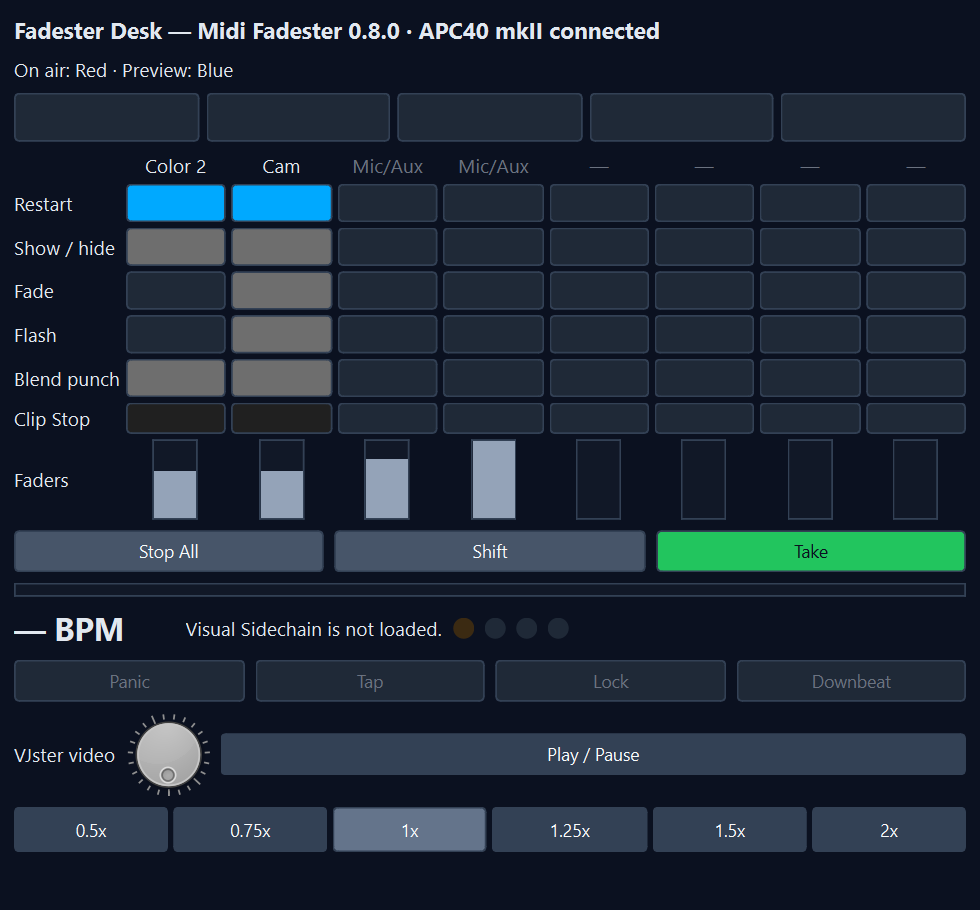

# APC40 mkII pads

How Midi Fadester turns the Akai APC40 mkII into a VJ deck, and what every pad, light and Fadester Desk dock button does. [Back to the README](../README.md).

With an APC40 mkII connected, the desk is a VJ deck.

- **Columns 1 to 8 are the sources of the scene on air**, bottom layer first: column 1 is the lowest video source in Program, column 2 the next, and so on. Audio-only sources, music files included, are skipped.
- **The faders fill themselves.** The first time OBS starts with the desk and all eight channel faders empty, they fill from Program as *Show or hide a layer* strips and **follow the scene on air**: switch scenes and they move to the new scene's sources. A fader you set yourself never moves, and neither does a column you pin. **Advanced → Fill empty faders from the scene on air** does the same at any time.
- **No surprise blackouts.** A newly filled fader starts with the layer as it is (100 % at first) and picks up when you move it through that level.

| On the APC40 | On the Fadester Desk dock | What it does |
| --- | --- | --- |
| Bottom row, column *k* | **Blend** | The source between its own blend in the scene (Normal, or say Screen on an overlay) and its other blend (Screen at first, or the next one when Screen is its own). |
| Shift + bottom row pad | **Next blend** | The next blend for that column: Lighten, Screen, Additive, Multiply, Subtract. A column already blending switches straight to it. |
| Row 2 | **Flash** | The source at 100 % while you hold the pad; the fader keeps its place underneath. With Shift, **Dark (hold)**: 0 % while held. |
| Row 3 | **Fade out** | The source fades out over the source fade time; press again to fade it back. With Shift, **Cut out**: to 0 % and back, at once. |
| Row 4 | **Show / hide** | Shows or hides the source (its eye in OBS). With Shift, **Show at 100 %**: shown, 100 %, its own blend. |
| Row 5 (top) | **Fade, beats**: ✂ 32 16 8 4 2 1 ½ | Pad 1 (yellow, ✂): **cut** the scene in Preview on air at once. Pads 2 to 8: **fade** Preview on air over 32, 16, 8, 4, 2, 1 or ½ beats (16 s down to 0.25 s at 120 BPM). The tempo is Visual Sidechain's, 120 BPM when it has none. The 32 pad is a slow roll for a big change. OBS allows at most 20 s, so below 96 BPM the 32 pad lasts 20 s and the dock prints 20s on it. The cut is a 50 ms move with your transition, which reads as a cut. Shift changes nothing on this row. Your own transition length is put back straight after; Cut and Stinger keep their own timing. Studio Mode only. |
| Clip Stop *k* | **Reset** | That source back to its own blend, a held Flash or Dark let go. With Shift: **pin** the column to its source (it stays when the scene changes); again, it follows the scene again. Pinning works on a column with no source yet. |
| Stop All Clips | **Reset all** | Every effect off (Clean / All FX Off) and every source back to its own blend. With Shift, **Fade all out**: every source fades out. |
| Scene Launch 1–5 | The five scene buttons | The first five scenes in OBS's Scenes list, top first. Press once: the scene goes to **Preview**. Press the scene in Preview again: it **fades** on air with the transition. The scene already on air does nothing, so there is always something to fade to. With Shift (Ctrl-click on the dock, Cmd-click on a Mac), or outside Studio Mode: **straight on air**, skipping Preview. Both use your OBS transition and its length. |
| Session | **Blackout** | Program fades to black over the transition length (at least 0.3 s), on top of everything, whatever is on air; press again (**End blackout** on the dock) to fade it back. Nothing is added to your scenes. Blinks while black. |
| Cue Level knob | (the timing line) | **Transition length**, 50 ms per click. With Shift: the **source fade time**. |
| Tempo knob | The speed dial | **Video speed** 0.05x faster or slower per click; with Shift held, 0.25x. |
| Nudge − / Nudge + | | **Video speed** 0.25x slower / faster. |
| Tap Tempo | **1x** | **Video speed back to 1x.** With Shift, **Beat 1**: Visual Sidechain counts from beat 1 now. |
| Play | **Play / Pause** | **Play or pause the video.** |
| Record | **Panic**, then **Restore** | Visual Sidechain **Panic**: all its effects off; press again to **Restore**. Blinks while panicked. |
| Metronome | **Tap** | Visual Sidechain **tap tempo**. With Shift, **Hold BPM**: hold its BPM, or let it follow the music again. |

The dock's words say what a button does; the APC40 keeps the words printed on it. Where the two differ, the dock button's tooltip names its hardware button (*On the APC40: Clip Stop*).

## Lights

| What | Light |
|---|---|
| Scenes | Program red, Preview pulsing from dim to bright green, other scenes dim blue, no scene dark. |
| Sources at their own blend | Dim white. |
| Sources with a blend punched | The blend colour: Lighten azure, Screen yellow, Additive orange, Multiply violet, Subtract magenta. |
| Flashing / faded out, blacked out or at 0 % | Bright white / amber. |
| Hidden source | Row 4 blinks dim / bright red (pressing its pads would change nothing you can see). |
| Column with no source | Rows 1 to 4 dark. |
| Row 5 | Always lit: the cut yellow on the left, then seven greens from dark (the longest fade) to light (the shortest, on the right). |
| Clip Stop | Lit while its column has a blend punched; while Shift is held, shows the pinned columns instead. |
| Session / Record | Blink while Program is blacked out / while Visual Sidechain is panicked. |

Pulses and blinks use the desk's slowest rate and start from the dim colour, so a pad stays lit even if the desk does not animate it.

A source's own blend is the one it had in the scene when it came onto its column, so Clean never turns a shape on black into a black wall by forcing Normal. When a column moves to another source (a scene change, a layer added), the source it leaves goes back to its own blend, and a blend you change in OBS with the mouse becomes that source's own.

## Video speed and Visual Sidechain on the desk

- The video speed controls drive VJster (the Chrome extension or the OBS video page) through [Fadester Companion](https://github.com/jbrick2070/streamdeck-fadester) 0.1.15 or later with its controls and VJster on. (An OBS media source restarts its clip when its speed changes, so live speed is VJster's.)
- Midi Fadester adds the clicks up and sends them at most 20 times a second as the obs-websocket vendor event `vjster_action` (`{"action": "vjster.speed.step", "steps": n}`, n × 0.05x, or `{"action": "vjster.speed.reset"}` / `{"action": "vjster.playPause"}`). Without the Companion nothing happens. The Companion keeps the speed between 0.25x and 4x.
- Record, Metronome and Shift + Tap Tempo call Visual Sidechain through obs-websocket (`panic` / `restore`, `tap_tempo`, `lock_bpm`, `resync_downbeat`); without it they do nothing and the log says so.

## Buttons left alone

- Only controls that are momentary in the desk's default mode are used. Solo, Activator, Record Arm and Crossfade A|B latch inside the desk, and Track Select and Master move the Device knobs onto other MIDI channels, so they are left alone; so are the Bank buttons. The log names a button with no job the first time it is pressed.
- MIDI Learn skips the endless Tempo and Cue Level knobs, which send clicks rather than a position.
- Darken is not a punch mode, because fading a Darken layer down turns its rectangle black.
- A strip learned onto a pad keeps that pad.
- The lights need the desk's MIDI Out; the pads work without them.
- The Advanced tab turns the pads off and sets the fade time. The obs-websocket `get_state` reply lists them under `vj_pads`, with the five scenes and which strips follow the scene.

## Fadester Desk dock

On a new installation it opens by itself the first time an APC40 mkII is seen. After that it is under **Docks → Fadester Desk**, and **Show Fadester Desk** on the settings dialog's **Strips** tab opens it too (OBS remembers where you put it). An installation that already had settings is left as it is. From top to bottom:

- the connection and the version, with **?** (what the pads do) and a gear (the settings dialog);
- a red bar while Visual Sidechain is panicked (*Press Restore*) and a red bar while Program is black (*Press End blackout*), always at the top;
- the reason something waits, with its button: **Reconnect** when the APC40 is gone, **Turn on** when the pads are switched off, **Turn on Studio Mode** when Studio Mode is off;
- **ON AIR** and **PREVIEW** with the scene names, the largest text on the dock;
- the five scene buttons (a filled dot marks the scene on air, a ring the one in Preview);
- the pad grid in the APC40's own colours with each column's source name above it: the framed row **Fade, beats** (✂ 32 16 8 4 2 1 ½), then Show / hide, Fade out, Flash, Blend and Reset, and the eight fader levels. A fader that waits to pick up shows an amber bar with a marker where it starts to act;
- **Reset all** and **Shift** (for the next pad only; the row names then read Show at 100 %, Cut out, Dark (hold) and Next blend);
- **Fade** (Preview on air with your transition; greyed when Studio Mode is off or Preview and Program are the same scene) and **Blackout** (works with or without the APC40, so a blackout can always be ended; reads **End blackout** while Program is black);
- the crossfader, the transition length and source fade time, and Visual Sidechain's BPM, **Panic**, **Tap**, **Hold BPM** and **Beat 1**.

Using it:

- Click a button and it does what the APC40's button does, while the APC40 mkII is connected: hold a Flash pad for as long as you hold the mouse; **Ctrl-click** (Cmd on a Mac) a scene to put it straight on air; **Escape** lets go of anything held from the dock.
- Without an APC40, with the pads switched off or on another controller's layout, the pad grid is hidden; the five scene buttons, Fade, Blackout and the tempo buttons stay. A scene button only sets Preview and Program, so it works from the mouse with no desk at all (while the APC40's pads are on, a scene button that a strip has learned stays that strip's).
- The dock's text follows OBS's font size.
- **Video speed** rows are hidden until you tick **Show video speed controls on the dock** on the **Advanced** tab (an installation that already had settings keeps them). They drive the video speed through [Fadester Companion](https://github.com/jbrick2070/streamdeck-fadester): an endless speed dial (0.05x per notch, like the Tempo knob; click it first to use the scroll wheel or arrow keys), preset speeds 0.5x, 0.75x, **1x**, 1.25x, 1.5x and 2x (the presets other than 1x need Companion 0.1.17 or later), and Play / Pause. They work without the APC40. Midi Fadester does not hear back from the video, so the dock shows only the last speed it asked for, marked unconfirmed.

