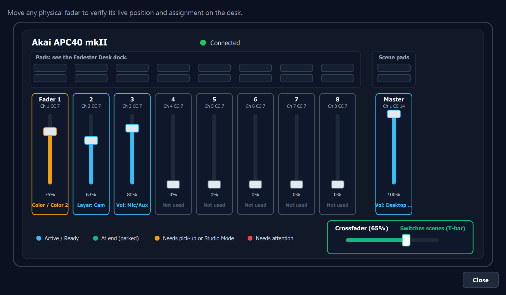

# Controllers and their MIDI maps

The ready-made layouts and the exact MIDI controls each one maps. [Back to the README](../README.md).

| Controller | Layout | Status | Faders and knobs it maps |
|---|---|---|---|
| **Akai APC40 mkII** | `apc40mk2` | **Tested on hardware** (Windows, last recorded 2026-11-08) | Crossfader (Ch 1 CC 15), Faders 1–8 (Ch 1–8 CC 7), Master (Ch 1 CC 14); FX 1–8 on the Device knobs (Ch 1 CC 16–23) |
| **Akai APC mini mk2** | `apcminimk2` | Beta, from the manufacturer's MIDI spec | Faders 1–8 (Ch 1 CC 48–55), Master (Ch 1 CC 56); no knobs, so FX 1–8 through Learn or a Stream Deck |
| **Akai MIDImix** | `midimix` | Beta, from the manufacturer's MIDI spec | Faders 1–8 (Ch 1 CC 19, 23, 27, 31, 49, 53, 57, 61), Master (Ch 1 CC 62); FX 1–8 on the third knob row (Ch 1 CC 18, 22, 26, 30, 48, 52, 56, 60) |
| **Korg nanoKONTROL2** | `nanokontrol2` | Beta, from the manufacturer's MIDI spec | Sliders 1–8 (Ch 1 CC 0–7, default CC mode); FX 1–8 on the knobs (Ch 1 CC 16–23) |
| **Novation Launch Control XL** | `launchcontrolxl` | Beta, from the manufacturer's MIDI spec | Faders 1–8 (Ch 1 CC 77–84, as sent by User template 1; a Factory template sends on channel 9, so use Learn); FX 1–8 on the third knob row (Ch 1 CC 49–56) |
| **Anything else** | `generic` | Learn | Up to 18 controls, each learned by moving it |

- **Beta** means the layout was written from the published MIDI implementation and not yet checked on a physical desk. It shows an amber *BETA* badge. If a fader does not match, **Learn** it once; the rest of the layout stays.
- **Change controller** on the Strips screen picks the MIDI port and the layout. The APC40 mkII's port is picked by itself.
- **Show controller** opens a live picture of the desk with each fader's position, job and state (faders, master and crossfader; the FX knobs are not drawn).
- A desk without a horizontal crossfader can give **Switch scenes** to any vertical fader. Layouts for desks without a crossfader or master turn those two slots off.
- **Reverse** on the Advanced tab (**Reverse direction** in step 3 of Set up) flips a control that runs the wrong way.
- Adding a desk is one entry in `src/core/apc40-profile.c`.

