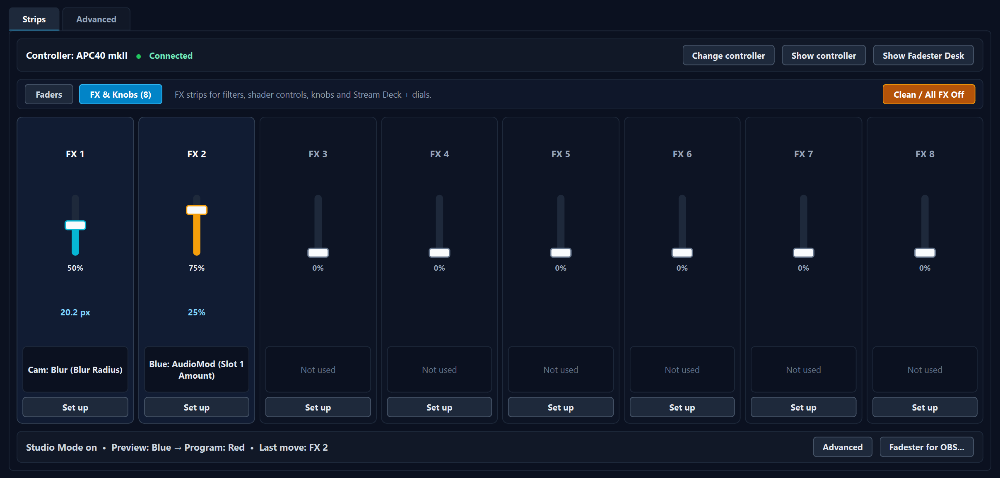
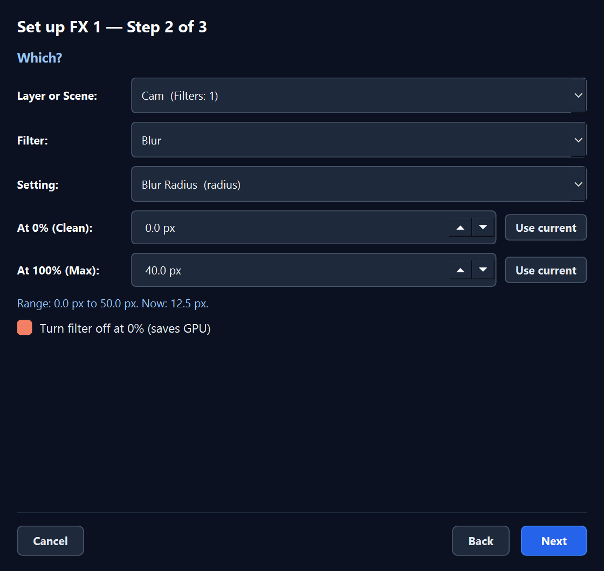

# How the faders work

The details behind each fader job: every job, the FX bank, the opacity filter, how a T-bar throw goes, the crossfade curves, smoothing, pick-up, rails and calibration. [Back to the README](../README.md).

## Every job in detail

| Job | What the fader does | What it needs |
|---|---|---|
| **Switch scenes (T-bar)** | Fades Preview into Program from 0 to 100 %. Reach the far end to finish; return to the start to cancel. | Studio Mode on. Any transition except Cut and Stinger, which OBS swaps for Fade while a T-bar moves. |
| **Mix two layers** | Crossfades the Left layer and the Right layer inside one scene. Left end shows Left, right end shows Right. | Both layers in the same scene. Which one is on top is detected automatically. |
| **Show or hide a layer** | Fades one layer from invisible to fully visible. | The layer in a scene. |
| **Volume** | Sets one audio source's volume on a cubic curve (volume = position cubed); the strip shows the dB value. OBS's own mixer slider uses a log curve, so the same position reads a different dB there. | A source that has audio. |
| **Whole mix** | Fades all OBS mixer inputs together, from silence to 0 dB, on the same cubic curve, through Fadester Companion. The strip shows *Requested* until Fadester Companion confirms or declines. | Fadester Companion running, with its option for all OBS mixer inputs turned on (see [Set up the shared mix for MIDI](../README.md#set-up-the-shared-mix-for-midi)). |
| **Filter or effect setting** | Sweeps one numeric setting of one filter between a value *At 0 %* and a value *At 100 %*. | The filter already added to the source or scene in OBS. |
| **Not used** | Nothing. Its MIDI control stays assigned, so you can give it a job later. | |

## Layer fades and filter settings

- Layer fades and mixes work through a filter the plugin adds to the source. OBS lists it in the source's Filters as `__midi_fadester_opacity__` (type *Midi Fadester fade (leave on)*); leave it there. It is not in OBS's add-filter menu. Your own filters are not touched, and at 100 % the filter skips its GPU pass.
- A layer faded to 0 % keeps running, so a media source fades back in at once. Tick **Also fade audio** in step 3 of Set up if its sound should follow.
- The filter sits on the source, not on the scene item: a source in two scenes fades in both, and Set up warns you. For a layer that should fade in one scene only, copy the source and use **Paste (Duplicate)**, not **Paste (Reference)**, in the other scene.
- One setting of one filter can be driven by one slot at a time. Set up refuses a second binding to the same setting.

## Switch scenes or Mix two layers?

Both crossfade video, in two styles.

**Switch scenes (T-bar)** is the broadcast switcher. It uses the scenes you already have and needs Studio Mode.

- Nothing happens in the first 6 % of the travel, so a fader resting near its end cannot start a transition by itself.
- Past that, the fader drives OBS's T-bar in a straight line to 100 %. (OBS's on-screen T-bar treats anything past 90 % as the end when you let go; Midi Fadester keeps fading to the physical end.)
- In the last 3 % the throw finishes: OBS swaps the scenes, the old Program scene moves into Preview (with OBS's default swap setting), and the strip reads *At end.*
- Come back into the first 3 % instead, and the throw cancels: Program does not change.
- **T-bar works in both directions** is on by default: the next throw starts from where the fader sits and runs the other way. Turn it off on the Advanced tab for one-way throws.
- **Finish now** on the strip completes a throw from the mouse.
- The Program box never jumps; it only fades.

**Mix two layers** is the DJ mixer. Put both sources, or two nested scenes, in one scene and give a fader the job with Left and Right. The middle shows both. There is no Preview and Program, and Studio Mode can stay off. **Feel** in step 3 of Set up picks the curve:

| Curve | What you see |
|---|---|
| **Dip-free** (default) | The picture never darkens in the middle. The lower layer stays at 100 % while the upper one fades: a true optical dissolve instead of the 25 % dip two half-transparent layers produce. |
| **Full at center** | Both layers reach 100 % at the center mark. |
| **Equal power** | A sine/cosine crossfade for sources of matched brightness. |
| **Linear** | A straight 0 to 100 % blend on both layers. |
| **Cut** | An instant switch at the halfway mark. |

## How it feels

| | |
|---|---|
| **Smoothing** | Every move gets a short glide (30 ms by default, **Smoothing** on the Advanced tab; 0 turns it off), so the 128 steps of a MIDI fader do not show on screen. |
| **Pick-up** | If a value moved without the fader (dragged in OBS, turned by a Stream Deck dial, loaded with a scene collection), the fader does not make it jump. The strip shows an amber bar, a marker at the target and *Move the fader up to 40% to start.*; once the fader crosses that point it acts again, without a step. The Fadester Desk dock shows the same amber bar and marker. |
| **Rails** | The top and bottom 3 % of the travel are rails. A control resting there is parked (*At end.*), so hand jitter never flickers a layer or re-triggers a transition. Moving 8 % back unparks it, and the rest of the travel is rescaled so there is no jump. |
| **Calibration** | Each control starts with the full MIDI range and widens it whenever it sends a value beyond anything seen before, saved per layout and control. A fader that stops at 125 instead of 127 still reaches 100 %. |
| **Resolution** | 7-bit controls, 14-bit CC pairs and pitch bend are all accepted. A binding remembers the MIDI channel as well as the number: the APC40 mkII's eight faders all send CC 7 and differ only by channel, and that works. |

## FX & Knobs and Clean / All FX Off

The bank bar on the Strips screen switches between **Faders** and **FX & Knobs (8)**. The eight FX slots are for filter sweeps and shader controls. On the APC40 mkII they are the eight Device Control knobs (CC 16 to 23); other desks map their knob rows (see [Controllers](CONTROLLERS.md)). The FX slots stay available on a controller without knobs, because a Stream Deck + dial or a script can drive them too.

- **Set up** on an FX strip (or **Filter or effect setting** on any fader) walks you through source or scene → filter → setting.
- Step 2 sets the value *At 0 %* and *At 100 %*, with **Use current** buttons to capture what OBS shows now: a knob can sweep a blur from 0 to 20 px or a brightness from 0 to −1.
- **Turn filter off at 0 % (saves GPU)** disables the filter while the knob rests at zero and turns it back on as soon as the knob moves. Two slots driving two settings of the same filter share that switch without fighting.

**Clean / All FX Off** resets every enabled filter-setting binding in both banks to its *At 0 %* value and applies its bypass. Volumes, layer fades, two-layer mixes and the T-bar stay where they are, media keeps playing, and Visual Sidechain's separate **Panic / Restore visuals** is untouched. It is also the `reset_fx` request, instant or as a timed ramp, so a Stream Deck key can do the same.
