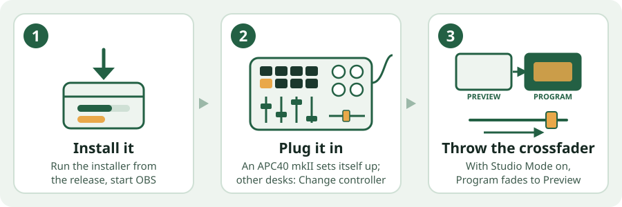

> このページは英語のクイックスタートの翻訳です。AI モデルで作成し、2 つ目の AI モデルで確認しました。ネイティブスピーカーによる確認はまだです。

# クイックスタート: Midi Fadester と Visual Sidechain

## Midi Fadester

Midi Fadester は、MIDI コントローラーのフェーダーとノブを OBS Studio のライブ操作に変えます。本物のクロスフェーダーでシーンをフェードし、2 つのレイヤーをミックスし、カメラをフェードし、音量を操作し、どのフィルタ設定でも動かせます。Akai APC40 mkII 向けに作られており、ほかのコントローラーでも MIDI Learn で使えます。

### クイックスタート

1. **インストールする。** [最新リリース](https://github.com/jbrick2070/midi-fadester/releases/latest) から `midi-fadester-<version>-windows-x64-Installer.exe` (Windows) または `midi-fadester-<version>-macos-universal.pkg` (Mac) を実行し、OBS Studio 33 以降を起動します。ほかのファイルと注意点: [Install](../../README.md#install) (英語)。
2. **コントローラーを接続する。** APC40 mkII は自動で設定され、**Fadester Desk** ドックが開きます。ほかのコントローラーの場合: **ツール → Midi Fadester** (OBS 上部のメニューバー) を開き、**ストリップ** タブの **コントローラーを変更** をクリックします。
3. **クロスフェーダーを動かす。** OBS の **スタジオモード** ボタン (右下) をクリックし、クロスフェーダーを反対側の端まで動かします。プログラムが、プレビューにあった内容へフェードします。

これで完了です。フェーダーに別の役割を与えるには、**ツール → Midi Fadester** でそのストリップの下の **セットアップ** をクリックします。

**[完全なガイド (英語)](../../README.md)**

## Visual Sidechain

Visual Sidechain は、Windows と macOS の OBS Studio 33 で映像を音楽に合わせて動かします。0.9.0 から Midi Fadester の一部なので、Midi Fadester をインストールすれば使えます。

### クイックスタート

1. **Midi Fadester をインストール** し ([Install](../../README.md#install)、英語)、OBS Studio 33 を起動します。
2. **フィルタを追加する。** ソースまたはシーンを右クリックして **フィルタ** を選び、エフェクトフィルタの下の **`+`** を押して **`Visual Sidechain: シェーダーフィルタ`** を追加します。
3. **音楽を再生する。** 映像が **トラック 1 (メインミックス)** の音に合わせて動きます。

これで完了です。フィルタのウィンドウの **エフェクト** で別の見た目を選べます。

> **本番の前にパニックキーを設定してください:** **設定 → ホットキー → `Visual Sidechain: パニック (すべてのエフェクトをオフ)`**。1 回押すと、すべてのシーンの Visual Sidechain のエフェクトがオフになります。

**[完全なガイド (英語)](../VISUAL-SIDECHAIN.md)**
