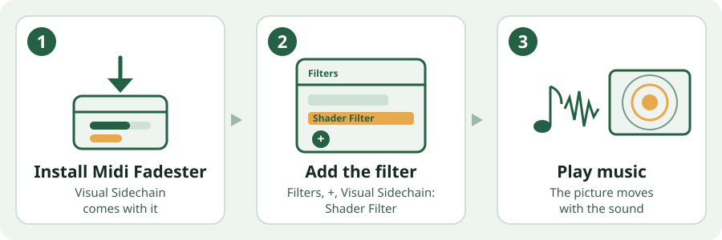

> Эта страница — перевод английских быстрых стартов, сделанный с помощью модели ИИ и проверенный второй моделью ИИ. Носитель языка её ещё не проверял.

# Быстрый старт: Midi Fadester и Visual Sidechain

## Midi Fadester

Midi Fadester превращает фейдеры и ручки MIDI-контроллера в живое управление OBS Studio: плавные переходы между сценами настоящим кроссфейдером, микширование двух слоёв, плавное появление камеры, регулировка громкости, изменение любой настройки фильтра. Он сделан для Akai APC40 mkII и работает с другими контроллерами через MIDI Learn.

### Быстрый старт

1. **Установите.** Из [последнего выпуска](https://github.com/jbrick2070/midi-fadester/releases/latest) запустите `midi-fadester-<version>-windows-x64-Installer.exe` (Windows) или `midi-fadester-<version>-macos-universal.pkg` (Mac), затем откройте OBS Studio 33 или новее. Другие файлы и предупреждения: [Install](../../README.md#install) (на английском).
2. **Подключите контроллер.** APC40 mkII настраивается сам, и открывается док-панель **Fadester Desk**. Другой контроллер: откройте **Инструменты → Midi Fadester** (строка меню OBS вверху) и нажмите **Сменить контроллер** на вкладке **Линейки**.
3. **Сдвиньте кроссфейдер.** Нажмите в OBS кнопку **Режим студии** (справа внизу) и сдвиньте кроссфейдер до другого края: «Передача» плавно переходит в то, что было в «Предпросмотре».

Готово. Чтобы дать фейдеру другую задачу, нажмите **Настроить** под его линейкой в меню **Инструменты → Midi Fadester**.

**[Полное руководство (на английском)](../../README.md)**

## Visual Sidechain

Visual Sidechain заставляет видео двигаться в такт музыке в OBS Studio 33 на Windows и macOS. С версии 0.9.0 он входит в Midi Fadester: установите Midi Fadester, и он у вас есть.

### Быстрый старт

1. **Установите Midi Fadester** (см. [Install](../../README.md#install), на английском) и откройте OBS Studio 33.
2. **Добавьте фильтр.** Щёлкните правой кнопкой по источнику или сцене, выберите **Фильтры**, нажмите **`+`** под фильтрами эффектов и добавьте **`Visual Sidechain: Шейдерный фильтр`**.
3. **Включите музыку.** Картинка движется в такт звуку (**Дорожка 1 (основной микс)**).

Готово. Другой вид выберите в окне фильтра: **Эффект**.

> **Перед эфиром назначьте клавишу аварийного сброса:** **Настройки → Горячие клавиши → `Visual Sidechain: Аварийный сброс (выключает все эффекты)`**. Одно нажатие выключает все эффекты Visual Sidechain во всех сценах.

**[Полное руководство (на английском)](../VISUAL-SIDECHAIN.md)**
